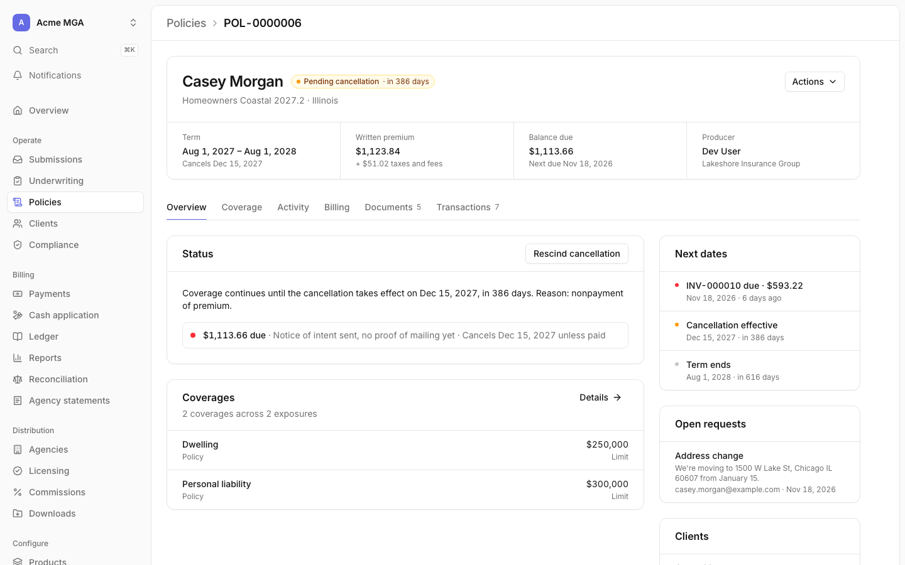
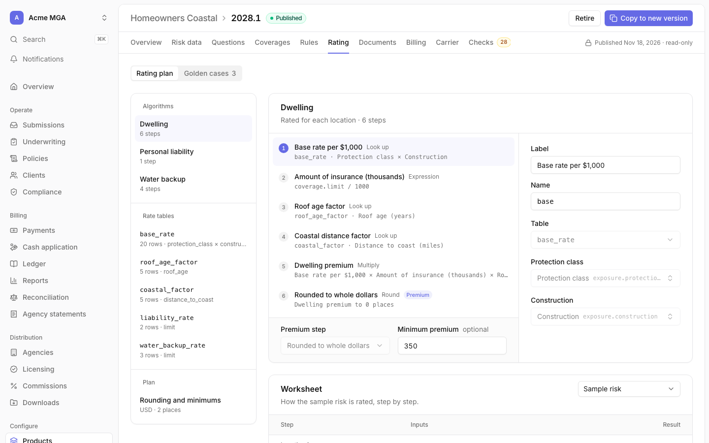
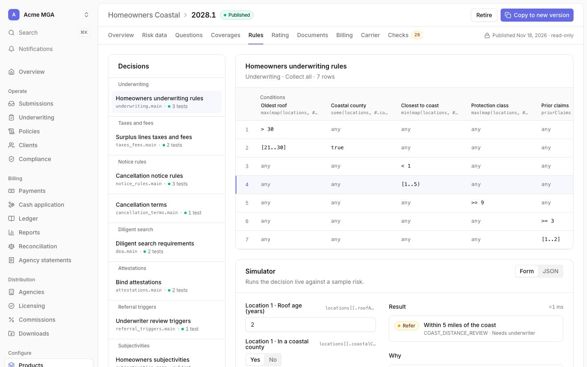
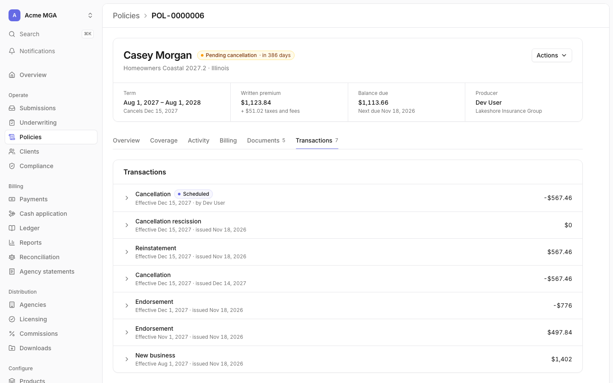
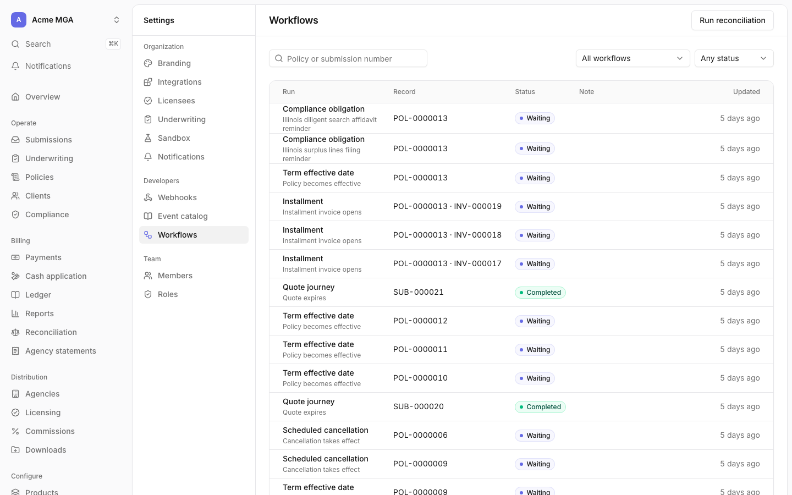
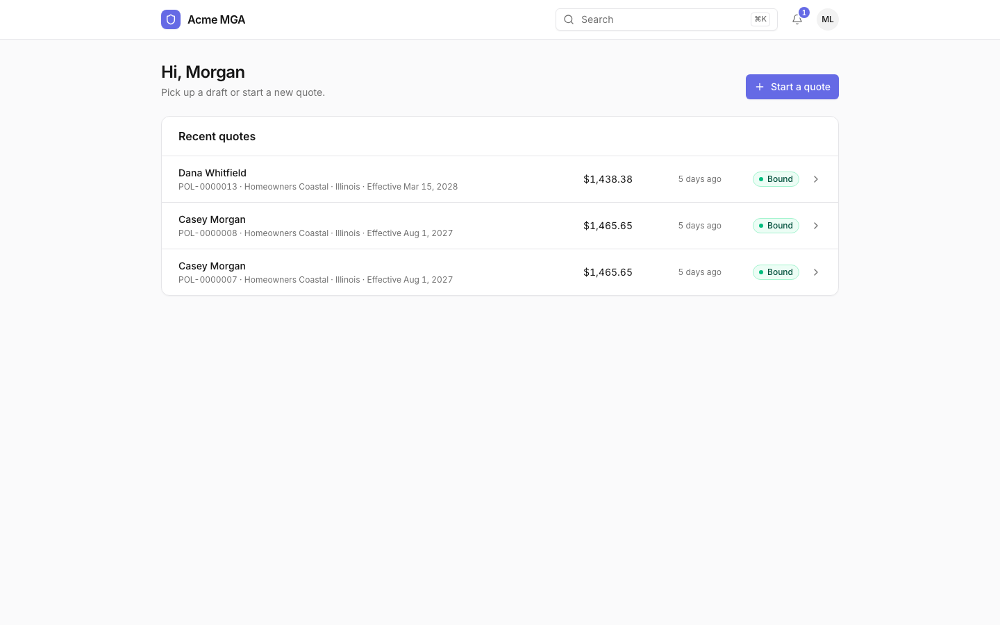
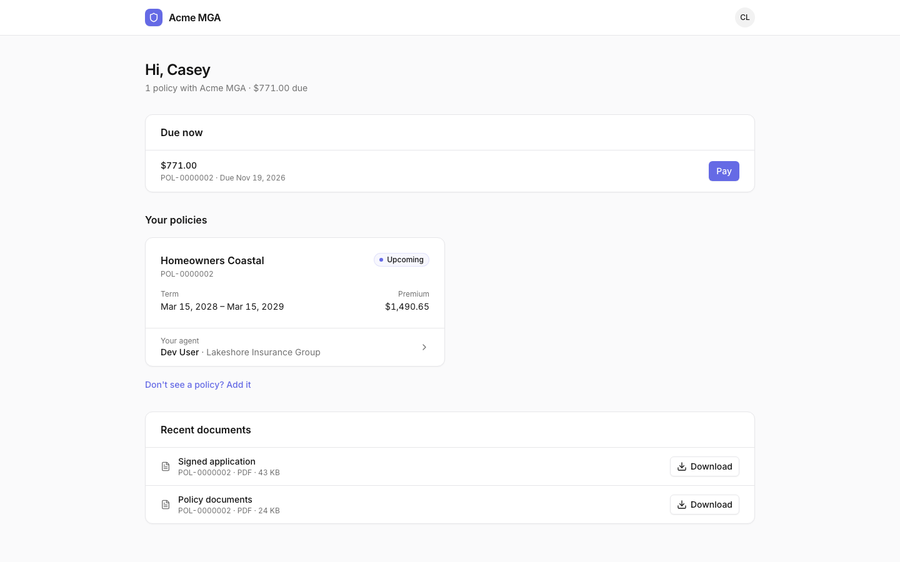

# PAS

A multi-tenant, configuration-driven **Policy Administration System** for P&C insurance, built for MGAs, program administrators and carriers who want to launch and change products in days, not quarters.

Tenants define their products in **admin**: risk data, intake forms, underwriting rules, rating (algorithm plans or uploaded spreadsheets), documents, lifecycle behavior, surplus-lines and notice compliance. Agents and customers then quote, bind and service those products through **app** (and, on the roadmap, an embeddable widget and a public API). Changing a product is a versioned, effective-dated, tested configuration release, not a code deploy.

> **Status: pre-release, under active development.** Roadmap phases 0–5 (foundations, catalog and forms, decisions and underwriting, rating, bind and issue, post-bind lifecycle) work end to end, along with much of phase 6: distribution and licensing, carrier connectors, a native billing ledger, agency downloads, the client portal and the integrations catalog. Not built yet: renewals, the public REST API and API keys, the embeddable widget, capacity and bordereaux, extensions and the AI builder. See [`PLAN.md` §18](./PLAN.md#18-delivery-roadmap) for the roadmap.



<table>
  <tr>
    <td width="50%"><br><sub><b>Rating plans</b>: algorithms per coverage, rate tables, golden cases</sub></td>
    <td width="50%"><br><sub><b>Rules</b>: versioned decision tables with a live simulator</sub></td>
  </tr>
  <tr>
    <td width="50%"><br><sub><b>Lifecycle</b>: issued transactions are append-only; corrections are new transactions</sub></td>
    <td width="50%"><br><sub><b>Durable workflows</b>: installments, notices, cancellations and filings on Postgres</sub></td>
  </tr>
  <tr>
    <td width="50%"><br><sub><b>Agent app</b>: quote, bind and service, tenant-branded</sub></td>
    <td width="50%"><br><sub><b>Client portal</b>: one login per client across producers</sub></td>
  </tr>
</table>

## Product tour

What PAS does today, written for MGA, carrier and brokerage decision-makers, with screenshots of the real apps. Start at the [overview](./docs/product/README.md).

- [Product builder and versioning](./docs/product/product-builder.md): versions per state with effective dates, immutable releases, publish checks
- [Forms and intake](./docs/product/forms-and-intake.md): risk data dictionary, config-driven questions, address verification
- [Rating](./docs/product/rating.md): rating plans with worksheets, spreadsheet raters, golden cases
- [Rules and underwriting workbench](./docs/product/underwriting.md): decision tables, referrals, authority, subjectivities, inspections
- [Quote to bind](./docs/product/quote-to-bind.md): the agent app from quote to bound policy
- [Policy lifecycle](./docs/product/policy-lifecycle.md): endorsements, cancellations with notice rules and MEP, rescission, reinstatement
- [Billing](./docs/product/billing.md): pay plans, installments, nonpayment, agency bill, mortgagee bill, bring your own billing
- [Native billing](./docs/product/native-billing.md): double-entry ledger, payments, lockbox, cash application, reports, daily reconciliation
- [Carriers](./docs/product/carriers.md): bring your own carrier with configured multi-step connectors and an ownership matrix
- [Agency downloads](./docs/product/agency-downloads.md): nightly ACORD downloads to agencies through IVANS
- [Documents](./docs/product/documents.md): template editor, state clause variants, forms library
- [Surplus lines and compliance](./docs/product/compliance.md): obligation engine, filings, remittance
- [Distribution](./docs/product/distribution.md): agencies, producers, license checks, commissions
- [Client portal](./docs/product/client-portal.md): one login per client across producers
- [Sandboxes and time travel](./docs/product/sandboxes.md): test a year of policy life in an afternoon
- [Integrations, events and webhooks](./docs/product/integrations.md): provider catalog, signed webhooks, notifications
- [Security and multi-tenancy](./docs/product/security.md): row-level security, roles, book scoping
- [**Technology**](./docs/product/technology.md): durable workflows, ports and adapters, the outbox, how it scales

## Surfaces

| Surface          | Who                        | What                                                                                                                | Status  |
| ---------------- | -------------------------- | ------------------------------------------------------------------------------------------------------------------- | ------- |
| `admin.pas.com`  | Tenant staff               | Product configuration + operations (UW queue, policies, billing, distribution, carriers, compliance), gated by RBAC | Built   |
| `app.pas.com`    | Agents, brokers, customers | Agent quote, bind and service; client portal; tenant-branded                                                        | Built   |
| Webhooks         | Partner systems            | Signed outbound event subscriptions and inbound provider webhooks                                                   | Built   |
| Embed            | Partner sites              | Drop-in quote/bind flow                                                                                             | Planned |
| `api.pas.com/v1` | Partner systems            | REST + OpenAPI, API keys                                                                                            | Planned |

## Key ideas

- **Product Release manifest**: every quote, term and transaction pins an immutable "lockfile" of the exact schema, forms, rules, rater, documents and lifecycle config versions it used. Results are reproducible forever, and config caches never need invalidation.
- **One lifecycle, many products**: generic state machines for submissions, terms, transactions and renewals. Product, carrier and state differences come in only as guards, parameters and effects from config.
- **Full-term rating, PAS-side proration**: raters price a term state; the platform computes deltas, proration, earned/unearned and out-of-sequence rerolls.
- **Two rating engines, one contract**: admin-authored rating plans (tables + algorithm steps) or uploaded Excel workbooks executed in-process, both effective-dated and golden-tested.
- **Rules as versioned decision graphs** (GoRules ZEN / JDM) using the [workbench](https://github.com/schester44/workbench) versioning model.
- **Durable workflows on Postgres**: installments, nonpayment notices, scheduled cancellations and filing deadlines run as workflows with timers, signals and memoized steps that survive restarts and deploys, and follow a sandbox's clock.
- **Compliance obligation engine**: SL filings, diligent-search affidavits, notices with proof of mailing, bordereaux and adverse-action notices, all driven by jurisdiction content.
- **Hexagonal + DDD**: domain code has no idea Prisma, pg-boss or Fastify exist. Every external system sits behind a port with a fake adapter for local dev and sandboxes.

## Stack

TypeScript · Node 26 · pnpm + Turborepo · Fastify · tRPC (dashboards) · REST/OpenAPI (public) · React 19 + Vite + TanStack Router/Query · shadcn/ui + Tailwind v4 · Postgres + Prisma 7 · pg-boss + an in-house durable workflow engine (separate worker) · Better Auth (organizations = tenants, RBAC) · GoRules ZEN · OpenTelemetry · oxlint + oxfmt · vitest

## Repository layout

```
apps/
  api/        Fastify: tRPC (admin, app), REST /v1, auth, inbound webhooks
  worker/     pg-boss: events, timers, documents, rating batch, integrations
  admin/      admin.pas.com SPA
  app/        app.pas.com SPA + embed bundle
packages/
  kernel/     shared kernel (Money, ids, dates, errors, Clock)
  modules/    one package per bounded context (domain / application / ports / infrastructure):
              catalog, form-library, rating, submissions, underwriting, policy, billing, ledger,
              compliance, distribution, carriers, agency-downloads, parties, addresses,
              integrations, events, search, tenants
  engines/    pure engines: expressions, forms-core, forms-react, decisions, rating, documents,
              pay-plans, enrichment, addressing
  workflows/  durable workflow engine (Postgres + pg-boss)
  db/  queues/  auth/  api-client/  ui/  storage/  observability/
docs/
  product/       product tour with screenshots
  design.md      design system
  landscape.md   competitive research and what it changed in the plan
  research/      vendor research
```

## Getting started

Requires Node 26+, pnpm 12 and Postgres 17+ (local install, or `docker compose up -d`).

```bash
pnpm install
cp .env.example .env          # set DATABASE_URL and BETTER_AUTH_SECRET (openssl rand -hex 32)
createdb pas                  # skip if using docker compose
pnpm db:generate
pnpm db:deploy                # apply migrations
pnpm dev                      # api :4000 · worker · admin :5173 · app :5174
```

In local dev the app connects as the database owner, so Postgres row-level security is not enforced (owners bypass it). Deployed environments run migrations, `pnpm queues:setup` (pg-boss schema and queues) and `pnpm workflows:setup` (workflow schema) as the owner (`DATABASE_URL_OWNER`), set `PGBOSS_MANAGE_SCHEMA=false` for the api and worker, then create the non-owner app role once with `PAS_APP_PASSWORD=... pnpm db:app-role` ([`packages/db/sql/app-role.sql`](./packages/db/sql/app-role.sql)) and point the api and worker's `DATABASE_URL` at `pas_app`.

Open http://localhost:5173, create an account and an organization (your tenant), then build a product: risk data, questions, coverages, rules and rating on a draft version, then publish it for a state. Quote and bind it in the agent app at http://localhost:5174/?tenant=<your-org-slug> (in dev the tenant comes from the `tenant` query parameter; deployed, from the host). `pnpm db:seed` adds sample agencies and producers to existing tenants. Under **Settings → Sandbox** you can copy the tenant into a sandbox and advance its clock to watch installments, notices and cancellations play out.

| Command                                                  | Description                                                     |
| -------------------------------------------------------- | --------------------------------------------------------------- |
| `pnpm dev`                                               | Run api, worker, admin and app in watch mode                    |
| `pnpm build`                                             | Build all apps                                                  |
| `pnpm typecheck`                                         | TypeScript across the workspace                                 |
| `pnpm lint` / `pnpm fmt`                                 | oxlint / oxfmt                                                  |
| `pnpm test`                                              | vitest (critical code only; see CLAUDE.md)                      |
| `pnpm db:generate` / `pnpm db:migrate` / `pnpm db:reset` | Prisma client / new migration / reset                           |
| `pnpm db:deploy` / `pnpm db:seed`                        | Apply migrations / seed sample agencies and producers           |
| `pnpm queues:setup`                                      | Install the pg-boss schema and queues (owner role, deploy step) |
| `pnpm workflows:setup`                                   | Install the workflow schema (owner role, deploy step)           |
| `pnpm db:app-role`                                       | Create/update the non-owner `pas_app` role (RLS applies to it)  |

## Integrations

Settings → Integrations is the provider catalog: Stripe (payments), Resend, Postmark and SMTP (email), Lob (print and mail), signed-webhook providers for email and print and mail, and data providers (US Census geocoder, E2Value, HazardHub). Every port has a built-in fake, which powers it until a tenant enables a provider; sandboxes only ever use test mode or the fake.

- `INTEGRATIONS_SECRET_KEY` (required to save provider secrets): an AES-256-GCM keyring, `k1:<base64 32 bytes>` (`openssl rand -base64 32`). The first key seals, every listed key opens. Rotate by prepending a new key, re-saving each integration, then removing the old one.
- Provider credentials (Stripe keys, Resend and Postmark tokens, Lob keys, SMTP passwords, webhook signing secrets) are entered per tenant in the admin, never in `.env`.
- Webhooks arrive at `<api origin>/api/webhooks/<kind>/<installId>`; each provider's page shows its URL. The api origin is `BETTER_AUTH_URL`.
- Optional, for local checks only: `STRIPE_TEST_SECRET_KEY` (a real test-mode PaymentIntent) and `RESEND_API_KEY` (a real Resend send).

## Documents

- [`docs/product/`](./docs/product/README.md): product tour with screenshots
- [`PLAN.md`](./PLAN.md): architecture, bounded contexts, lifecycle state machines, config model, rating, rules, forms, documents, compliance, roadmap, open decisions
- [`docs/landscape.md`](./docs/landscape.md): Duck Creek, Socotra and others, and where we differ
- [`docs/design.md`](./docs/design.md): the design system (look, tokens, components, copy)
- [`CLAUDE.md`](./CLAUDE.md): working agreement for AI agents and contributors

## License

[Functional Source License 1.1, Apache 2.0 future license](./LICENSE). You can use, modify and self-host PAS for your own business. You can't sell or host it as a competing product or service without a commercial license. Each release becomes Apache-2.0 two years after it ships.
