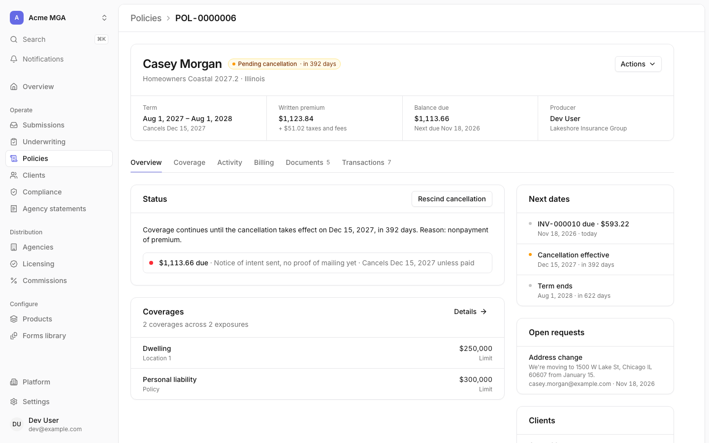

# PAS: the policy administration system you configure, not code

**Launch and change P&C products in days. Run new business, endorsements, cancellations, billing and surplus lines compliance on one platform built for MGAs, program administrators and carriers.**

Your product team builds products in the admin: risk data, questions, rules, rating, pay plans, documents and lifecycle behavior. Agents quote and bind in a branded agent app, insureds serve themselves in a client portal, and every date-driven obligation, from installment due dates to surplus lines filing deadlines, runs on durable automation you can audit and test.

_Every policy in one place: term, premium, balance due, the next dates that matter and the reason behind its status._

> **Evaluating the architecture?** Start with [Technology](technology.md): the durable workflow engine, ports and adapters, the transactional outbox, immutable configuration and how PAS scales with your team.

## Why teams choose it

**Products are configuration, not code.** A product version holds its risk data, questions, coverages, rules, rater, pay plans and documents. You publish it per state with effective dates for new business and renewal. Changing a rate is a new version with passing checks, not a ticket in an engineering backlog.

**Every quote and policy is pinned to the exact rules it was sold under.** Publishing creates an immutable release. Quotes, terms and transactions keep pointing at it, so a rate change never disturbs in-force business and any premium can be reproduced years later.

**Built for how MGAs actually work.** Admitted and non-admitted placement, diligent search affidavits, surplus lines taxes and stamping fees, agency bill with account currents, mortgagee bill, producer licensing at bind, commissions by tier, broker of record changes. Carrier connectors you configure yourself, a native billing ledger and nightly agency downloads come with it. These are product features, not professional services.

**Compliance timing you can trust.** Notice rules compute the earliest valid cancellation date. Nonpayment cancellations wait for proof of mailing. Filing obligations carry their own deadlines and escalate. All of it runs on a durable workflow engine on Postgres that survives restarts and deploys without repeating a side effect.

**Test a year of policy life in an afternoon.** Sandboxes copy your configuration, run against test providers and have their own clock. Advance a month and watch installments fall due, notices go out and cancellations take effect.

**Multi-tenant from the first table.** Every tenant-owned row carries its tenant, Postgres row-level security backs up application scoping, and roles decide what each user sees, down to an agency's own book.

**Yours to run.** Self-host it on Postgres and object storage, or let us host it. External systems connect through ports with a built-in test adapter for each, so you start on native components and bring your own billing platform, email, mail and data vendors when you're ready.

## Feature tour

| Area                                                 | What it covers                                                                                                       |
| ---------------------------------------------------- | -------------------------------------------------------------------------------------------------------------------- |
| [Product builder and versioning](product-builder.md) | Products, versions per state with effective dates, immutable releases, publish checks, golden cases                  |
| [Forms and intake](forms-and-intake.md)              | Risk data dictionary, config-driven questions, repeatable locations, address verification                            |
| [Rating](rating.md)                                  | Rating plans with rate tables and step-by-step worksheets, spreadsheet raters, golden test cases                     |
| [Rules and underwriting workbench](underwriting.md)  | Decision tables, referrals with "Why referred?", authority levels, subjectivities, inspections                       |
| [Quote to bind](quote-to-bind.md)                    | The agent app: quote, customize, legal and surplus lines details, review and sign, pay and bind                      |
| [Policy lifecycle](policy-lifecycle.md)              | Endorsements with diffs and pro rata, cancellations with notice rules and MEP, rescission, reinstatement             |
| [Billing](billing.md)                                | Pay plans, installments and autopay, nonpayment automation, agency bill, mortgagee bill, bring your own billing      |
| [Native billing](native-billing.md)                  | Double-entry ledger, payments by card, ACH, check and wire, lockbox, cash application, reports, daily reconciliation |
| [Documents](documents.md)                            | Template editor with live preview, state clause variants, form schedules, forms library                              |
| [Surplus lines and compliance](compliance.md)        | Obligation engine, Illinois filings, filing channels, tax remittance reports, compliance dashboard                   |
| [Distribution](distribution.md)                      | Agencies and hierarchy, producers, license checks at bind, commissions, broker of record                             |
| [Carriers](carriers.md)                              | Bring your own carrier: configured multi-step connectors, ownership per product, carrier figures win, file feeds     |
| [Agency downloads](agency-downloads.md)              | Nightly ACORD downloads to enrolled agencies' IVANS mailboxes, commission statements, certification harness          |
| [Client portal](client-portal.md)                    | One login per client across producers: policies, documents, invoices, payments, change requests                      |
| [Sandboxes and time travel](sandboxes.md)            | Copies of your configuration with test providers and a clock you control                                             |
| [Integrations, events and webhooks](integrations.md) | Provider catalog, bring-your-own credentials, signed webhooks, event catalog, notifications                          |
| [Security and multi-tenancy](security.md)            | Tenant isolation with row-level security, built-in and custom roles, book scoping, append-only history               |
| [Technology](technology.md)                          | For CTOs: durable workflows, ports and adapters, the outbox, immutable configuration, how it scales                  |

## Who it's for

- **MGAs and program administrators** who want to own their product logic and launch new states and programs without a vendor change order.
- **Carriers** running specialty or E&S programs that need surplus lines machinery, delegated distribution and clean data for bordereaux.
- **Brokerages and agency networks** that want a branded agent experience and one portal login per client, whoever wrote the policy.

## What's next on the roadmap

Renewals, a public REST API with API keys, an embeddable quote widget, bordereaux and capacity management are designed and planned. This tour only describes what works today.
