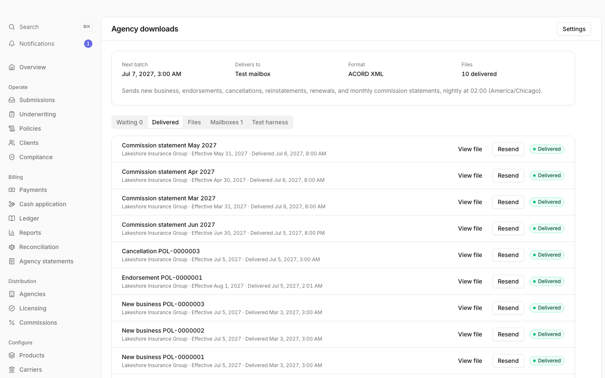
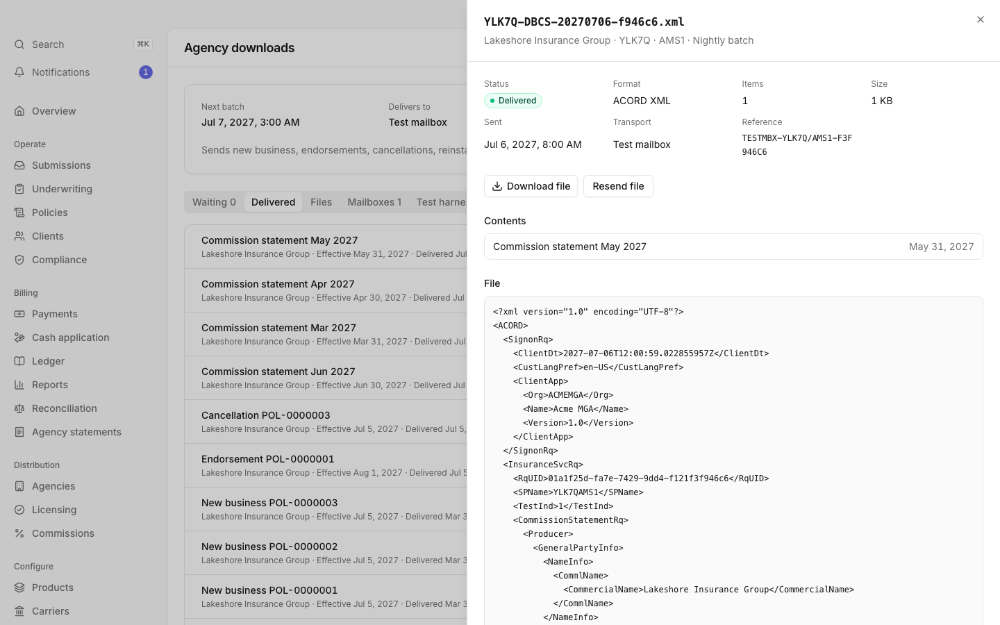
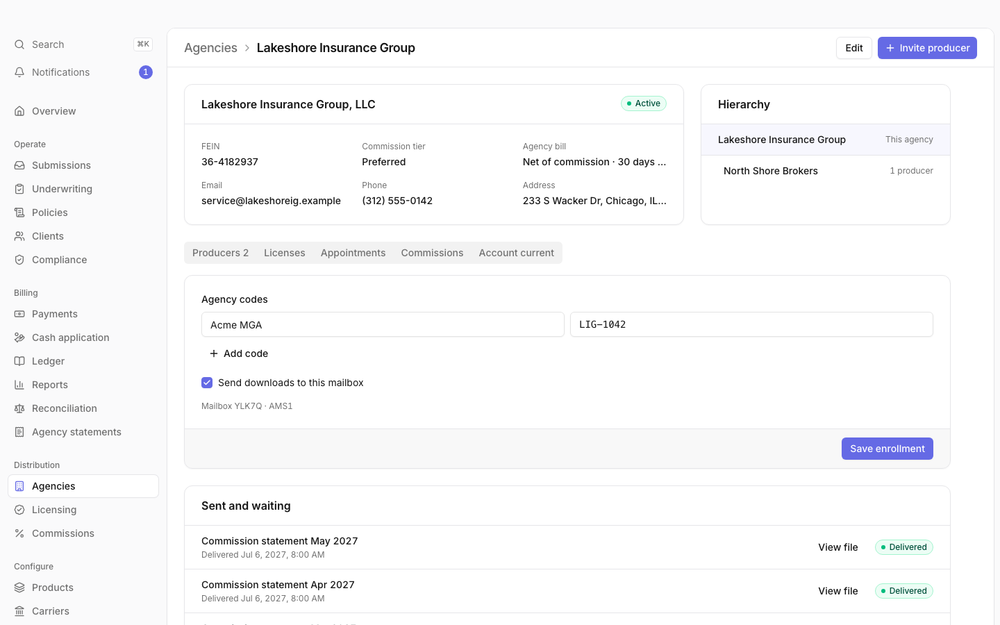
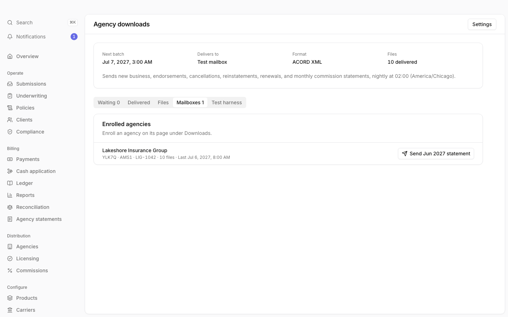
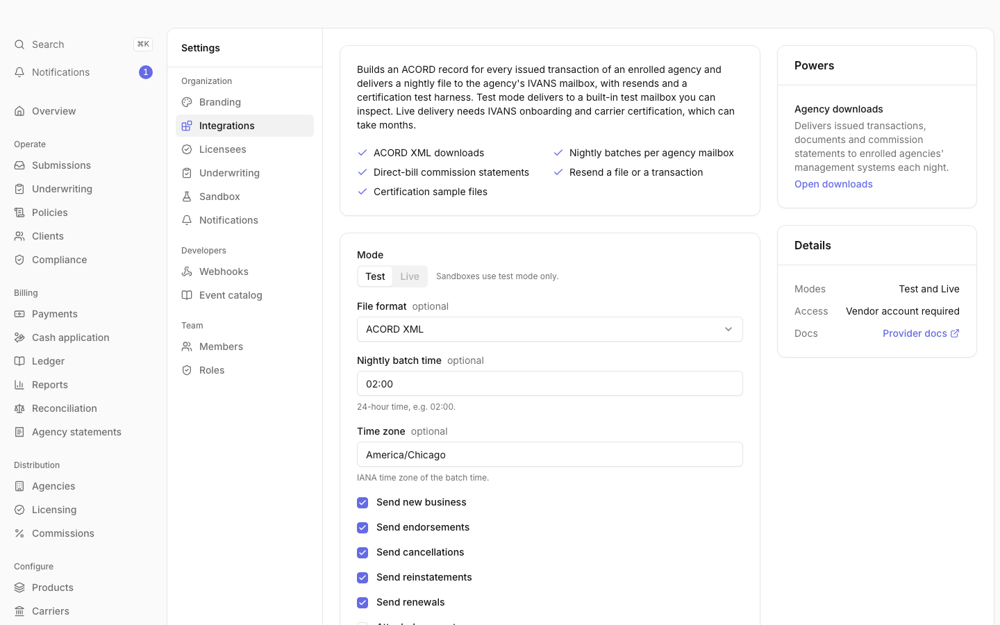
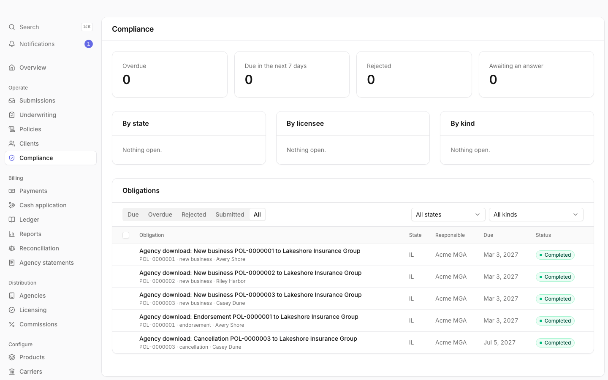
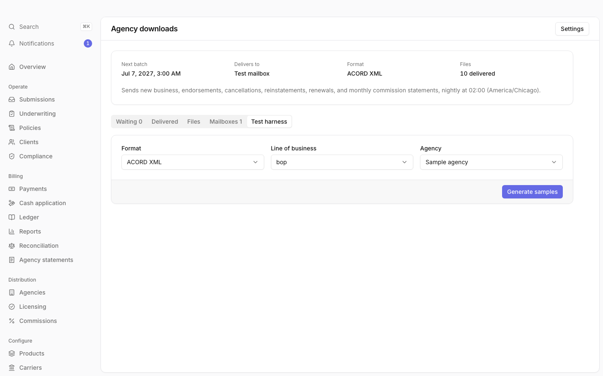

# Agency downloads

**Put every policy you write into your agencies' management systems automatically.** Enroll agencies, and each night PAS delivers ACORD-shaped records of new business, endorsements, cancellations, reinstatements and renewals, plus monthly commission statements, to each agency's IVANS mailbox.

## The problem

Agencies expect their carriers and MGAs to "download" into their agency management system. Without it, every policy you bind is re-keyed by the agency, mistakes creep in, and agencies prefer markets that do download. Building it is a long project, and certification takes months.

## How it works

Agency downloads is an **add-on** in the integrations catalog. Enable it, choose the file format and the nightly batch time, and map your lines of business and coverages to ACORD codes.

Then **enroll agencies** on their agency page: IVANS account and mailbox, agency codes per carrier or MGA, and a start date. From then on, every issued transaction for an enrolled agency becomes a canonical **ACORD-shaped record**, waits in the next batch, and is delivered nightly per mailbox in your time zone. Each delivery opens an `ams_download` obligation on the compliance dashboard, which completes when the file is delivered.

_The nightly batch at a glance, and every delivered file with view and resend._

## What you can do

- **Enable downloads** per tenant with file format, nightly batch time and time zone, which transaction types to send, whether to attach documents, and line-of-business and coverage code mappings.
- **Enroll agencies** with their IVANS account, mailbox and agency codes.
- **Send automatically** new business, endorsements, cancellations, reinstatements and renewals, plus a monthly commission statement for direct-bill commissions.
- **Inspect any file**: status, format, transport, reference and the contents of the generated XML.
- **Resend** a file or a single transaction when an agency asks.
- **Generate certification samples** with the test harness, per format, line of business and agency, for the carrier certification process.
- **Track delivery as compliance**: `ams_download` obligations show on the compliance dashboard with their due dates and status.

_Every file is viewable: status, format, transport, reference and the generated ACORD XML._

_Enroll an agency on its own page and see what was sent and what's waiting._

_Each enrolled agency's mailbox, file count and last delivery, with an on-demand commission statement._

_Settings: format, batch time and time zone, what to send, and your ACORD code mappings._

_Each download is an obligation on the compliance dashboard, completed when delivered._

_Generate certification sample files per format, line of business and agency._

## Formats and certification

- **ACORD XML**: built from the public ACORD structure. Verify element names and code lists against the licensed specification and certify with IVANS before production use.
- **ACORD AL3**: requires an ACORD license (or IVANS translation); the current AL3 writer is a placeholder until then.
- **Delivery**: test mode delivers to a built-in test mailbox, and sandboxes always use it. Live delivery needs IVANS onboarding, transport credentials and carrier or MGA certification, which IVANS reports can take six to nine months, so start early.

## How it fits

- Agencies, producers and commissions: [Distribution](distribution.md)
- `ams_download` obligations on the dashboard: [Surplus lines and compliance](compliance.md)
- The add-on lives in the catalog: [Integrations, events and webhooks](integrations.md)
- Watch a month of nightly batches in minutes: [Sandboxes and time travel](sandboxes.md)

## Under the hood

- Records are captured on `policy.transaction_issued` through the policy and catalog public APIs, so the download reflects exactly what was issued.
- Format adapters turn the canonical record into ACORD XML or AL3; transports deliver through the integrations `agency_downloads` category.
- The nightly batch is a durable workflow per tenant, scheduled in tenant-local time, so it catches up correctly after sandbox time travel. Acknowledgement and rejection handling from IVANS is on the roadmap.
