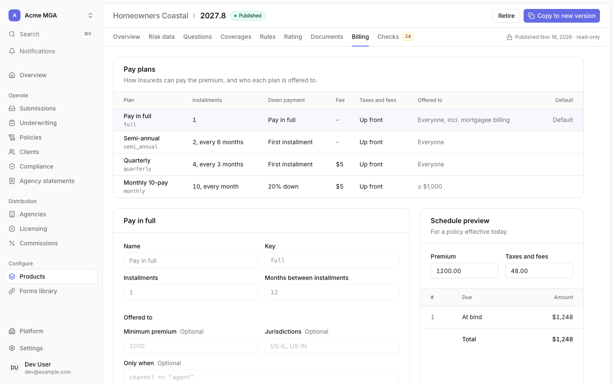
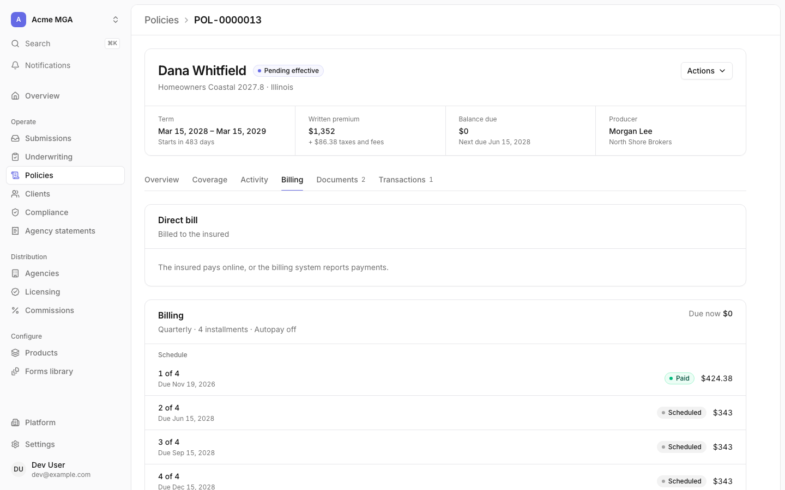
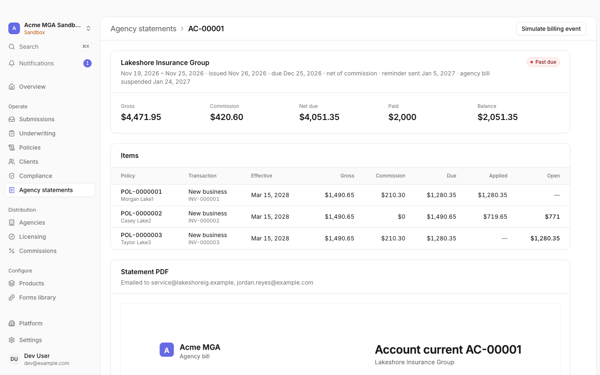
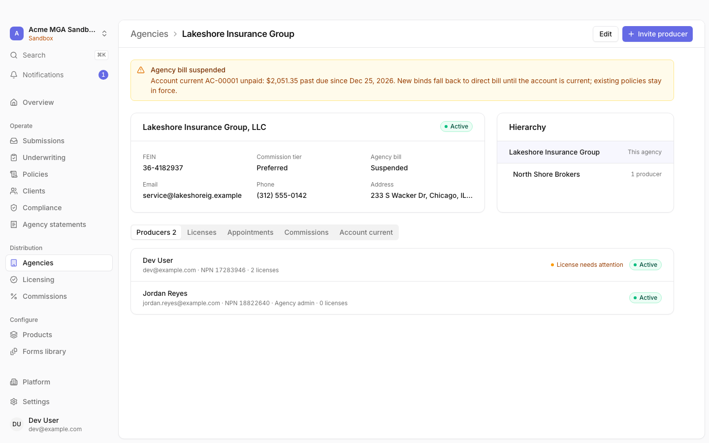
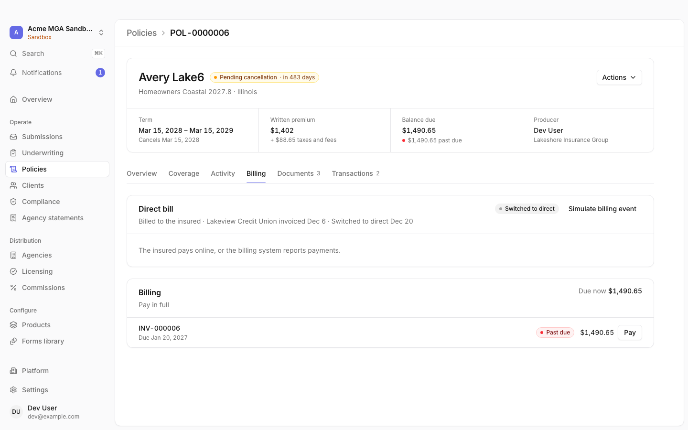
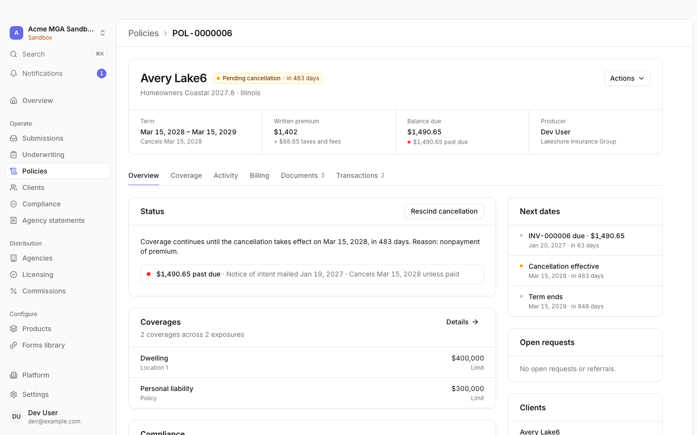

# Billing

**Pay plans, installments, autopay, agency bill and mortgagee bill, with nonpayment handled end to end.** Configure how each product is paid for, let the platform run the dates, or connect your existing billing platform through one canonical set of billing events.

## The problem

Billing is where policy and money meet, and most systems split them badly. Pay plans are hard-coded, installment reminders are a cron job, nonpayment cancellations are started by hand from an aging report, and agency bill and mortgagee bill live in spreadsheets beside the system of record.

## How it works

**Pay plans are product configuration.** Each version defines its plans (pay in full, semi-annual, quarterly, monthly 10-pay or your own): installment count and interval, down payment, installment fees, taxes and fees up front or spread, and eligibility by minimum premium, jurisdiction or channel. A schedule preview shows exactly what an insured would pay.

At bind the agent chooses a **billing method**: direct bill (card now, installments later, optional autopay), agency bill (the agency pays on its monthly account current) or mortgagee bill (the lender is invoiced and the policy is in force while it pays).

Every installment then runs on its own durable workflow: it opens, charges the saved card if autopay is on, goes past due, retries, sends a reminder, waits out the grace period and, if still unpaid, starts nonpayment.

_Pay plans per product version, with a live schedule preview for any premium._

## What you can do

- **Offer eligible pay plans on every quote**, each with today's amount and the installment schedule.
- **Charge the down payment at bind** and save the card for autopay with recorded consent.
- **Spread endorsement premium** over unbilled installments, and net return premium against unpaid installments (waiving fees on unbilled ones) before refunding.
- **Automate nonpayment**: reminder, notice of intent by email and print and mail with proof recorded, cancellation at the earliest valid date, held if there's no proof of mailing. A payment before the date rescinds the cancellation and sends a rescission notice.
- **Run agency bill**: per-agency eligibility, gross or net remittance, remittance days, credit limits checked at bind, a monthly account current with commission netted and a PDF emailed to the agency, aging with reminders and suspension of the agency bill privilege until the account is current.
- **Run mortgagee bill**: the lender packet (invoice, evidence of insurance, declarations) by print and mail with proof and by email, reminders, an offer to switch the insured to direct bill, then nonpayment notices to the insured and the mortgagee.
- **Simulate billing events** in sandboxes or on built-in billing to rehearse payments, reversals and delinquency.

_Installments per policy with due dates and status, and whether autopay is on._

_Agency bill: a monthly account current with commission netted and remittances allocated oldest first._

_Aging an account current suspends the agency's agency bill privilege, not the insured's coverage._

_Mortgagee bill: the lender was invoiced, didn't pay, and the policy switched to direct bill with the history kept._

_Nonpayment in progress: the notice of intent was mailed and the policy cancels on the earliest valid date unless paid._

## Bring your own billing

Already run a billing platform? PAS keeps owning **invoices** (what's owed, by whom, when) and the **policy consequences** of money events (cure, nonpayment cancellation, reinstatement). Your billing platform owns money movement.

- Your system posts canonical billing events to a signed, per-tenant endpoint: `payment.received`, `payment.failed`, `payment.reversed`, `refund.issued`, `credit.applied`, `credit.removed`, `writeoff.applied`, `writeoff.removed`, `invoice.adjusted`, `account.delinquent`, `account.current`, `payment_method.updated`.
- Events are idempotent by source and event ID, and reference PAS invoice IDs or policy numbers.
- **One application path**: PAS's own payments, refunds and adjustments are applied as the same canonical events, so behavior is identical whichever system moved the money.
- Choose the **delinquency source**: PAS due-date tracking, or `account.delinquent` from your billing platform.
- Publishing invoices and schedules outbound to an external billing platform is planned.

## How it fits

- Pay plans and billing methods are chosen at the pay step: [Quote to bind](quote-to-bind.md)
- Cancellations, rescissions and reinstatements: [Policy lifecycle](policy-lifecycle.md)
- Agencies, credit limits and commissions: [Distribution](distribution.md)
- Insureds pay invoices and manage autopay in the portal: [Client portal](client-portal.md)
- Payment, print and mail and email providers: [Integrations, events and webhooks](integrations.md)

## Under the hood

- Pay plans, eligibility, schedules, spreading and netting live in a pure engine with publish checks, and the plans travel in the product release.
- `billing.installment`, `billing.agency_account` and `billing.mortgagee_bill` are durable workflows keyed to tenant time; each step re-reads the invoice before acting, so a late payment or a reversal is never ignored by a stale timer.
- Every money change is a row in `billing_events`, unique per source and event ID, and writes the matching policy timeline entry in the same transaction.
