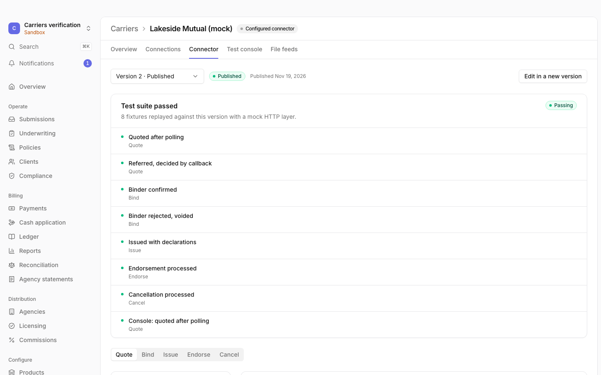
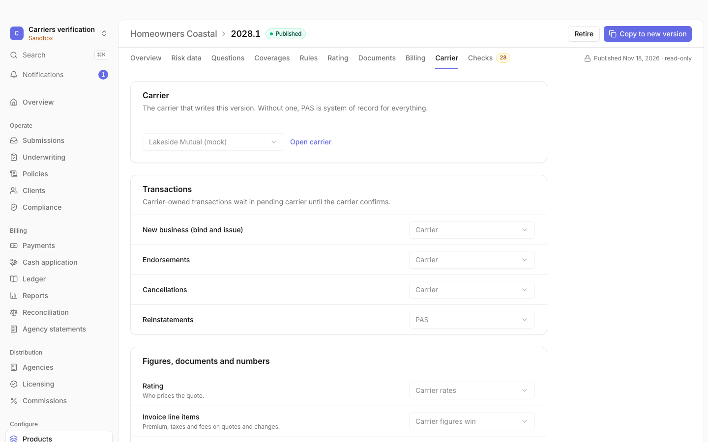
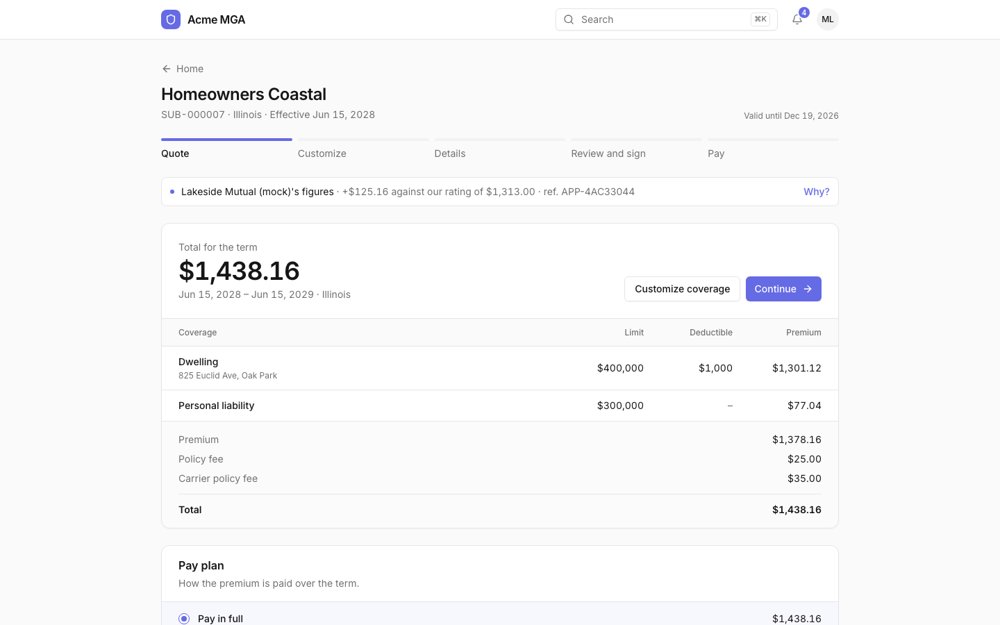
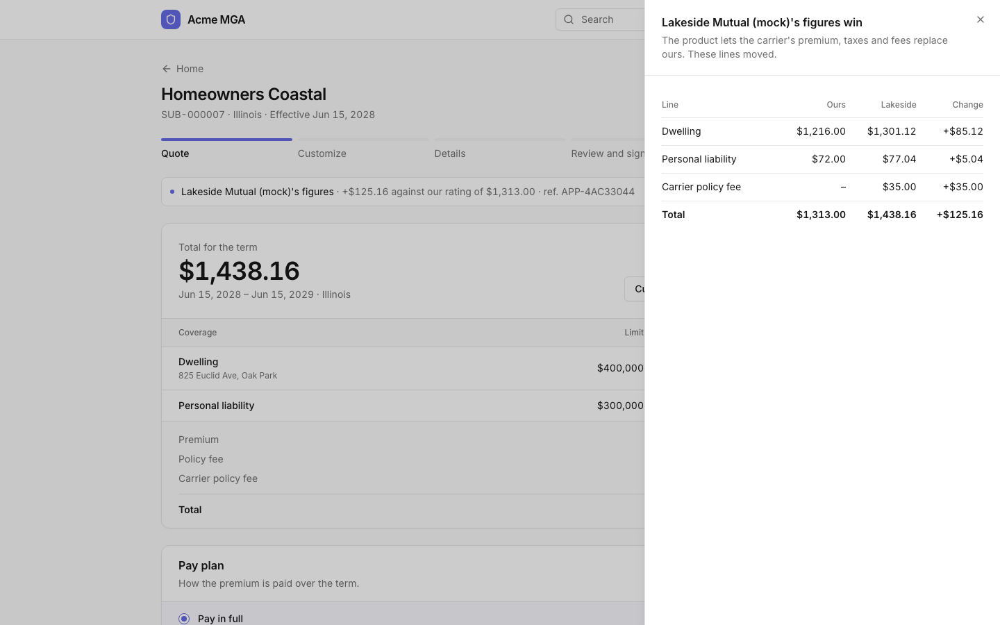
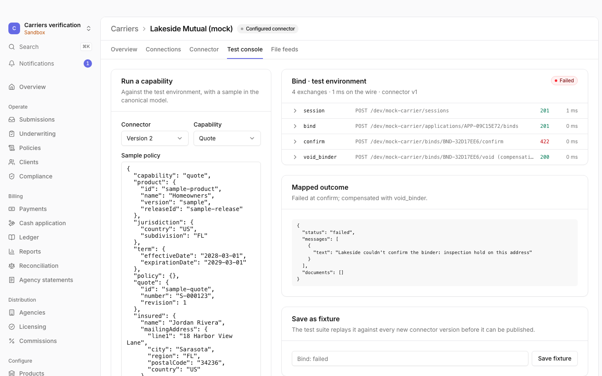
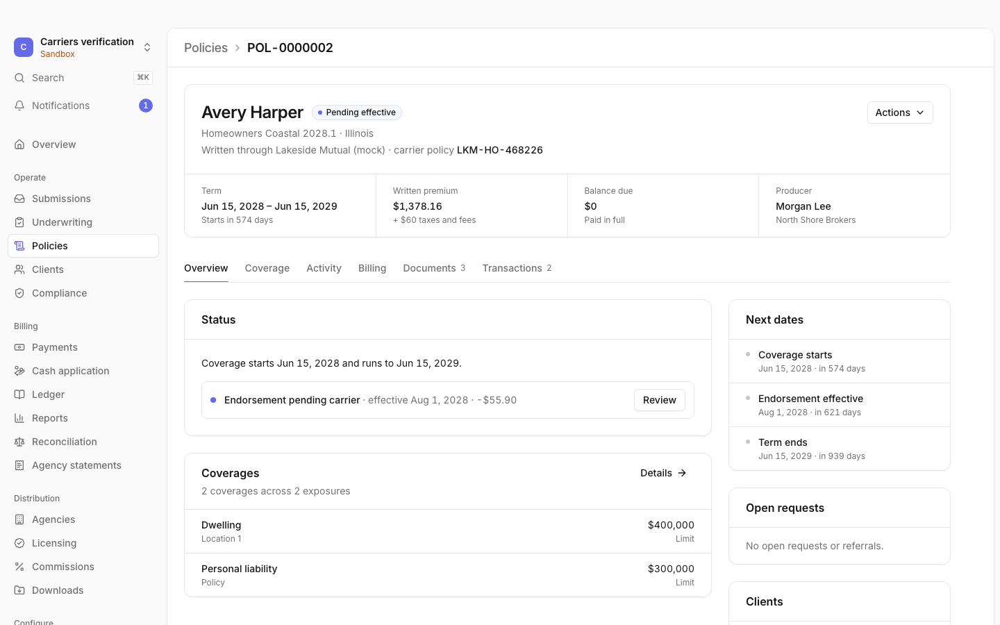
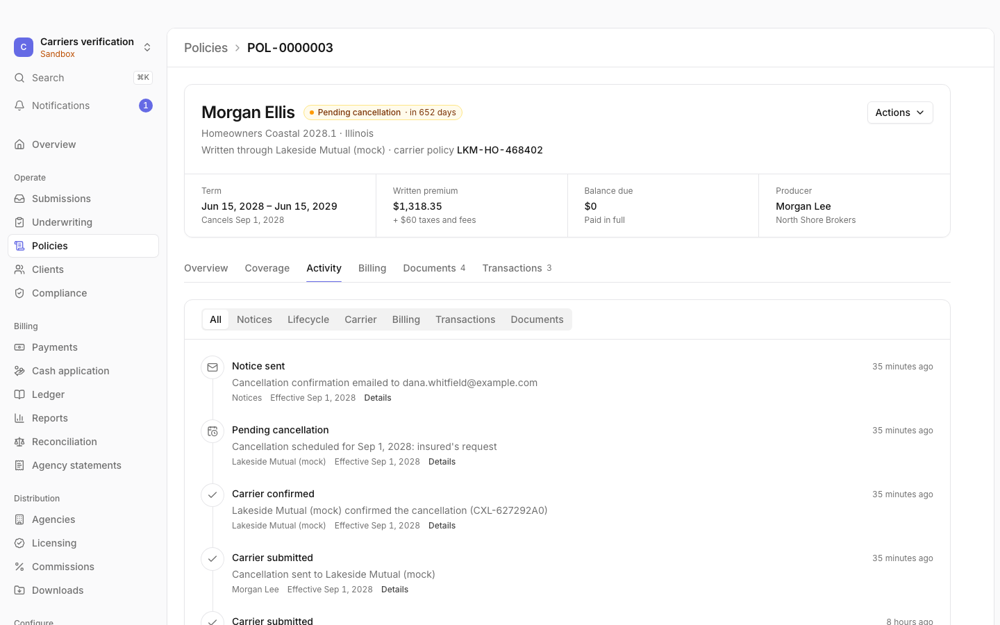
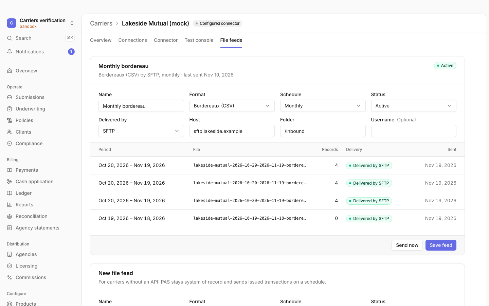
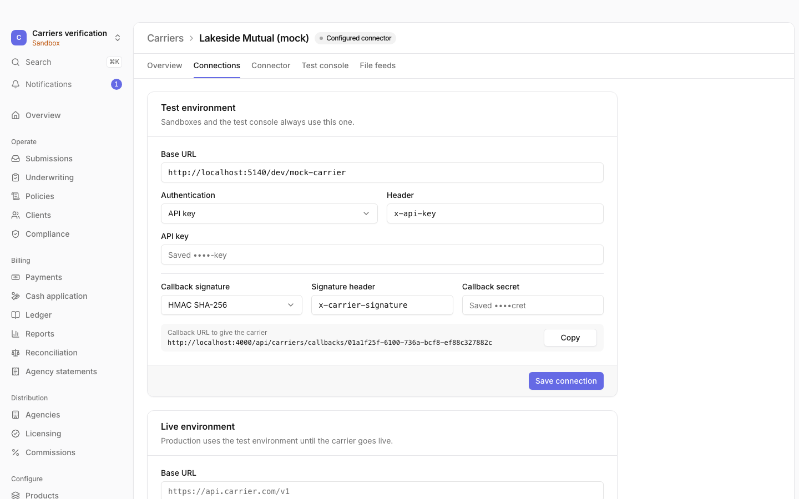
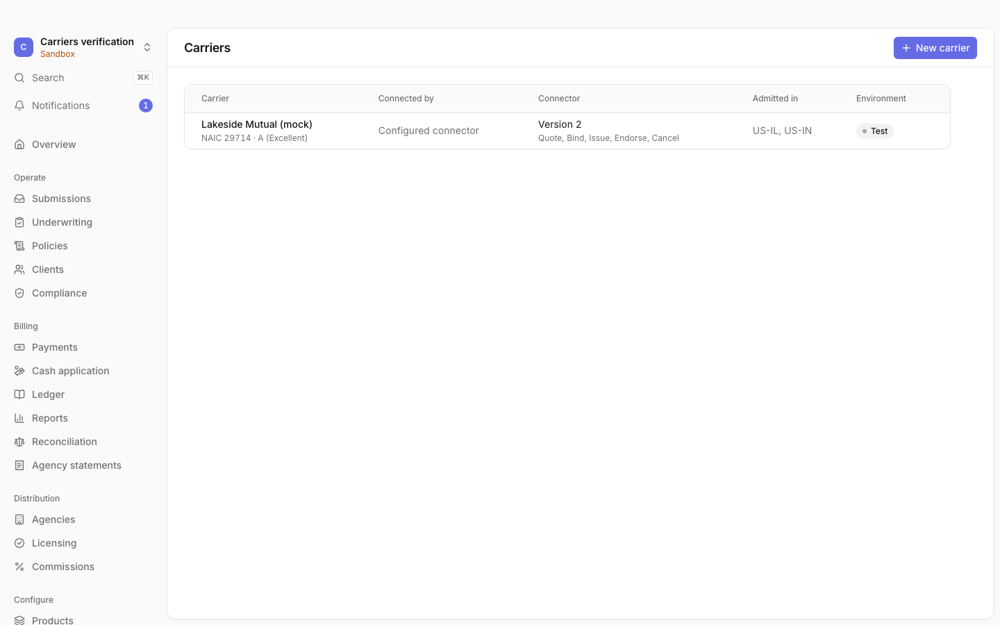

# Carriers

**Bring your own carrier, without waiting for anyone to write an adapter.** Configure how PAS talks to each carrier as multi-step flows, decide per product who owns each part of the transaction, and let carrier figures win where the carrier rates and issues.

## The problem

MGAs write for carriers with very different systems. Some rate and issue in their own platform, some take a nightly file, most sit somewhere in between. Integrating usually means a custom project per carrier, and when the carrier's premium differs from yours, nobody can say why.

## How it works

Each **carrier** has a profile (NAIC code, rating, admitted states, lines) and a way to connect:

- **Configured connector** (the default, no code): per capability (quote, bind, issue, endorse, cancel), a **flow of steps**: requests, polling with backoff, waiting for a signed callback, branching on the response, mapping, compensation and failure. Later steps use earlier outputs, such as a session token or the carrier's application ID. Mappings between PAS's canonical model and the carrier's payloads are expressions with a live preview.
- **File feeds** for carriers without an API: PAS stays system of record and sends issued transactions as bordereaux on a schedule.
- **Extension adapters** for carriers too irregular to map are designed in; the sandboxed extension runtime that loads them is planned.

Each **product version** names its carrier and an **ownership matrix**: who owns new business, endorsements, cancellations and reinstatements (PAS or the carrier), who rates, whose invoice line items win, whose documents go in the packet and in what order, whose policy number is kept, and how billing works. Because it's on the version, every release pins it.

_A connector version: the test suite that must pass, and the quote flow's steps: create a session, submit, poll for the decision, branch on referral, wait for the carrier's callback, map the decision._

## What you can do

- **Build flows per capability** with request, poll, await callback, branch, map, compensate and fail steps, each with retries, backoff, timeouts and an optional idempotency key.
- **Map with expressions** and see the result of each mapping against the sample as you type.
- **Connect test and live environments** with API key, basic, OAuth2 client credentials or mTLS; secrets are encrypted. Sandboxes and the test console always use the test environment.
- **Receive signed callbacks** at a per-connection URL; the correlation key in the callback resumes the waiting flow.
- **Run any capability in the test console** against the test environment and see every exchange on the wire, the mapped outcome and any compensation.
- **Save runs as fixtures.** Every capability needs recorded fixtures, and the test suite must pass before a connector version can be published.
- **Set the ownership matrix** per product version, and publish only when the carrier's connector supports the capabilities it needs.
- **Hold carrier-owned transactions in pending carrier** until the carrier confirms, with the carrier's reference on the timeline.
- **Let carrier figures win**: the quote shows the carrier's premium, taxes and fees, the difference from your rating and a "Why?" with the line-by-line diff.
- **Compensate on failure**: if the carrier refuses the binder, the flow voids it and the quote shows why.
- **Send file feeds** (for example a monthly bordereau by SFTP) and see each delivery.

_The ownership matrix on a product version: each concern decided separately._

_In the agent app, the quote shows the carrier's figures and how far they are from your own rating._

_"Why?" shows every line that moved: your rating, the carrier's and the change._

_A failed bind in the test console: the carrier refused to confirm, so the flow ran its compensation step and voided the binder._

_A policy written through the carrier, with an endorsement waiting in pending carrier._

_The timeline records each submission to the carrier and each confirmation with the carrier's reference._

_File feeds for carriers without an API: format, schedule, delivery and every file sent._

_Test and live connections, authentication, callback signing and the URL to give the carrier._

_Every carrier, how it's connected and which capabilities its connector supports._

## How it fits

- The carrier's quote appears in the agent journey: [Quote to bind](quote-to-bind.md)
- Endorsements and cancellations wait for the carrier: [Policy lifecycle](policy-lifecycle.md)
- Premium payable to the carrier, net of commission: [Native billing](native-billing.md)
- Ownership pins with the release: [Product builder and versioning](product-builder.md)
- Flows run on durable workflows: [Technology](technology.md)

## Under the hood

- Connector definitions are versioned and immutable once published. Each flow runs as a `carrier.flow` durable workflow, so a multi-step conversation survives restarts and can wait hours for an asynchronous decision. The exchange log is stored with secrets redacted.
- The outcome of a finished flow is applied inside the workflow, not via a later event, so it can't be dropped.
- Carrier-owned binds support direct bill by card today; agency and mortgagee bill on carrier-owned binds, status sync and on-demand carrier documents are on the roadmap. A real SFTP adapter for file feeds is also planned (sandboxes deliver to storage).
