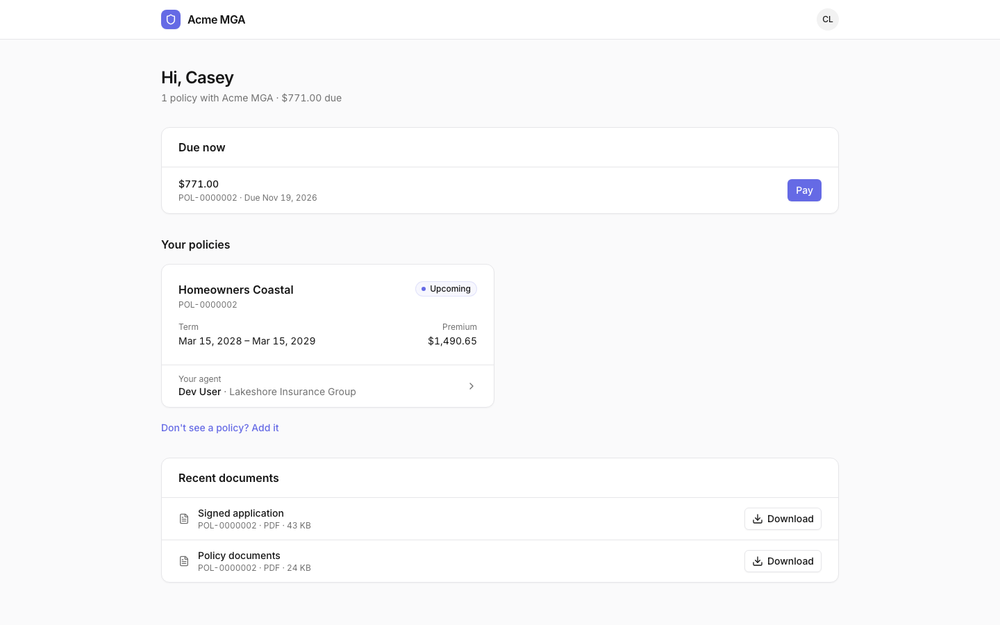
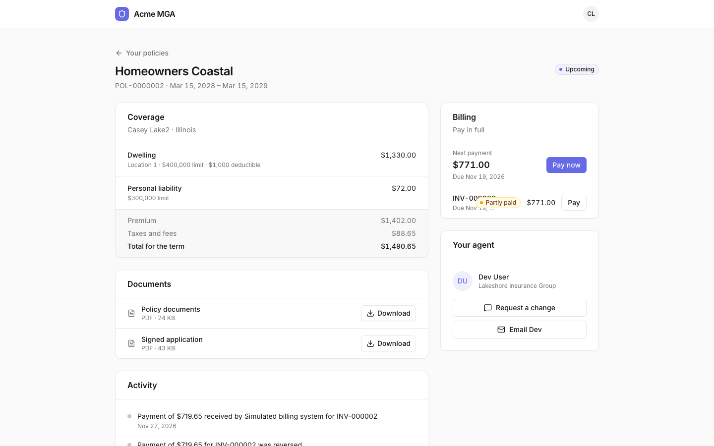
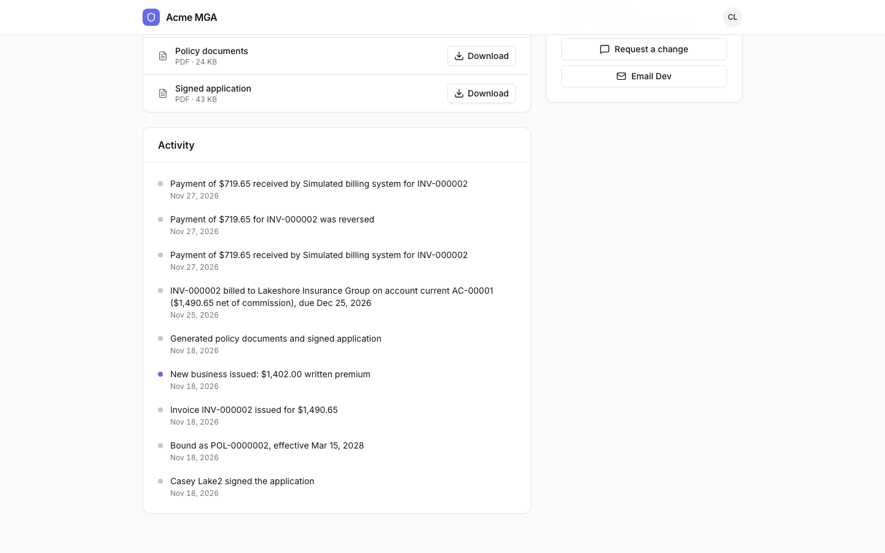
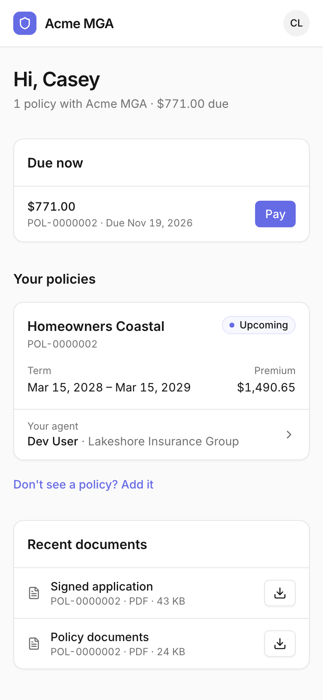
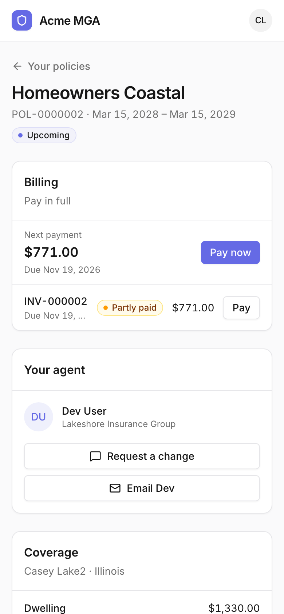
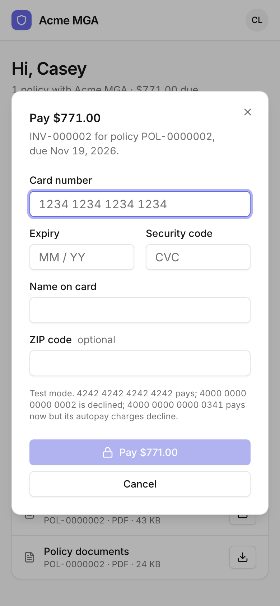
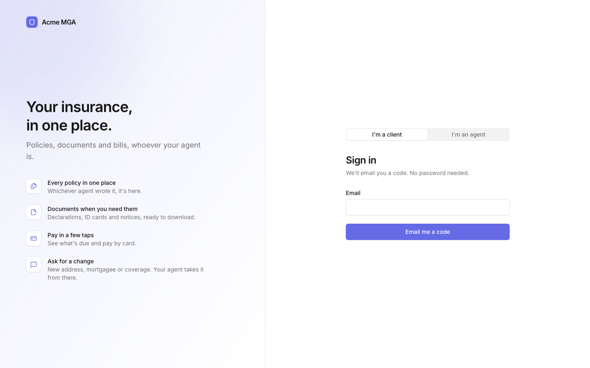

# Client portal

**One login per client that shows every policy they hold with you, whichever agent wrote it.** Policies, documents, invoices, payments, autopay and change requests in your brand.

## The problem

Brokerages and MGAs have thousands of producers writing for the same clients. Each policy ends up with its own login, or no login at all, and every "can you send me my dec page?" or "how much do I owe?" becomes a call to the agency.

## How it works

Every insured person or business has one **client account** per tenant. Policies link to it at bind, duplicates created by different agents are matched and merged, and the producer of record on each policy stays unchanged.

Clients sign in to your branded app with a **one-time code by email**; no password to forget. The named insured is invited at bind, and a client can also claim a policy with its policy number and ZIP code. Clients aren't staff users; they get a fixed client capability set and see only policies where they're a party.

_The portal home: what's due, every policy across producers, the agent for each and recent documents._

## What you can do

- **See every policy** with status, term, premium and "your agent", across all producers in your network.
- **Download documents**: policy documents, signed applications and notices.
- **Pay invoices** by card and see installment schedules and payment history.
- **Manage autopay** for installment plans.
- **Request a change** (a new address, a mortgagee, a coverage question), routed to the producer, or email the agent directly.
- **Follow activity** on each policy: payments, invoices, documents and transactions in plain language.
- **Add a policy** you don't see by verifying its policy number and ZIP code.

_One policy: coverage, documents, billing and the agent, with a change request one click away._

_The policy's activity, written for the insured rather than for staff._

  
  
  

_Designed for phones first: check what's due, see the agent and pay in a few taps._

_Clients and agents sign in on the same branded page. Clients get a code by email; no password needed._

## How it fits

- The named insured is invited when the policy binds: [Quote to bind](quote-to-bind.md)
- Invoices, installments and autopay come from billing: [Billing](billing.md)
- "Your agent" follows broker of record changes: [Distribution](distribution.md)
- Portal branding, subdomain and custom domains: [Security and multi-tenancy](security.md)

## Under the hood

- The client user is global but the experience is per tenant: the same email works at any tenant's portal, and each portal shows only that tenant's client accounts.
- Access is derived from policy parties and enforced twice, in the portal use cases and in the policy module's own scope.
- Sign-in codes go through the tenant's email provider from the integrations catalog. Card payments in the portal use the payments port; Stripe Elements in the portal pay dialog, passkeys and renewal offers are on the roadmap.
