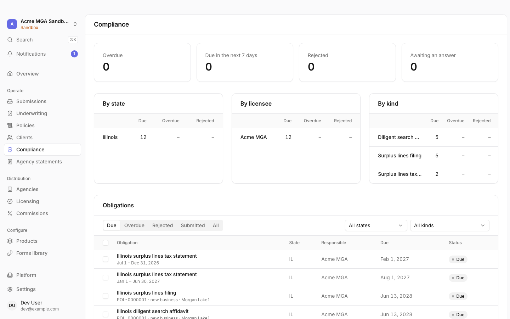
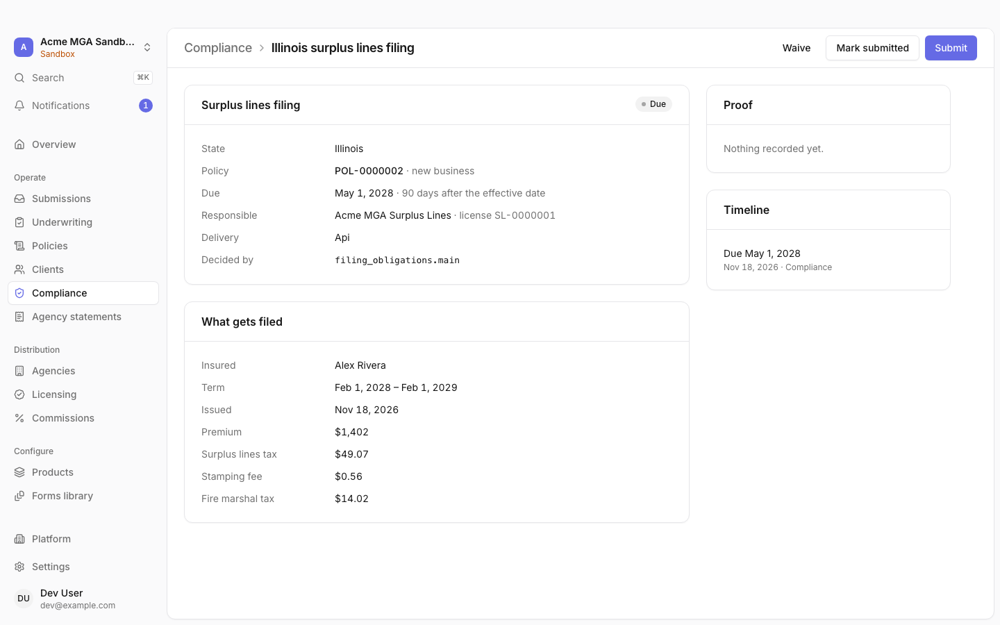
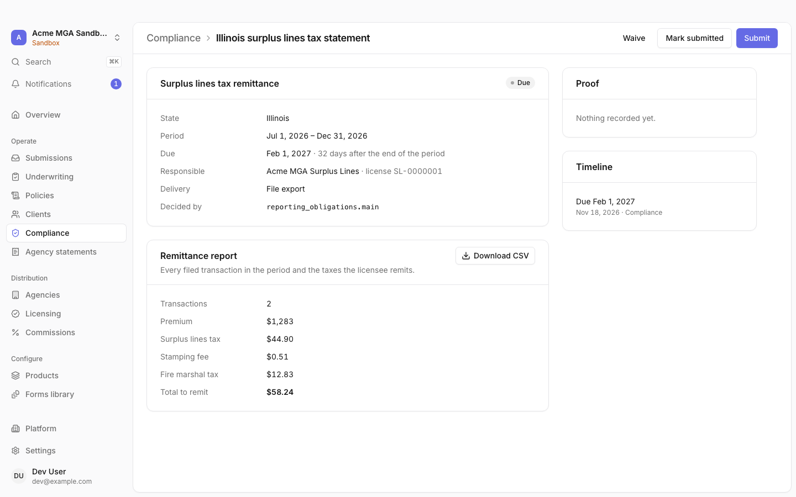
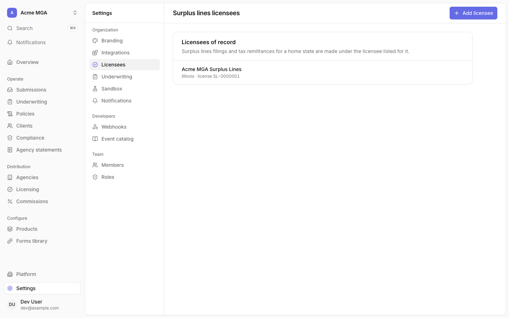

# Surplus lines and compliance

**Every filing, affidavit and tax statement you owe, created automatically with its deadline, delivered through the right channel and escalated before it's late.**

## The problem

Surplus lines compliance runs on spreadsheets and calendar reminders. Each state has its own deadlines, its own forms and its own taxes, a missed filing means real penalties, and nobody can see at a glance what's due this week across licensees and states.

## How it works

An **obligation engine** handles every duty with the same shape: an event creates an obligation with a due date, a responsible party, a delivery channel and required proof.

Which obligations exist, and when they're due, comes from **decision tables** on the product version, not code. When a non-admitted transaction is issued, filing rules create the state's surplus lines filing and, where required, a diligent search affidavit. Reporting rules create periodic tax statements per licensee and state. Due dates can be relative to the effective date, the issue date or the end of a reporting period.

Each obligation then runs on a durable workflow: a reminder before the due date, overdue at the deadline and escalation after it, stopping as soon as it's met.

_What's due, overdue and rejected, by state, licensee and kind._

## What you can do

- **Place admitted or non-admitted** per product and state, and switch on the surplus lines machinery for non-admitted business.
- **Capture the home state** at bind; it decides which state's taxes, filings and licensee apply.
- **Collect diligent search declinations** at bind when the state requires them, or after binding where the state allows.
- **Compute surplus lines taxes and fees** (premium tax, stamping fee, fire marshal tax and other state extras) as rules, itemized on the quote and invoice, with return premium producing negative lines.
- **Record licensees of record** per state, with license numbers, used for filings and remittances.
- **Work obligations** from the dashboard: submit through the channel, mark submitted for manual channels, waive with a reason, and record proof (filing number, confirmation file).
- **Produce remittance reports** per period, licensee and state, with transactions, premium and each tax, downloadable as CSV.
- **Get notified** when an obligation goes overdue, in-app or through webhooks.

_A filing obligation: Illinois, 90 days after the effective date, filed by the licensee of record through the state channel._

_A tax remittance statement: every filed transaction in the period and the taxes the licensee remits._

_Licensees of record per home state._

## Filing channels

Obligation kinds say what's owed; **filing channels** say how it's delivered. A channel declares which kinds and jurisdictions it serves.

- **Surplus Line Association of Illinois (SLAI)** for Illinois filings. The adapter is built from public material; it needs SLAI credentials and certification before production use.
- **File export** for states and kinds delivered by upload, with a manual checklist.
- **Test filing office** for sandboxes, which accepts or rejects so you can rehearse corrections.

Agency downloads use the same engine: each delivery to an enrolled agency's management system is an `ams_download` obligation on the dashboard. See [Agency downloads](agency-downloads.md).

Illinois is the first jurisdiction with content. Other states are configuration: new decision rows for deadlines and taxes, plus a channel.

## How it fits

- Diligent search and disclosures at bind: [Quote to bind](quote-to-bind.md)
- Endorsements, cancellations and reinstatements create filings too: [Policy lifecycle](policy-lifecycle.md)
- Filing and reporting rules are decision tables: [Rules and underwriting workbench](underwriting.md)
- Rehearse a quarter of filings and escalations: [Sandboxes and time travel](sandboxes.md)

## Under the hood

- Obligations are created from `filing_obligations` and `reporting_obligations` decisions evaluated on domain events, through the transactional outbox, so a filing exists if and only if the transaction committed.
- `compliance.obligation` workflows schedule reminder, overdue and escalation steps on the obligation's own dates; API channels are polled by a `compliance.filing` workflow until accepted or rejected.
- Notice rules (earliest valid cancellation dates, delivery methods, recipients) live in the same rules model. See [Policy lifecycle](policy-lifecycle.md).
