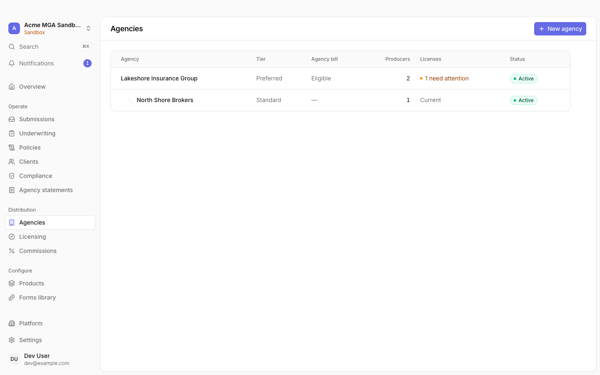
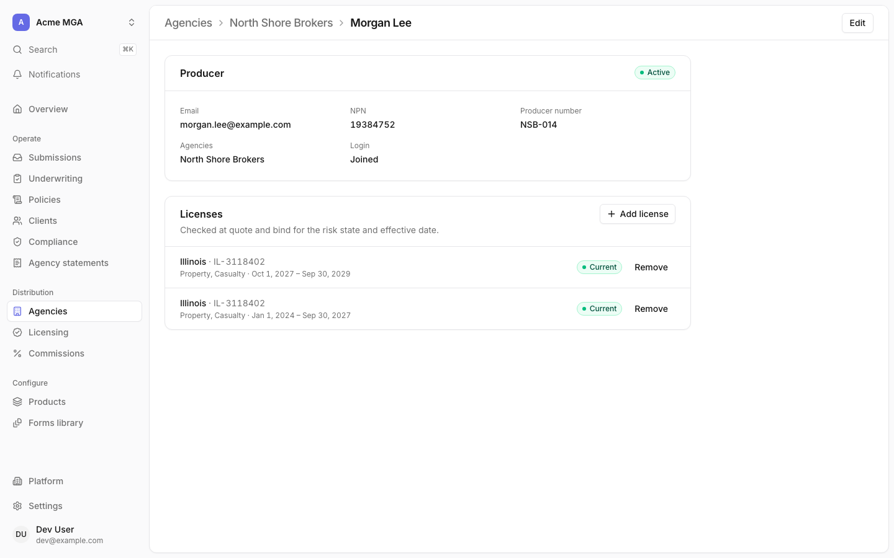
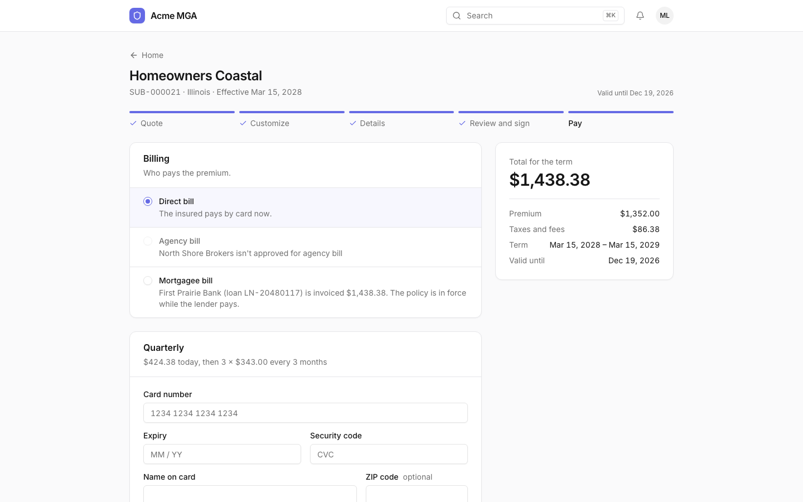
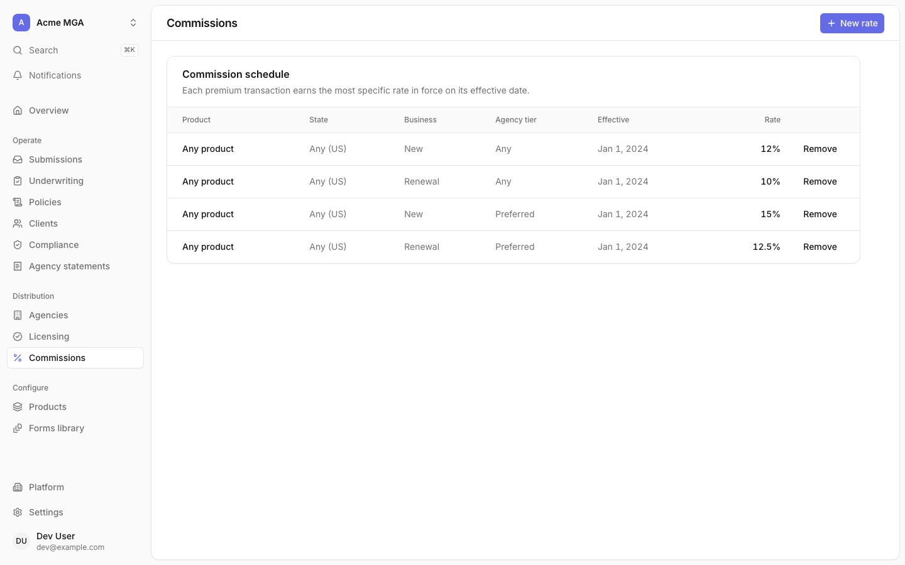
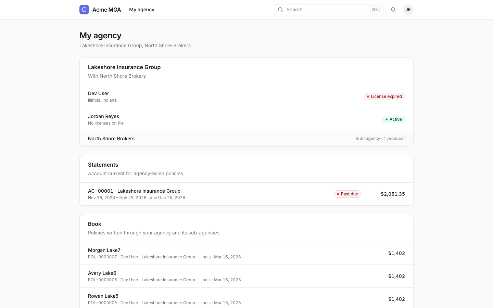

# Distribution

**Run your agency network in the same system that writes the policies.** Agencies and sub-agencies, producers and their licenses, license checks at bind, commission schedules and broker of record changes.

## The problem

Distribution data usually lives outside the policy system, so nobody stops an unlicensed producer at bind, commissions are calculated in a spreadsheet after the fact, and agency admins can't see their own book without asking.

## How it works

**Agencies** form a hierarchy (an agency and its sub-agencies) with a tier, contact details and agency bill terms. **Producers** are linked to agent logins, belong to one or more agencies and carry an NPN, a producer number and licenses by state with lines of authority and dates.

At bind the platform checks that the producer of record holds a license for the risk state on the effective date. Each product decides whether that check **blocks**, **warns** or is **off**. Every issued premium transaction earns commission from the most specific rate in force: by product, state, new or renewal business and agency tier.

_Agencies and sub-agencies with tier, agency bill eligibility and producers whose licenses need attention._

## What you can do

- **Model the network**: agencies, sub-agencies, tiers, agency bill eligibility, remittance terms and credit limits.
- **Manage producers** with NPN, producer number, agency memberships and licenses by state and line of authority.
- **Check licenses at bind** per product (block, warn or off). The agent sees exactly why a bind is blocked.
- **Set commission schedules** with effective dates by product, state, new or renewal, and agency tier, and record commission on every premium transaction, including pro rata return commission.
- **Change broker of record** with a timeline entry; the client portal's "your agent" follows the policy's producer.
- **Scope the book automatically**: agency admins see their agencies and sub-agencies, agents see their own production, staff see the tenant's whole book.
- **Give agency admins "My agency"** in the agent app: producers and license status, account current statements and the agency's book.

_Producer licenses by state, checked at quote and bind for the risk state and effective date._

_A license check at bind: the producer's license expires before the policy starts, so binding is blocked until a current license is on file._

_Commission rates by product, state, new or renewal business and agency tier, each with its effective date._

_Agency admins see their producers, account currents and book in the agent app._

## How it fits

- Agency bill, account currents and credit limits: [Billing](billing.md)
- The license check runs at the pay step: [Quote to bind](quote-to-bind.md)
- Book scoping is part of role-based access: [Security and multi-tenancy](security.md)
- Licensing providers in the catalog: [Integrations, events and webhooks](integrations.md)

## Under the hood

- Book scope is resolved in one place for every module: the role decides the reach, and distribution turns it into a tenant, producer or set-of-agencies scope that submissions, policies, search and both apps apply as a column filter.
- License checks go through a licensing port. "Licenses on file" is built in and a test provider serves sandboxes; the NIPR Producer Database adapter is a stub that needs a subscription and credentials.
- Commissions are computed in the worker on `policy.transaction_issued`, idempotent per transaction. Payouts, overrides and statement exports are on the roadmap.
