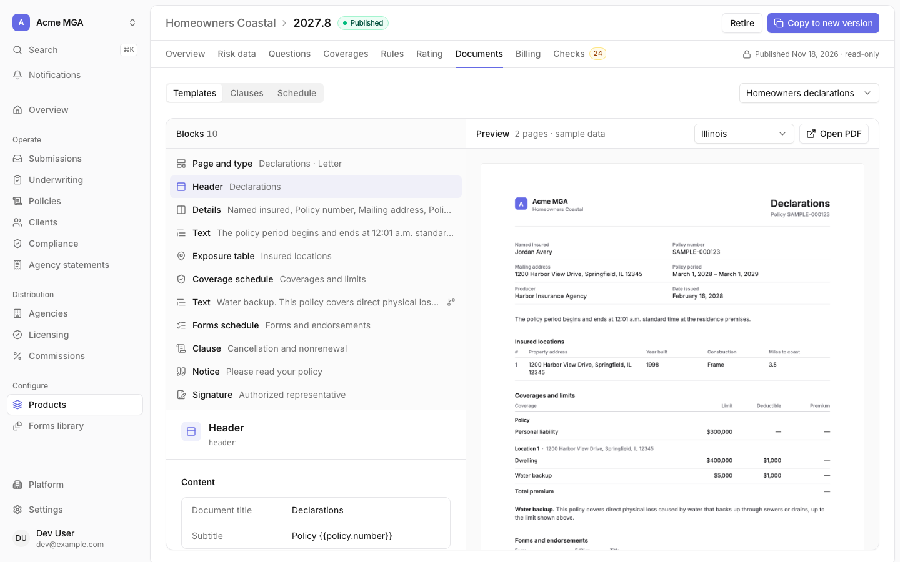
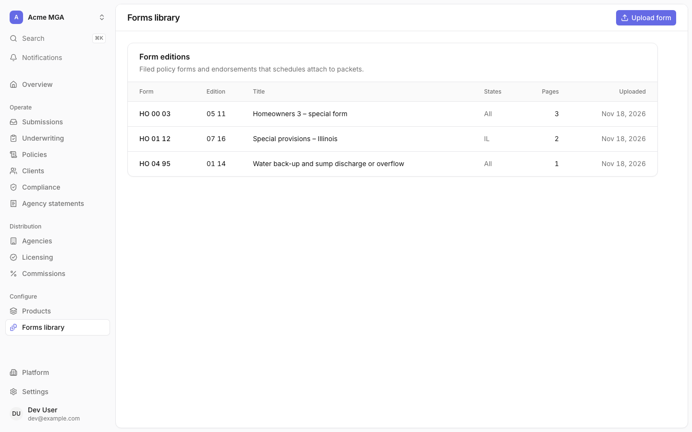
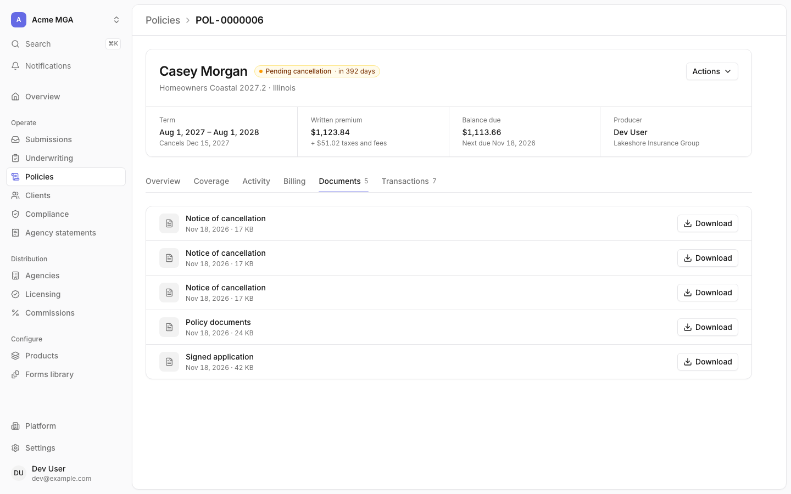

# Documents

**Design dec pages, quote proposals and notices in the admin, preview them per state with real data, and let the form schedule decide what goes in each packet.**

## The problem

Document generation is usually a separate system with its own templates, its own copy of the data and its own release cycle. State-specific wording gets pasted into the wrong state, and filed forms are attached by memory.

## How it works

Templates are built from a **block library**: page and type, header, details, text, exposure tables, coverage schedule, forms schedule, clauses, notices and signature. Blocks merge fields from the policy, quote or transaction (`{{policy.number}}`), and clauses carry **state variants**. A live PDF preview renders the template against sample data for any jurisdiction.

Filed forms live in the **forms library**: uploaded PDF editions with form number, edition date and states. The version's **form schedule** decides, with conditions, which templates and editions attach to each packet.

_Compose templates from blocks and preview the PDF for any state with sample data._

## What you can do

- **Compose templates** for declarations, quote proposals, applications, notices and letters from blocks, with merge fields and clauses.
- **Vary wording by state** with clause variants, and preview each state's packet.
- **Upload filed forms** (number, edition, states) and schedule them with conditions.
- **Generate at the moment it matters**: the quote proposal and application at review, the policy documents and signed application at bind, notices on cancellation.
- **Download everything** from the policy's documents tab or, for insureds, the client portal.
- **Catch errors at publish**: document checks verify merge fields and scheduled editions before a version can go live.

_Filed policy forms and endorsements, ready for form schedules to attach._

_Every generated document is stored against the policy and the transaction that produced it._

## How it fits

- Templates and the form schedule ship in the product version: [Product builder and versioning](product-builder.md)
- The insured reviews and signs real documents before binding: [Quote to bind](quote-to-bind.md)
- Cancellation, nonpayment and rescission notices: [Policy lifecycle](policy-lifecycle.md) and [Billing](billing.md)
- Account current statements for agencies are generated the same way: [Billing](billing.md)

## Under the hood

- Templates render with react-pdf in both the browser (preview) and on the server (generation), from one block model, so the preview is the document.
- Generated documents are immutable files in object storage (S3 or local) linked to the transaction or term.
- Filling static AcroForm PDFs from risk data and carrier-supplied documents are on the roadmap.
