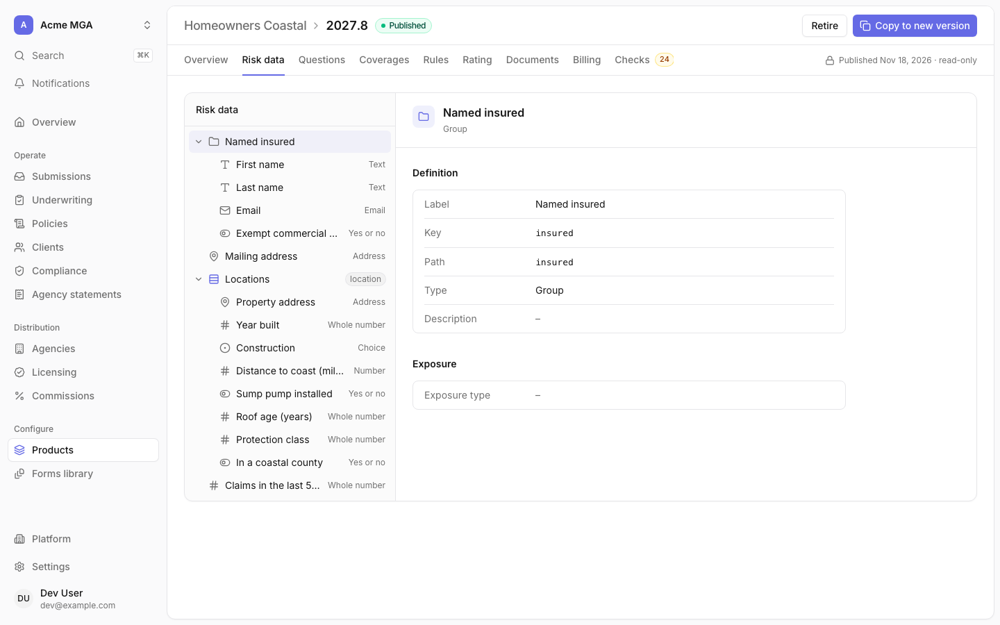
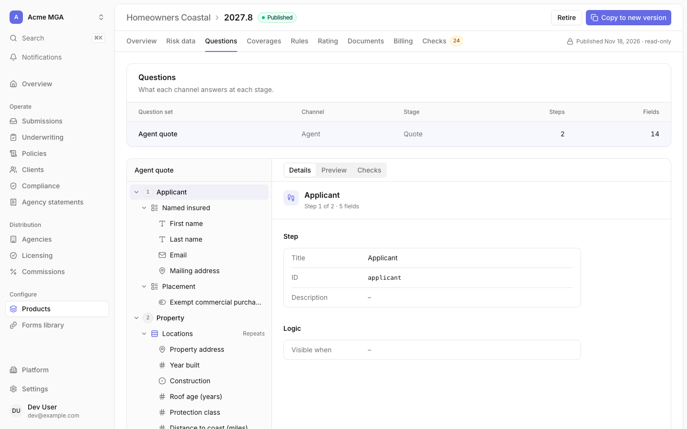
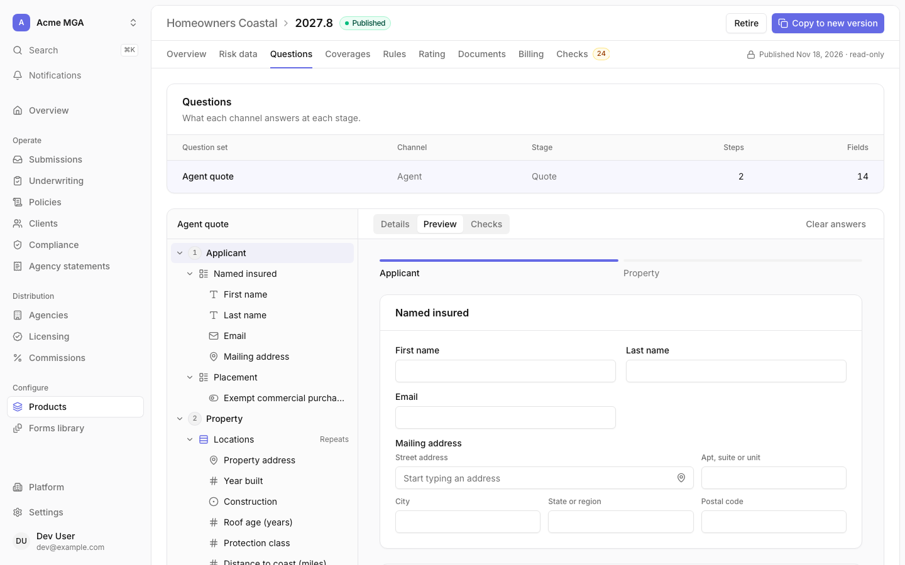
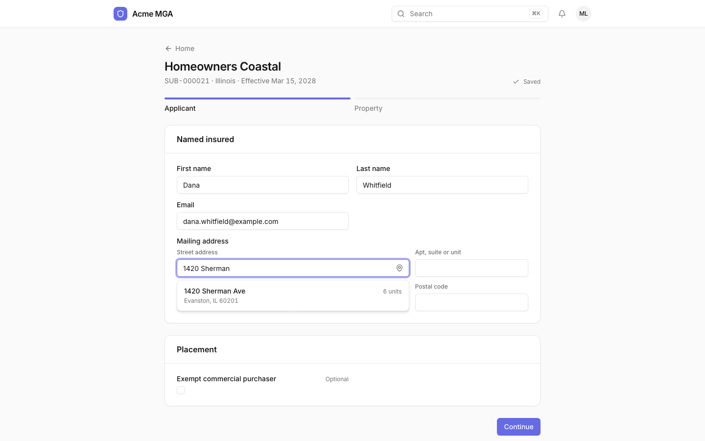
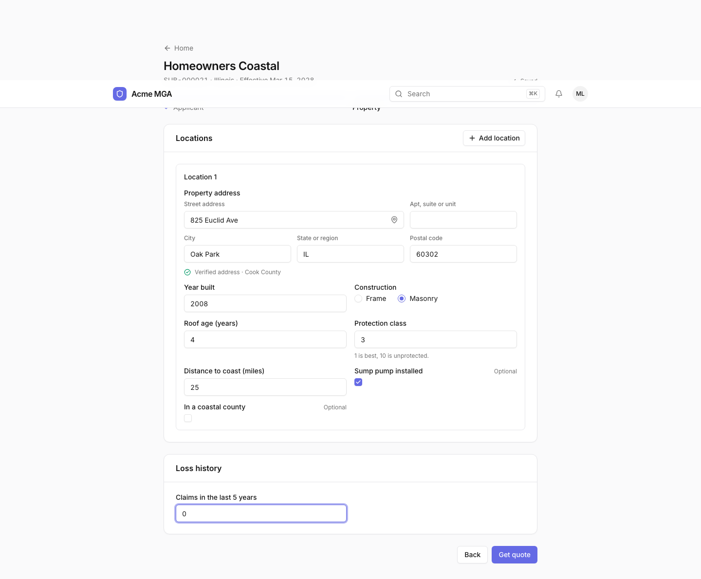

# Forms and intake

**Collect exactly the risk data your rules and rater need, with forms you configure, not build.** One data dictionary per product drives the questions agents answer, the rules that evaluate them and the documents that print them.

## The problem

Intake forms usually drift away from the rating and underwriting logic behind them. A field renamed in the form breaks the rater, a question added for one state shows up in all of them, and addresses arrive in a dozen spellings that make duplicate risks invisible.

## How it works

Every product version has a **risk data dictionary**: typed fields (text, numbers, money, dates, choices, yes/no, addresses), groups and **repeatables** such as locations. Each field has a canonical path like `locations[].roofAge` that questions, rules, rating and templates all reference. Publish checks verify those references.

**Questions** are built on top: steps, sections and fields bound to those paths, with visibility, required and validation expressions. The same form engine runs in the browser and on the server, and the server is authoritative.

_The risk data dictionary, with repeatable locations marked as an exposure that coverages attach to._

## What you can do

- **Model the risk once** with typed fields, groups and repeatable exposures like locations. Coverages attach to the exposure and premium is produced per coverage per location.
- **Build question sets per channel and stage** with steps, sections, help text and expressions for visibility, required and validation.
- **Preview the form live** while you edit, and see the evaluated state (visible, required, errors) for any answers.
- **Autosave and validate server-side** as agents fill the form, so drafts survive and nothing invalid reaches rating.
- **Verify addresses as agents type.** Suggestions, standardization, unit selection for multi-unit buildings and county detection, through the address provider you connect.
- **Detect duplicate risks** across agents with a per-product clearance mode (block, warn or off), keyed by the verified address.

_Question sets per channel and stage, built from the risk data dictionary._

_Preview the real form while you edit it._

_Address suggestions as the agent types, including buildings with units._

_Repeatable locations with verified addresses and the questions rating needs._

## How it fits

- The fields here feed the rater: [Rating](rating.md)
- Rules read the same paths to refer, decline or add requirements: [Rules and underwriting workbench](underwriting.md)
- The intake form is the first step of the agent journey: [Quote to bind](quote-to-bind.md)
- Templates merge the same data into dec pages and notices: [Documents](documents.md)

## Under the hood

- Risk data is stored as JSON validated against the pinned schema, with typed columns for cross-product fields such as insured name, state, dates, premium and status.
- Expressions use one sandboxed language (ZEN) in the browser and on the server, so a visibility rule behaves identically in preview, in the agent app and at bind.
- Addresses go through an address provider port and a per-tenant address registry keyed by the provider's stable address ID. A built-in sample provider works out of the box; Smarty and Geoapify adapters are built from their public specs, so connect Smarty with your account and certify it. Nested repeatables (buildings within locations) are on the roadmap.
