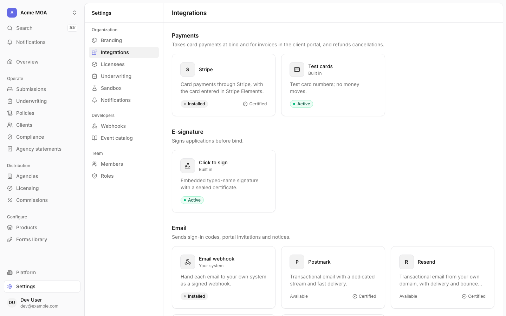
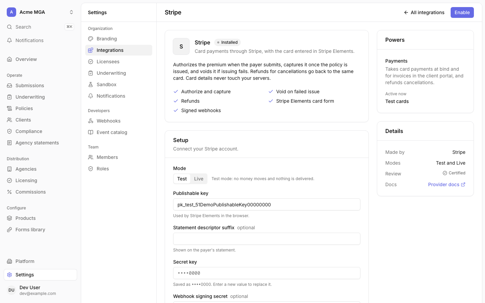
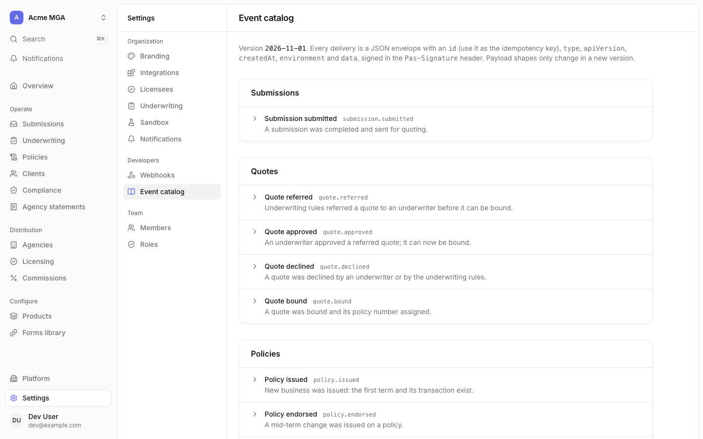
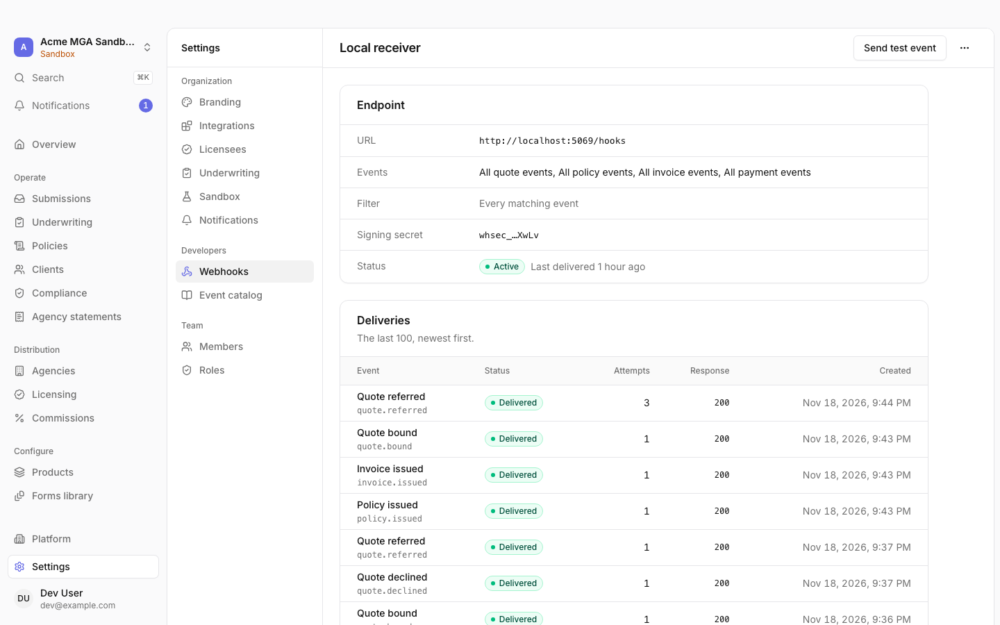
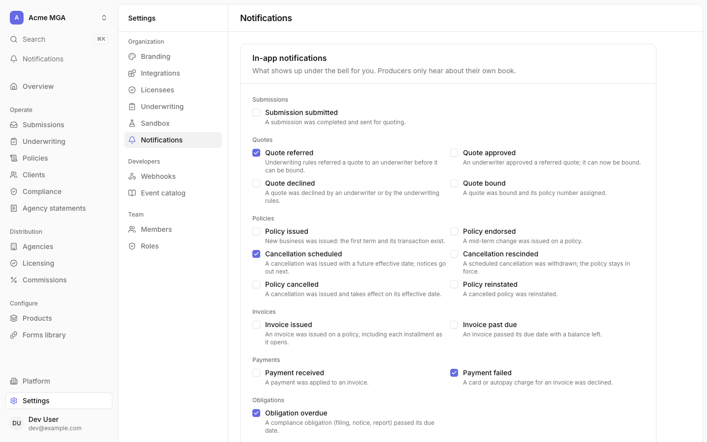

# Integrations, events and webhooks

**Connect the providers you already use, keep the credentials yours, and let your other systems react to everything that happens.** A provider catalog with a built-in test adapter for every category, signed webhooks over a versioned event catalog, and in-app notifications.

## The problem

Every external system in insurance (payments, e-signature, email, print and mail, data vendors, filing offices) is usually wired in by custom code, with shared credentials in environment files and no way to run without the real vendor. Downstream systems learn about policy changes from nightly extracts.

## How it works

**Settings → Integrations** is the catalog. Each category has providers, and each provider has a page with what it powers, its setup and its health. Enable a provider for your tenant with your own credentials. Until you do, the built-in adapter powers that category, so everything works on day one and in every sandbox.

_The catalog, grouped by what each provider powers._

## The catalog today

| Category             | Providers                                                                              |
| -------------------- | -------------------------------------------------------------------------------------- |
| Payments             | Stripe, test cards (built in)                                                          |
| E-signature          | Click to sign (built in)                                                               |
| Email                | Resend, Postmark, SMTP, email webhook to your own system, developer mailbox (built in) |
| Print and mail       | Lob, print and mail webhook to your own system, test print and mail (built in)         |
| Address verification | Smarty, Geoapify, sample addresses (built in)                                          |
| Data                 | US Census geocoder, E2Value, HazardHub, sandbox data (built in)                        |
| Licensing            | Licenses on file (built in), NIPR Producer Database, test licensing                    |
| Filing               | Surplus Line Association of Illinois, file export, test filing office                  |
| Billing              | Native billing (built in), external billing system via signed billing events           |
| Agency downloads     | IVANS Download, with a built-in test mailbox                                           |
| Inspections          | Mock inspections (built in)                                                            |
| Chat                 | Slack, test chat (built in)                                                            |

Several vendor adapters (Smarty, Geoapify, E2Value, HazardHub, Lob, NIPR, SLAI, IVANS) are built from public specifications and need your account to confirm and certify before production use. Each provider page says which.

_A provider page: capabilities, test or live mode, and secrets that are stored encrypted and never shown again._

## Events and webhooks

A **public event catalog** lists stable, versioned event types, separate from internal events so internals can change without breaking you: submission submitted; quote referred, approved, declined and bound; policy issued and endorsed; cancellation scheduled and rescinded; policy cancelled and reinstated; invoice issued and past due; payment received and failed; obligation overdue; filing rejected.

- **Webhook endpoints** subscribe to event types with wildcards and an optional filter on product, premium, jurisdiction or producer.
- Every delivery is a JSON envelope with an ID you can use as an idempotency key, signed in a `Pas-Signature` header.
- Failed deliveries retry with backoff for about 24 hours; an endpoint that keeps failing is disabled and admins are emailed.
- A **delivery log** shows each attempt, status and response, with replay and test events.
- **Slack** messages and **in-app notifications** use the same subscriptions. Staff choose what reaches their bell; producers only hear about their own book.

_The versioned event catalog, with the envelope and signature documented in place._

_Each endpoint's subscriptions, signing secret and every delivery attempt with its response._

_Notification preferences per user, by event type._

## How it fits

- Native billing or your own billing platform through canonical billing events: [Billing](billing.md) and [Native billing](native-billing.md)
- Carriers connect under Carriers, not here: [Carriers](carriers.md)
- Nightly downloads to agencies' management systems: [Agency downloads](agency-downloads.md)
- Filing channels per obligation kind and jurisdiction: [Surplus lines and compliance](compliance.md)
- Sandboxes always use test mode or the built-in adapter: [Sandboxes and time travel](sandboxes.md)
- Ports, adapters and the outbox in depth: [Technology](technology.md)

## Under the hood

- Provider secrets are sealed with AES-256-GCM using a keyring; the first key seals, every listed key opens, so keys rotate without downtime.
- Inbound provider webhooks arrive at a per-install URL shown on each provider page and are verified with the provider's signing scheme.
- Webhook payloads are rebuilt from each module's public read models, never copied from internal events, and delivered from a durable queue. A public REST API with API keys is on the roadmap.
