# Native billing

**A built-in billing system with a real double-entry ledger.** Take payments by card, ACH, check and wire, apply cash, import lockbox files, reverse NSFs, refund, write off, and close every day with a reconciliation that proves the books agree with the policies.

## The problem

MGAs often run billing in a separate system bolted onto the policy platform, or in spreadsheets beside it. Cash gets applied in one place and policy consequences happen in another, unapplied checks sit in a drawer, and month-end means reconciling three sources that never quite agree.

## How it works

Native billing is its own module with its own **double-entry journal**. It talks to the policy side exactly the way an external billing platform would: PAS publishes invoices, statements and commission facts to it, and it sends back the same **canonical billing events** (`payment.received`, `payment.reversed`, `refund.issued`, `writeoff.applied` and the rest) that any billing platform posts. That means you can start on native billing and move to your existing billing platform later, or the other way round, and policy behavior doesn't change.

Every money movement is a **journal entry**: balanced per currency, immutable once posted and append-only. Corrections are reversing entries, never edits. Each command carries an idempotency key, so a retried request posts exactly once.

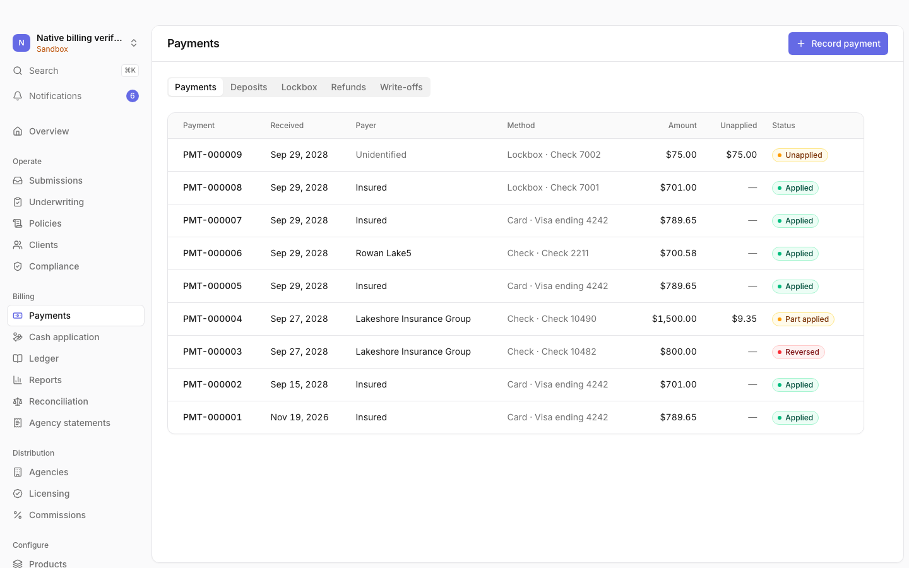
_Every payment by method, payer, amount and what's still unapplied._

## What you can do

- **Take payments** by card through your payment provider, or record checks, wires and ACH pushes received. Checks go into the day's deposit batch.
- **Import lockbox files** from your bank (a CSV with amount, date, check number and an invoice, statement, loan or policy number). Rows that don't match land as exceptions in unapplied cash until someone matches them.
- **Apply cash** to one or many invoices or to an agency's account current, unapply it, and leave the remainder as unapplied cash.
- **Reverse NSFs and chargebacks** with a reason; the receivable reopens and the policy side reacts (for example, nonpayment starts again).
- **Refund** credits by card or by check request, and **write off** small balances. Write-offs at or under a threshold post at once; larger ones need a second person to approve.
- **Book receivables on the written basis**: each issued transaction books its full premium, taxes and fees as receivable when it's issued. Installments are only the billing schedule; installment fees are booked when their installment bills.
- **Track commission payable per agency**, on the written basis or as premium is collected. Collected-basis commission accrues with each payment and gives itself back on NSFs and refunds.
- **Run reports**: trial balance, receivables aging, unapplied cash, deposits, premium payable to carriers net of commission, and taxes and fees payable by jurisdiction, each with a date and CSV export.
- **Reconcile daily**: the ledger compares every invoice with PAS's open balances and every cached balance with its journal lines, catches up any fact it missed, and repairs stragglers with adjusting entries.

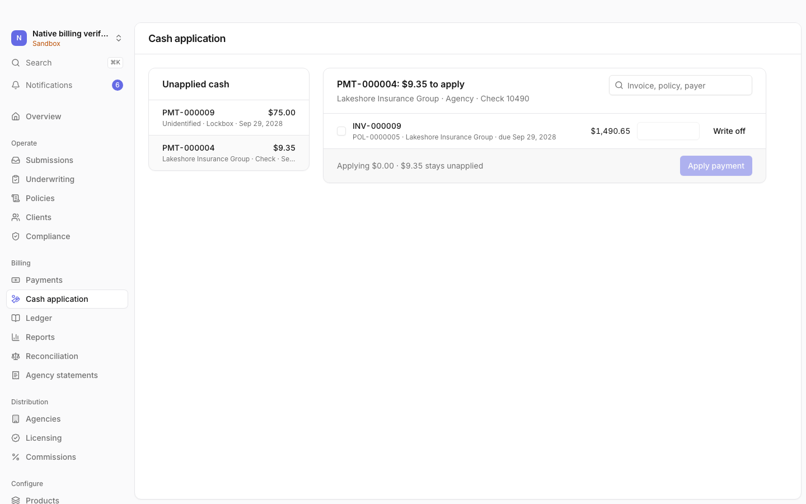
_Cash application: pick a payment, find the open items it pays, apply or leave the rest unapplied._

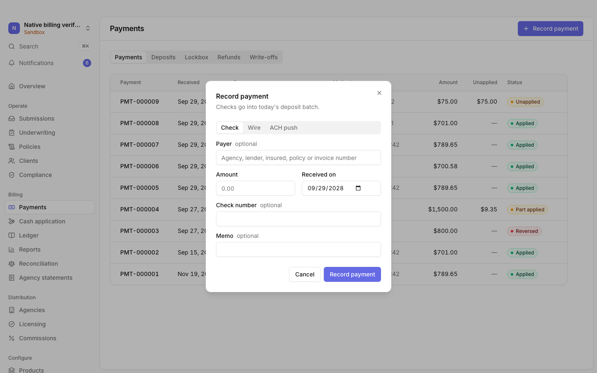
_Record checks, wires and ACH pushes; checks go into today's deposit batch._

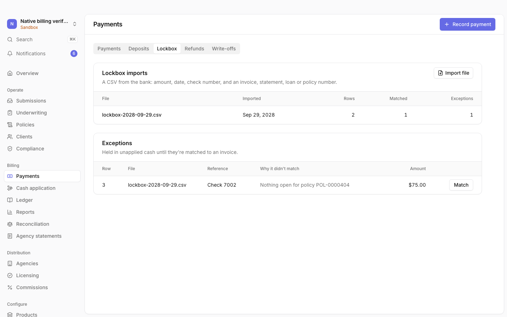
_Lockbox imports match rows to invoices; exceptions wait in unapplied cash with the reason they didn't match._

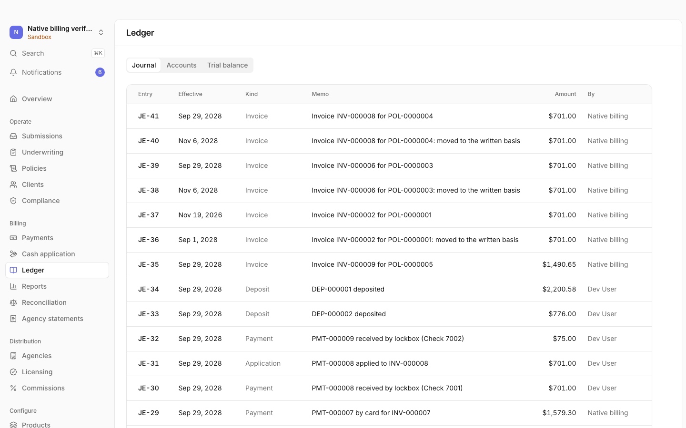
_The journal: every entry with its kind, memo, amount and who or what posted it._

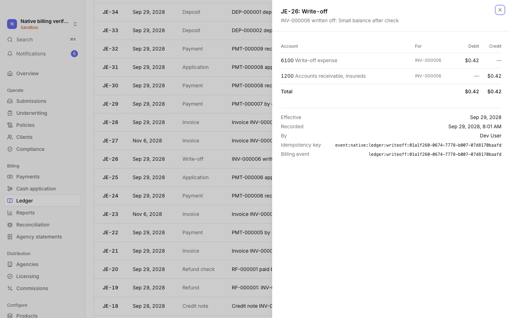
_One entry: balanced debit and credit lines, effective and recorded dates, the actor and the idempotency key._

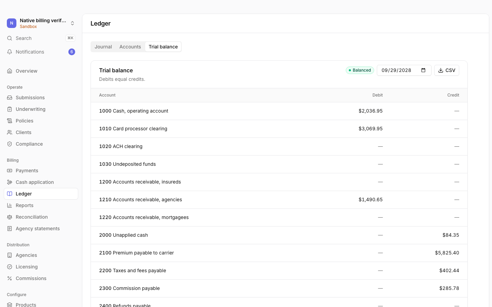
_A trial balance for any date. Debits equal credits, enforced by the database._

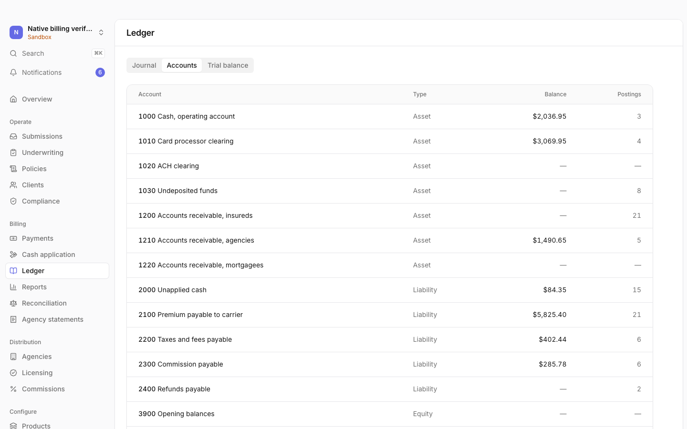
_Accounts for cash, clearing, receivables by payer type, unapplied cash, premium payable to carriers, taxes and fees payable, commission payable and refunds payable._

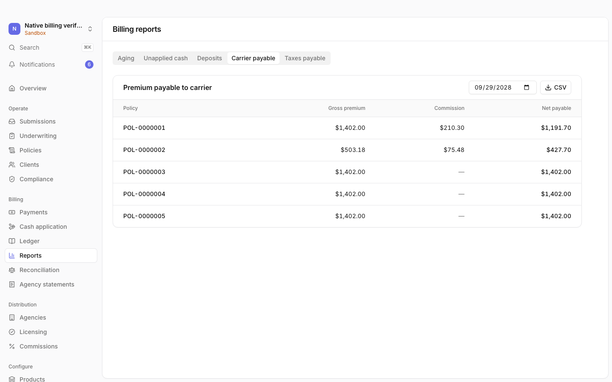
_Premium payable to the carrier, net of commission, per policy._

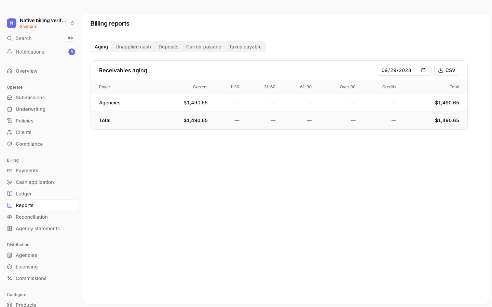
_Receivables aging by payer type and bucket._

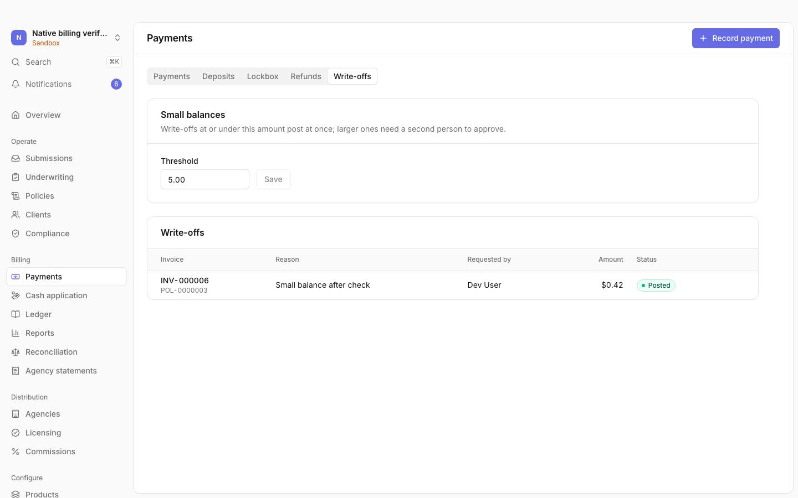
_Write-offs above the threshold need a second person's approval._

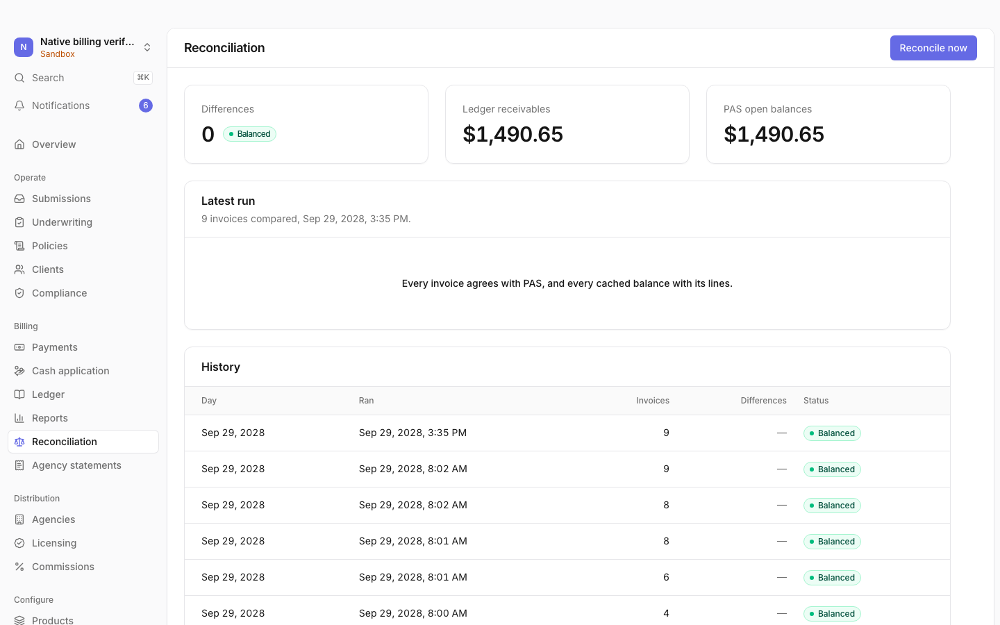
_Reconciliation runs every day and on demand. Ledger receivables and PAS open balances agree._

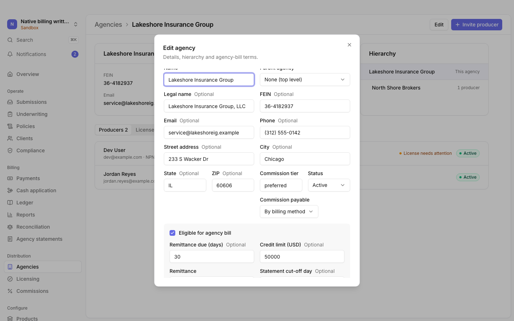
_Commission payable per agency: by billing method (the default), on written premium, or as premium is collected._

## Choose native or bring your own

In **Settings → Integrations → Billing**, choose **Native billing** (built in) or **External billing system** (your existing billing platform posts signed billing events). Both apply money to PAS invoices through the same canonical path, so cures, nonpayment cancellations and reinstatements behave identically. See [Billing](billing.md#bring-your-own-billing).

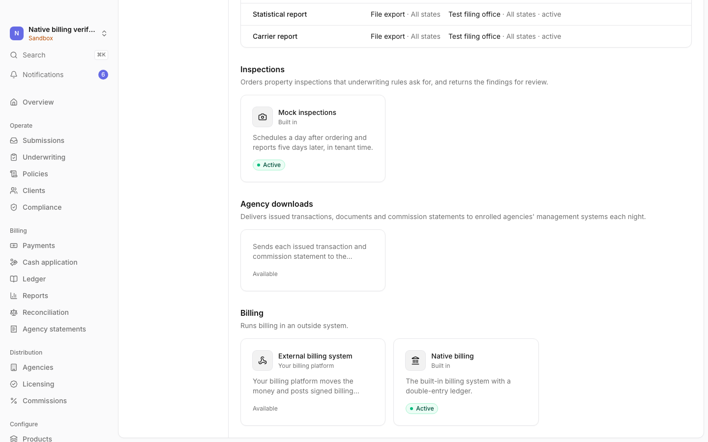
_One switch decides who moves the money._

## How it fits

- Pay plans, installments, agency bill and mortgagee bill: [Billing](billing.md)
- Commission schedules and agencies: [Distribution](distribution.md)
- Rehearse a month of payments and reconciliations: [Sandboxes and time travel](sandboxes.md)
- Workflows and the reconciliation sweep: [Technology](technology.md)

## Under the hood

- Balance is checked in the domain and again by a deferred database constraint, and a trigger makes the journal append-only. Cached balances carry versions that the daily `ledger.reconciliation` workflow verifies.
- Every command (record payment, apply, reverse, refund, write off) takes an `Idempotency-Key` and leaves an audit trail of who did what.
- The ledger is a separate bounded context. It reaches PAS only through the billing gateway and canonical billing events, the same seams an external platform uses.
- GL export with a chart-of-accounts mapping, ACH debit with NACHA returns, and BAI2 lockbox formats are on the roadmap.
