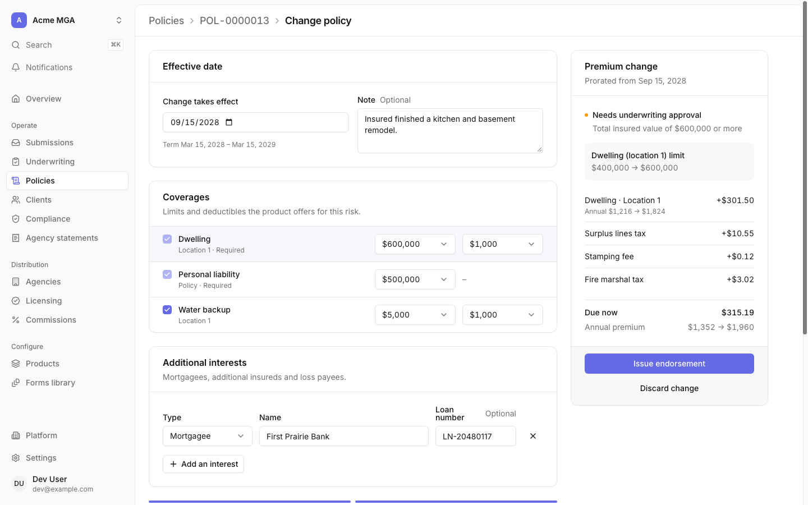
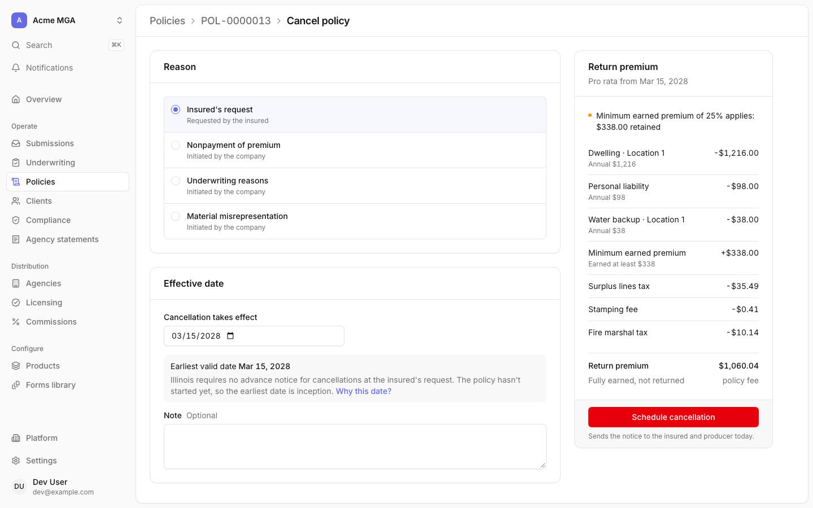
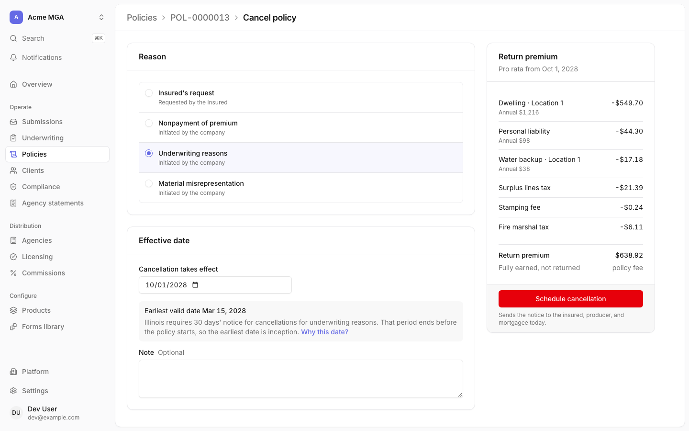
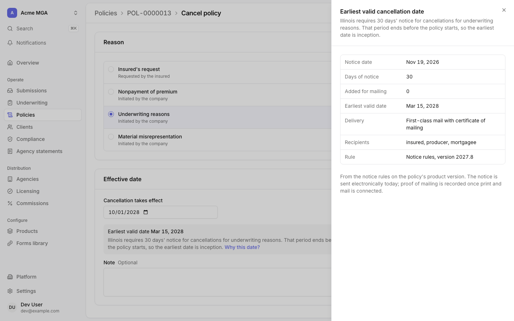
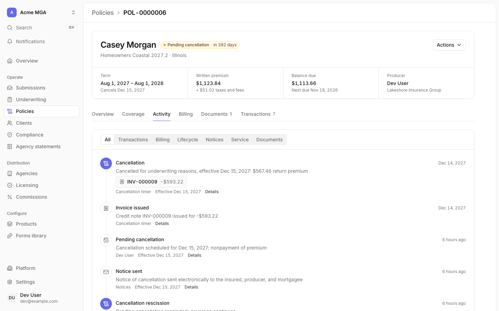
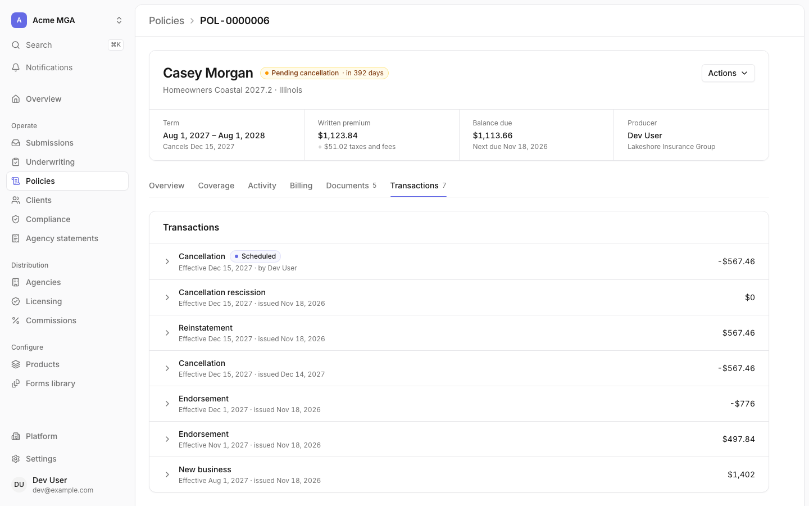
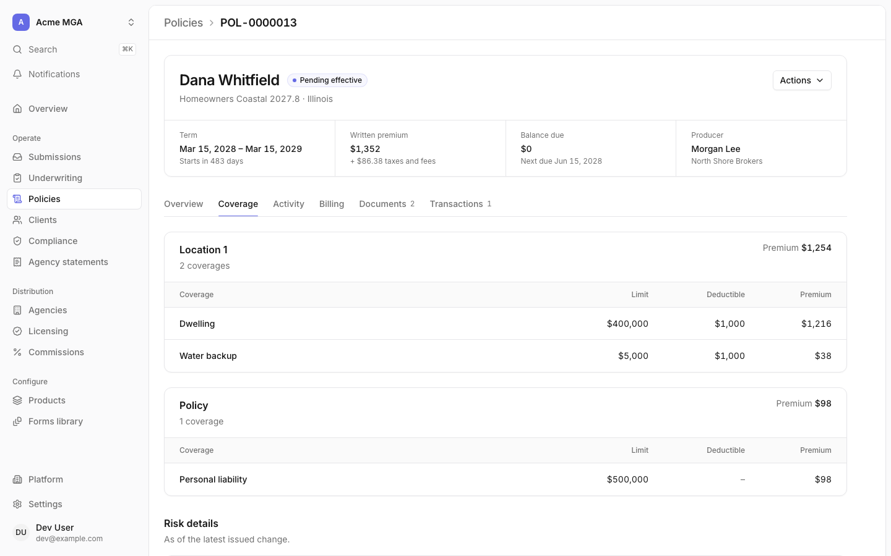

# Policy lifecycle

**Endorse, cancel, rescind and reinstate with the math and the compliance rules done for you.** Every change is a transaction with a preview, a pro rata premium delta per coverage, a document trail and a place on the policy timeline.

## The problem

Mid-term changes are where policy systems leak money and create regulatory exposure. Proration is done in spreadsheets, notice periods are remembered rather than enforced, minimum earned premium is applied inconsistently, and nobody can reconstruct what a policy looked like on a given date.

## How it works

The policy page is the home for a term: status, premium, balance due, next dates, coverages, parties, documents, billing and the full timeline. From **Actions** you start an endorsement or a cancellation.

**Endorsements** re-rate the full term with the release the policy was bound under. The platform computes the pro rata change per coverage, levies taxes on the transaction premium, and shows a diff of what changed. If referral rules fire, the endorsement waits for underwriting approval.

**Cancellations** take a reason from the product's catalog. Notice rules compute the earliest legally valid effective date for that reason, initiator and policy age, and refuse an earlier one. The preview shows the return premium per coverage, minimum earned premium and fully earned fees.

_An endorsement preview: what changed, the prorated delta per coverage and tax, and the referral it triggers._

## What you can do

- **Endorse** endorsable risk fields, coverages, limits and deductibles, the mailing address and additional interests, effective any date in the term.
- **See the premium change before issuing**, prorated from the effective date, with annual before-and-after figures.
- **Route to underwriting** when referral rules fire on the changed risk.
- **Cancel with the right date**: earliest valid date from notice rules, with a "Why this date?" explanation of notice days, mailing days, delivery method and recipients.
- **Apply minimum earned premium and fully earned fees** per product and jurisdiction, shown as a separate line on the credit note.
- **Schedule cancellations** for a future date; the policy shows "Pending cancellation" with a countdown and the notice goes to the insured, producer and mortgagee.
- **Rescind a pending cancellation**, such as a cured nonpayment, and **reinstate** with or without a lapse inside the product's reinstatement window.
- **Read the timeline**: transactions, billing, lifecycle, notices, service requests and documents, each linked to its invoice or credit note.

_Insured-requested cancellation: the earliest valid date, pro rata return and the 25% minimum earned premium retained._

_Underwriting cancellation: Illinois requires 30 days' notice; return premium is pro rata from the chosen date._

_"Why this date?" shows the inputs, the delivery method and the version of the notice rules that decided it._

_One append-only timeline per policy, filterable by transactions, billing, lifecycle, notices, service and documents._

_Issued transactions are never edited. Corrections are new transactions._

_Coverages and premium per location as of the latest issued change._

## Why it matters

- **No more proration spreadsheets.** Pro rata by day, per coverage, with configured rounding, the same way every time.
- **Cancellations that hold up.** The system refuses dates that violate the state's notice rules and records exactly which rule version applied.
- **A policy history you can defend.** Every transaction materializes a term version snapshot, and nothing issued is ever mutated.

## How it fits

- Nonpayment cancellations, notices and proof of mailing: [Billing](billing.md)
- Notice rules and cancellation terms are decision tables: [Rules and underwriting workbench](underwriting.md)
- Endorsement and cancellation transactions on surplus lines policies create filings: [Surplus lines and compliance](compliance.md)
- Rehearse a cancellation from notice to effective date: [Sandboxes and time travel](sandboxes.md)

## Under the hood

- Policy terms, transactions and term versions live in one aggregate. Issued rows are immutable in Postgres.
- Scheduled cancellations run on a `policy.cancellation` workflow that sleeps until the effective date, then re-checks the policy before acting. A notice without proof of mailing holds the cancellation and is checked again daily.
- Effective dates are calendar dates interpreted at the jurisdiction's inception time (12:01 a.m. local standard time); timestamps are instants. Out-of-sequence endorsements, short-rate cancellation tables and rescinding an already-effective cancellation are on the roadmap.
