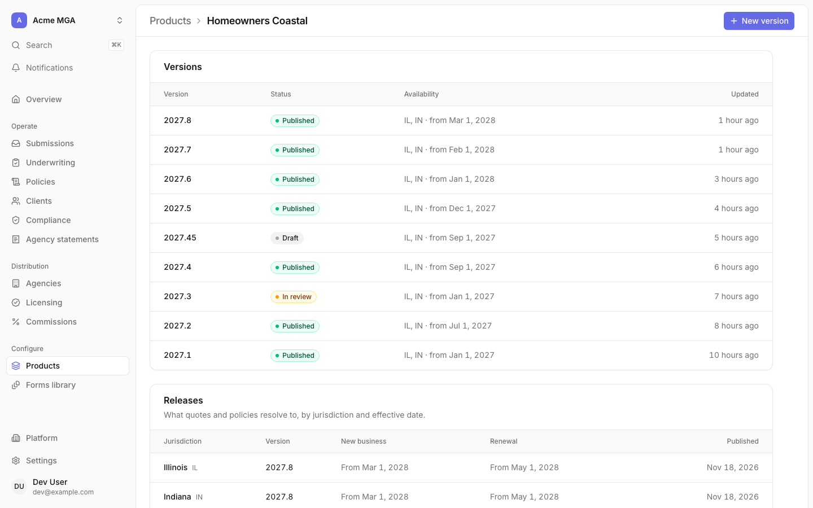
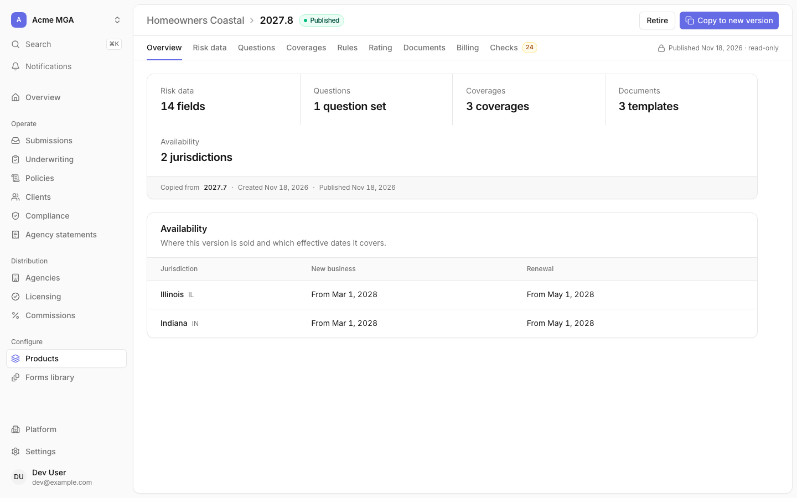
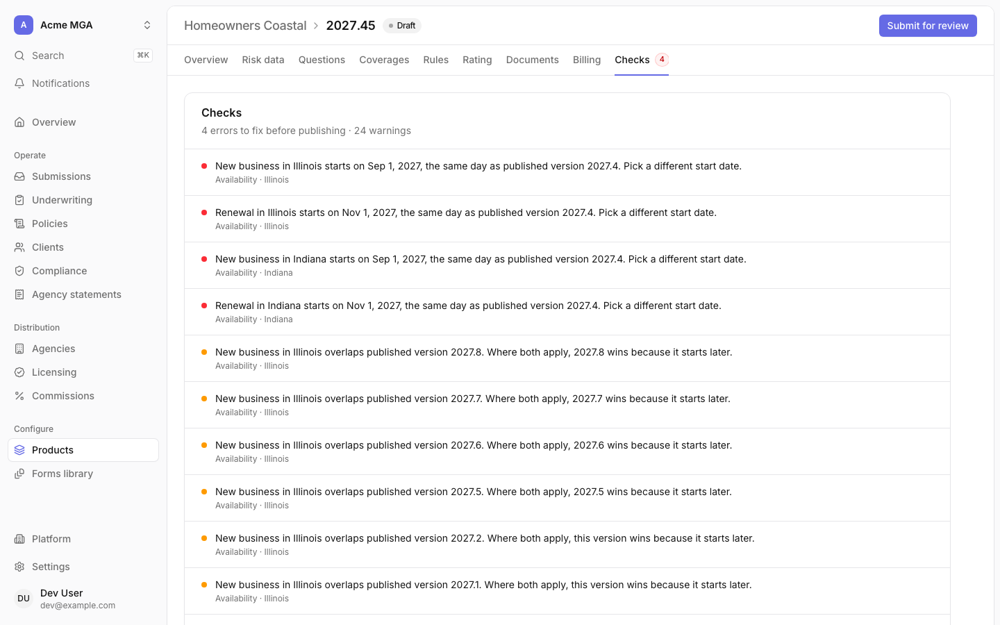
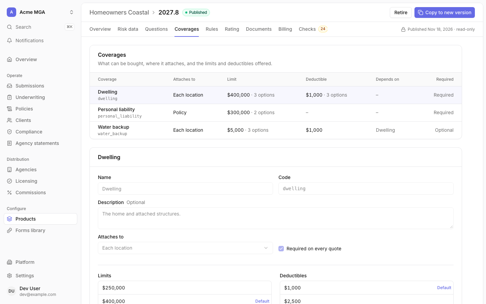

# Product builder and versioning

**Build a product once, then change it safely for years.** Versions per state, effective dates for new business and renewal, immutable releases and publish checks that catch mistakes before an agent ever sees them.

## The problem

In most policy systems a rate change is a project. Product logic lives in code or in a vendor's configuration tool that only consultants understand, nobody can say exactly which rules priced a given policy, and a mistake in one state's filing quietly reaches every state.

## How it works

A **product** is the long-lived identity ("Homeowners Coastal"). A **version** ("2027.8") holds everything that defines it: risk data, questions, coverages, rules, rating, pay plans and documents. Each version lists the jurisdictions it's sold in, with separate effective dates for new business and renewal.

When you publish, the platform resolves a **release** per jurisdiction: an immutable, content-hashed manifest of every artifact the version uses. New quotes resolve the release in force for the risk state and effective date. Quotes, policy terms and transactions keep that release forever.

_Every version with its status and states, and the releases that quotes resolve to by jurisdiction and effective date._

## What you can do

- **Version per state with effective dates.** Publish 2027.8 for Illinois and Indiana new business from March 1 and renewals from May 1, while earlier versions keep serving earlier dates.
- **Copy to a new version** from any published version and change only what's different. Published versions are read-only.
- **Move through draft, in review and published**, with retirement for versions you no longer sell.
- **Define coverages** with where they attach (policy or each location), limit and deductible options with defaults, dependencies and whether they're required.
- **Configure lifecycle behavior** per version: cancellation reasons, notice rules, minimum earned premium, rounding, billing methods and pay plans.
- **Publish only when checks pass.** Static checks verify every reference between questions, rules, rating, documents and the risk data. Golden cases must pass. Overlapping effective dates are flagged with an explanation of which version wins.

_The version overview: what it contains and where and when it's sold._

_Checks run continuously on drafts. Errors block publishing, warnings explain overlaps with versions already in market._

_Coverages, where they attach, and the limit and deductible options agents can choose from._

## Why it matters

- **Rate changes never disturb in-force policies.** Endorsements and cancellations re-rate with the release the term was bound under.
- **Every premium is reproducible.** The release pins the exact rater, tables and rules used, so a regulator's question about a 2027 policy has a precise answer.
- **Product teams own the product.** Business users author versions; engineering isn't in the loop for a new state or a new deductible option.

## How it fits

- Questions and the risk data dictionary: [Forms and intake](forms-and-intake.md)
- Rate tables, algorithms and spreadsheet raters: [Rating](rating.md)
- Eligibility, referral, tax and notice rules: [Rules and underwriting workbench](underwriting.md)
- Pay plans and billing methods per version: [Billing](billing.md)
- Templates and form schedules per version: [Documents](documents.md)
- Trying a new version against a year of policy activity: [Sandboxes and time travel](sandboxes.md)

## Under the hood

- Releases are stored once and protected by database triggers, so a published manifest can't be edited even by a bug. Because they're immutable, compiled rules and raters are cached in process by release ID with no invalidation protocol.
- Resolution rules are explicit: new business uses the release whose new business window covers the risk state and effective date (latest start wins); mid-term transactions use the term's pinned release.
- Configuration is typed JSON with static checks, which also makes AI-drafted changes verifiable mechanically before a person reviews them.
