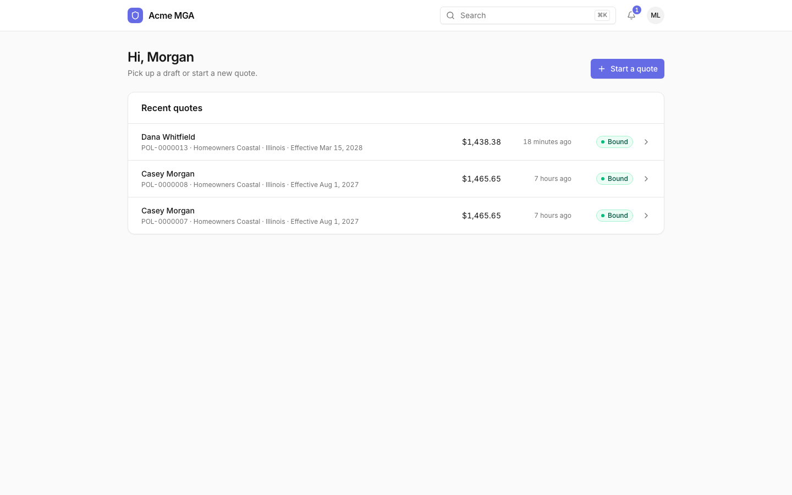
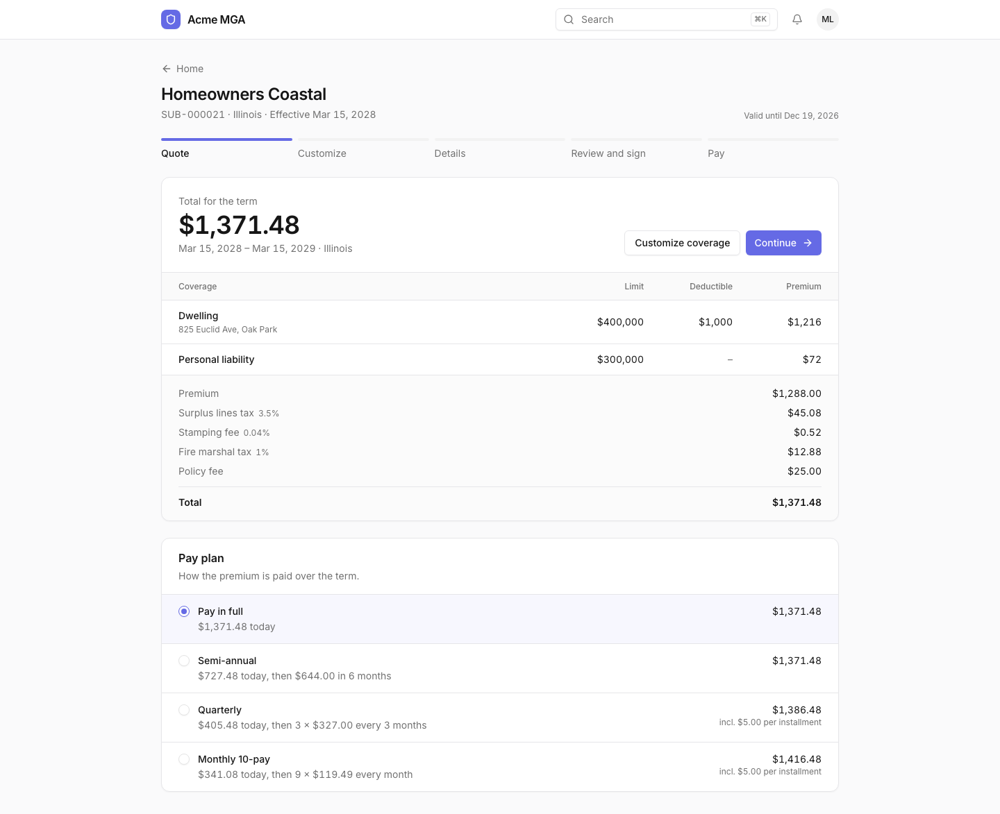
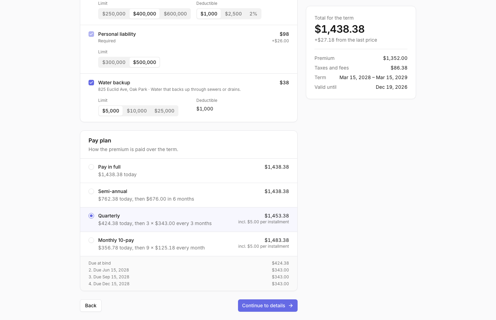
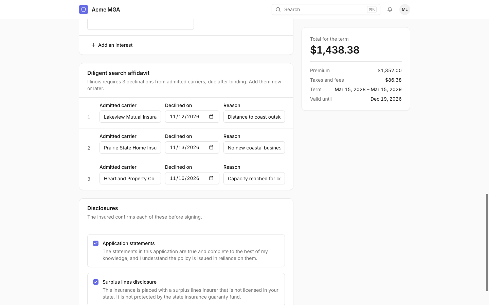
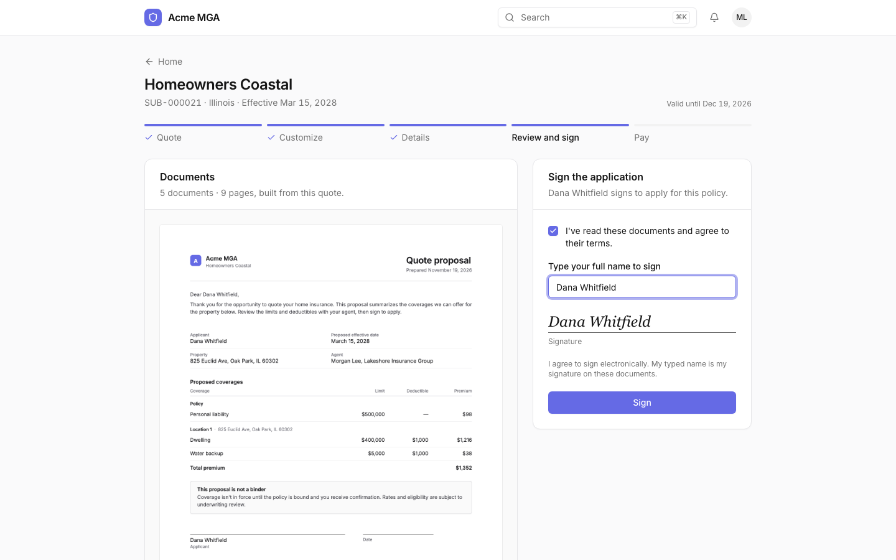
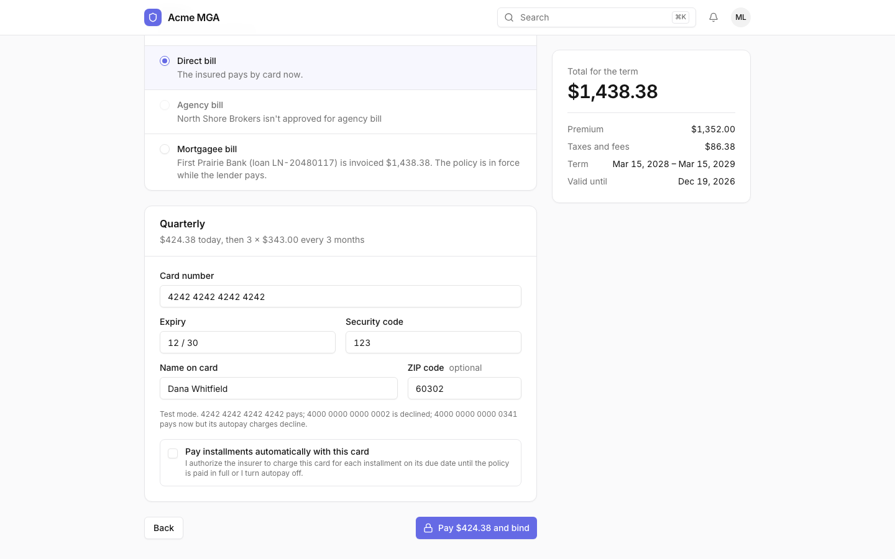
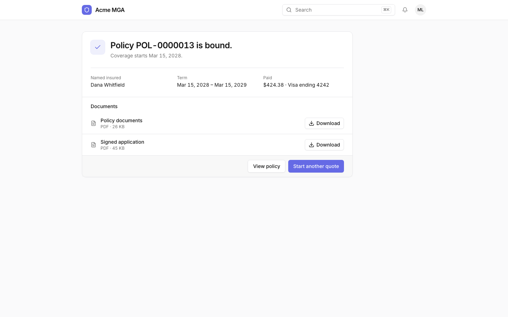
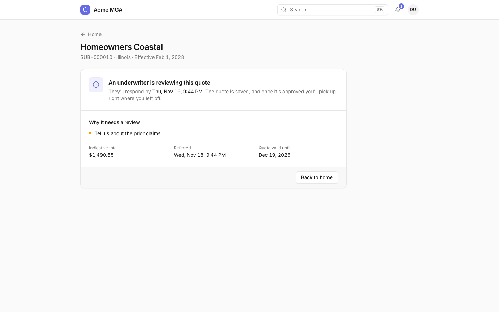
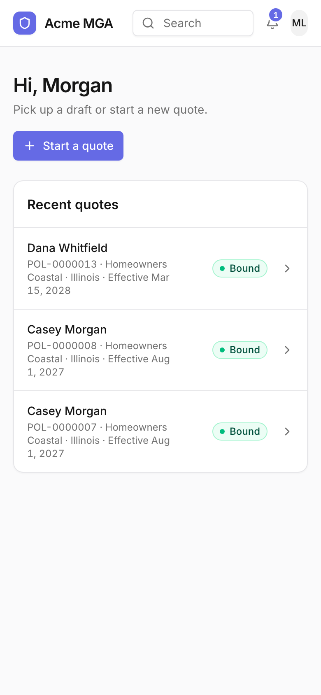
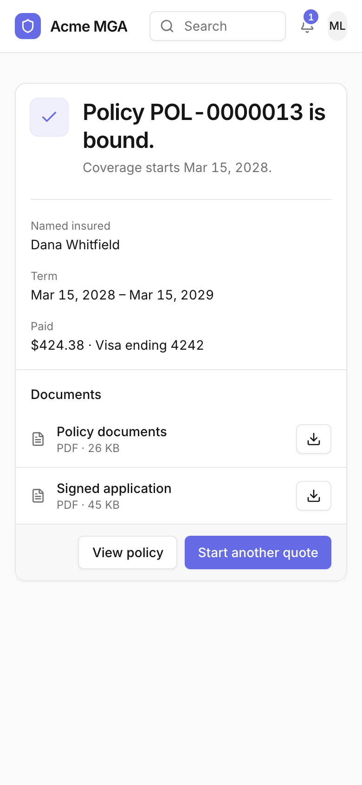

# Quote to bind

**One session from first question to bound policy, with underwriting as the only interruption.** A branded agent app that quotes, customizes, captures legal and surplus lines details, collects a signature and payment, and binds.

## The problem

Agents bounce between a rater, an application PDF, an e-signature tool and a payment link, then wait for someone to key the policy. Every hand-off loses time and data, and surplus lines requirements like diligent search are tracked in email.

## How it works

The agent picks the product, the state and the effective date. The app resolves the release in force and walks five steps:

1. **Quote**: answer the questions; rules and rating run and return a premium with taxes, fees and pay plans, or a referral with the reason.
2. **Customize**: change limits, deductibles, optional coverages and the pay plan, with live re-rating.
3. **Details**: named insureds, mailing address, home state, producer, additional interests such as mortgagees, the diligent search affidavit when required, and disclosures.
4. **Review and sign**: the actual documents built from this quote, signed with an embedded click-to-sign step.
5. **Pay**: choose direct, agency or mortgagee bill, pay the down payment by card and opt into autopay. Payment binds the policy.

_The agent's home: drafts and recent quotes, and one button to start._

_A quote in under a second, with every tax and fee itemized and each eligible pay plan's schedule._

## What you can do

- **Start a quote** for any product available in the state on the effective date, with the release pinned automatically.
- **Customize within the rules**: limit and deductible options, optional coverages and dependencies come from the product version. The premium and the difference from the last price update as you change them.
- **Compare pay plans** with the exact amount due today and each installment.
- **Capture surplus lines requirements**: the home state that decides which state's taxes and filings apply, admitted declinations for the diligent search affidavit when the state requires them, and the non-admitted disclosure.
- **Add mortgagees and other interests** that receive the policy and can be billed.
- **Review the real documents** (quote proposal, application, disclosures) before signing.
- **Bind with payment** by card, with consent recorded for autopay, or bind on agency or mortgagee bill without collecting.
- **Pause for underwriting**: a referral tells the agent who is reviewing and by when, and the quote resumes where it left off once approved.
- **Check the producer's license** at bind for the risk state and effective date.

_Coverage changes re-rate live; the pay plan shows every installment date._

_Jurisdiction-driven requirements: Illinois needs three admitted declinations for a surplus lines placement._

_The insured reviews the documents generated from this quote and signs electronically._

_Direct, agency or mortgagee bill, with eligibility explained for each, and autopay consent captured at bind._

_Bound: policy number, payment confirmation and the policy documents, ready to download._

_When rules refer, the agent sees why and when to expect an answer._

  
  

_The agent app works on a phone, from quote to bound._

## How it fits

- The questions come from the product's intake form: [Forms and intake](forms-and-intake.md)
- Referrals land in the underwriting workbench: [Rules and underwriting workbench](underwriting.md)
- The pay plan and billing method set up billing: [Billing](billing.md)
- Binding a non-admitted policy creates filing obligations: [Surplus lines and compliance](compliance.md)
- License checks and producer of record: [Distribution](distribution.md)
- The named insured is invited to the portal at bind: [Client portal](client-portal.md)

## Under the hood

- Each quote runs on a `quote.journey` durable workflow: it waits for changes, waits on an underwriting decision with the quote's validity as the timeout, and expires the quote if nobody acts. The quote aggregate owns every state change; the workflow only waits and nudges.
- Binding creates the policy, term, new business transaction, term version and financial transactions in one database transaction, and emits the events that drive documents, billing, commissions and compliance through the outbox.
- E-signature and payments go through ports. Click-to-sign and test cards are built in; Stripe is in the integrations catalog.
