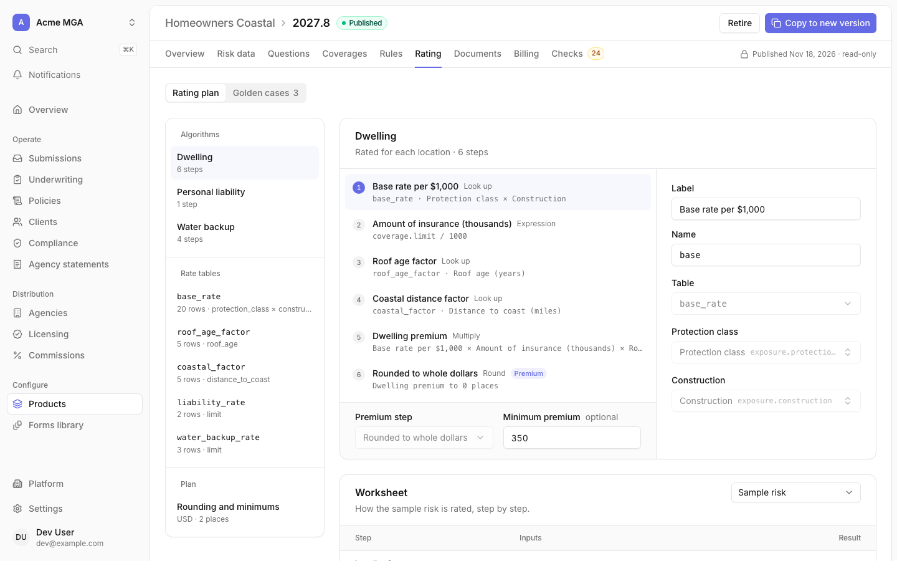
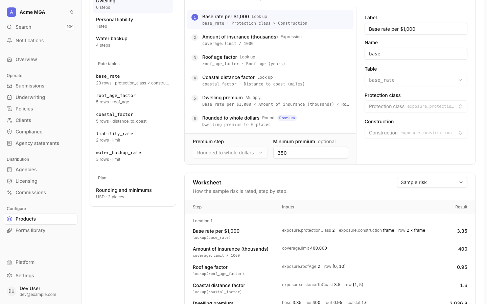
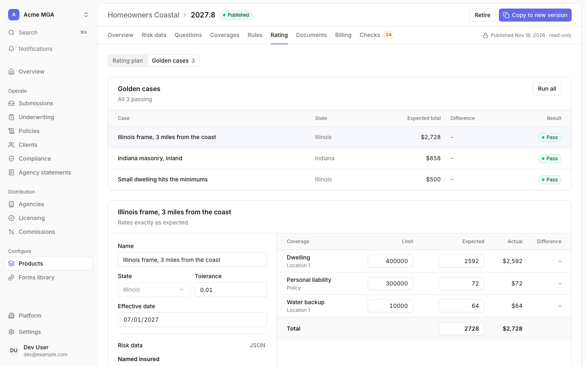

# Rating

**Price with rate tables and transparent algorithms, or keep your actuaries in Excel.** Two rating engines behind one contract, both versioned with the product, both golden-tested before anything is published.

## The problem

Rating logic is where errors cost real money. It's often buried in code nobody on the business side can read, or in a spreadsheet that gets copied into a system by hand and drifts the moment the actuary updates it. When a regulator or an underwriter asks "why is this premium $1,216?", the answer takes days.

## How it works

Each product version carries its rater. Choose either:

- **A rating plan**: rate tables (exact keys, ranges and bands, imported from CSV or edited in a grid) and an ordered algorithm per coverage, made of lookups, expressions, multiplications, minimums and explicit rounding.
- **A spreadsheet rater**: upload the actuary's `.xlsx`, map rating inputs to cells or named ranges and outputs back to coverages with a binding manifest, and the workbook runs in process.

Either way the rater prices the **full term**. The platform computes proration, endorsement deltas and return premium itself, so raters stay simple and every product prorates the same way. Taxes and fees come from rules, not the rater.

_A rating plan: algorithm steps per coverage on the left, rate tables below, and each step's configuration on the right._

## What you can do

- **Edit rate tables** in a grid or import them, with ranges and multi-key lookups.
- **Build algorithms step by step**: look up a base rate by protection class and construction, apply roof age and distance-to-coast factors, multiply by amount of insurance, round to whole dollars, apply a minimum premium.
- **See the worksheet** for any sample risk: every step with its inputs, the table row it matched and the result.
- **Upload a spreadsheet rater** and bind it to the risk data. Uploads with macros, external links or unsupported functions are rejected with a clear reason.
- **Attach golden cases** with expected premium per coverage and a tolerance. "Run all" shows pass or fail per case, and failing cases block publishing.
- **Set rounding and minimums** per plan, with currency and precision made explicit.

_The worksheet underwriters, auditors and support teams can read: every factor, every lookup, every result._

_Golden cases are tests your product team owns. A rate change that breaks one can't be published._

## Why it matters

- **Explainable premium.** The worksheet answers "why this price" in seconds, for underwriters, agents and regulators.
- **Actuaries keep their tools.** A spreadsheet rater goes from workbook to production with versioning, tests and an audit trail, without retyping formulas.
- **Consistent proration.** Because raters only price full terms, pro rata, minimum earned premium and out-of-sequence handling live in one tested place.

## How it fits

- Rating inputs come from the risk data dictionary: [Forms and intake](forms-and-intake.md)
- Surplus lines taxes, stamping fees and policy fees come from rules: [Rules and underwriting workbench](underwriting.md)
- Endorsement deltas and return premium use the same rater: [Policy lifecycle](policy-lifecycle.md)
- Raters ship inside a product version and release: [Product builder and versioning](product-builder.md)

## Under the hood

- Both engines implement one `Rater` port. Plans compile once per immutable version; every step emits a trace line that becomes the worksheet.
- The spreadsheet engine is our own, built on MIT-licensed components (workbook parsing, formula parsing and a large function library) with Excel-correct rounding. Test it against your own workbooks before relying on it for a filed rater.
- Money is decimal end to end, never floating point, and rounding is a configured step rather than an accident.
