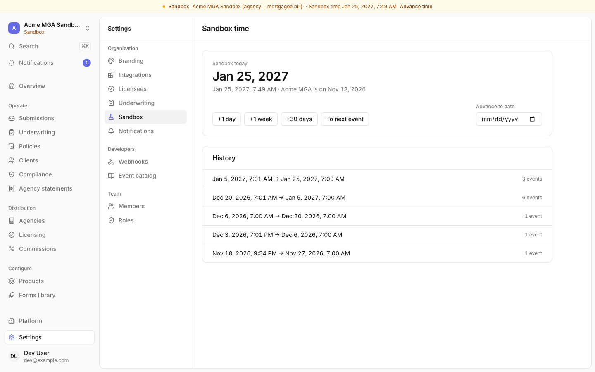
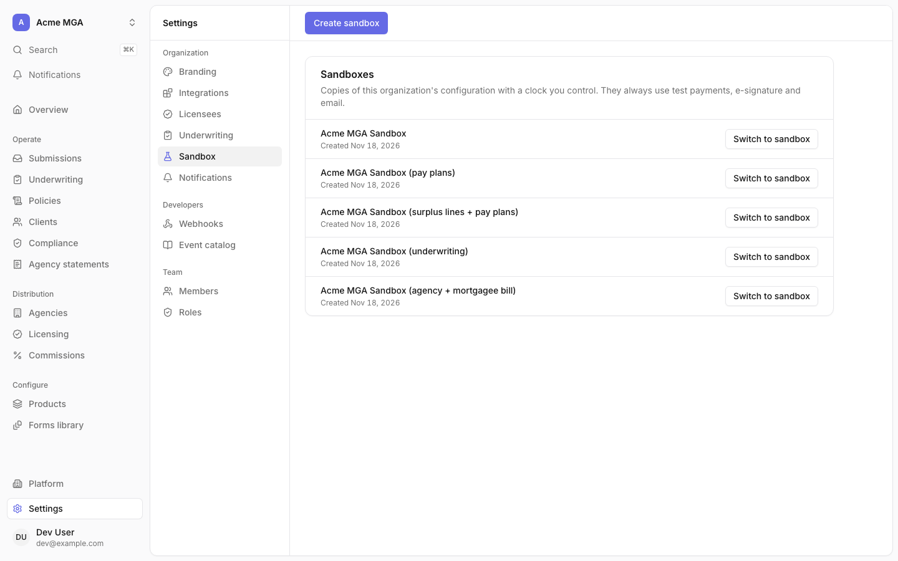
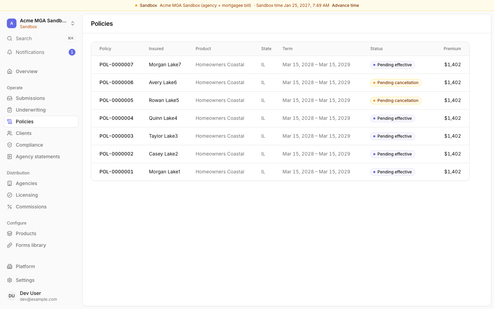

# Sandboxes and time travel

**Test a product's whole year before an insured ever sees it.** Sandboxes copy your configuration, run against test providers and have their own clock, so you can advance months in seconds and watch every timer fire.

## The problem

Insurance runs on dates: effective dates, installment due dates, grace periods, notice periods, filing deadlines. Most systems can't test any of that without waiting for the calendar or hand-editing the database, so date-driven bugs are found by insureds and regulators.

## How it works

A **sandbox** is a separate tenant linked to your production tenant. Creating one copies your products, versions, rules, raters, documents and distribution network. Sandboxes always use test payments, test e-signature, test email and test filing offices, never your live providers.

Each sandbox has a **clock you control**. Advance it by a day, a week, 30 days, to the next scheduled event, or to any date. Every durable workflow timer that would have come due in that window fires in order: policies become effective, installments open and go past due, autopay retries, notices go out, cancellations take effect, obligations escalate.

_Advance the sandbox clock and see how many events each jump fired._

## What you can do

- **Create sandboxes** for a product launch, a rate change, a new billing method or training.
- **Switch between sandbox and production** from the organization picker; a banner always shows you're in a sandbox and its current date.
- **Advance time** by a day, a week, 30 days, to the next event, or to a chosen date, and see the history of every jump.
- **Rehearse whole lifecycles**: bind on agency bill and watch the account current cut, age and suspend; let a mortgagee ignore its invoice and watch the switch to direct bill; let an installment lapse and watch nonpayment run to cancellation.
- **Simulate billing events** such as payments, reversals and delinquency without a billing platform.
- **See every timer** on Settings → Developers → Workflows: what each run is waiting on and when it wakes in sandbox time, with wake now, retry and cancel. See [Technology](technology.md#durable-workflows-built-for-an-industry-that-runs-on-waiting).
- **Give underwriters and agents a safe place** to practice with the same apps and logins.

_Several sandboxes per tenant, each with its own data and clock._

_Inside a sandbox the banner shows the sandbox date; everything else is the product you'll run in production._

## How it fits

- Watch installments, autopay and nonpayment run: [Billing](billing.md)
- Watch cancellations wait for their effective date: [Policy lifecycle](policy-lifecycle.md)
- Watch filings fall due and escalate: [Surplus lines and compliance](compliance.md)
- How the clock reaches every timer: [Technology](technology.md)

## Under the hood

- Domain and application code never read the system clock; they ask a `Clock` port that applies the tenant's offset. Production tenants always have an offset of zero.
- Workflow wake times are stored in **tenant time**. A timer fires when wall-clock time plus the tenant's offset reaches it, so advancing a sandbox pulls its timers earlier without touching other tenants.
- Provider routing forces test mode or the built-in fake for every sandbox, so a sandbox can't charge a real card or mail a real letter. Promoting a release from sandbox to production and refreshing a sandbox's configuration from production are on the roadmap.
