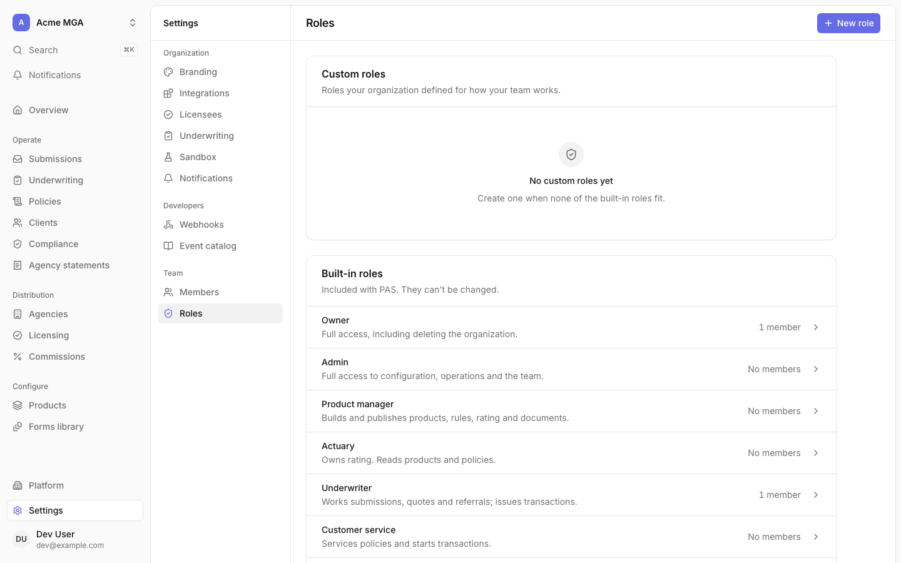
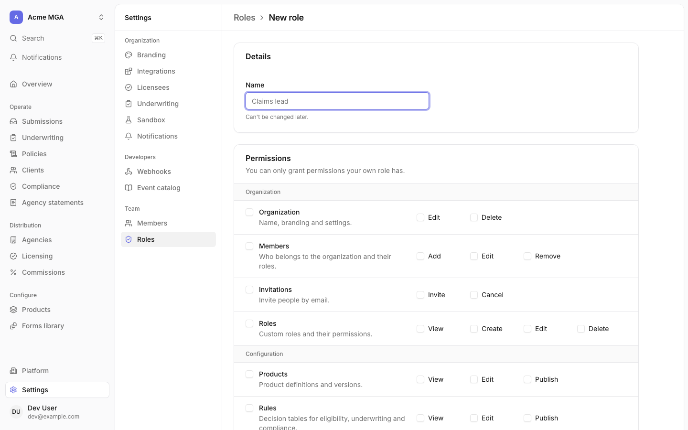
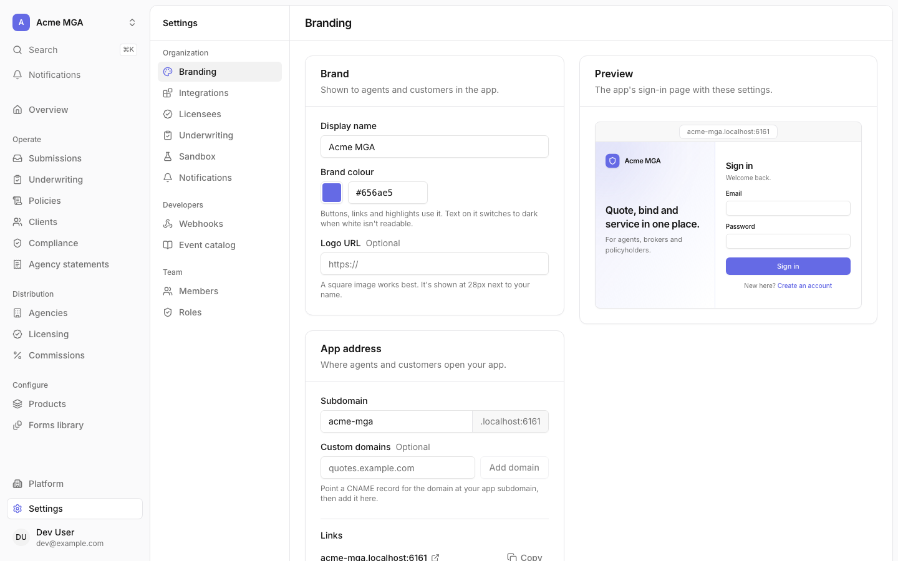
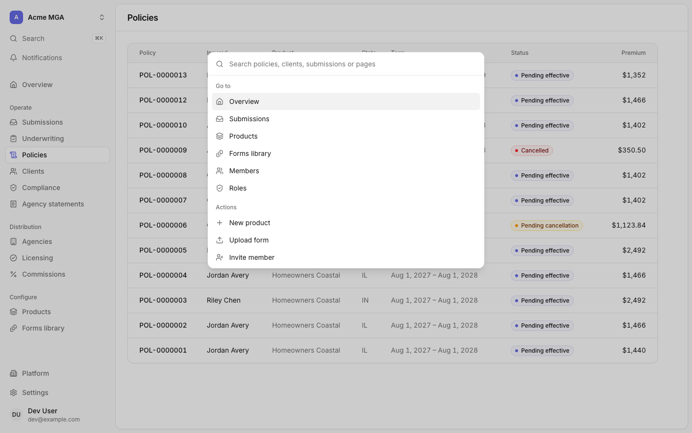

# Security and multi-tenancy

**Every tenant isolated at every layer, every user limited to what their role allows, and a history that can't be rewritten.**

## The problem

A policy system holds personal data, money and regulated records for many parties at once: the MGA, its carriers, hundreds of agencies and thousands of insureds. Isolation that depends on every developer remembering a `WHERE` clause, roles that can't express "this agency's book only", and records that can be edited after the fact are all audit findings waiting to happen.

## How it works

**A tenant is an organization**: an MGA, a program administrator or a carrier, with its own products, policies, team, branding and integrations. Every tenant-owned table carries the tenant, every repository method requires a tenant context, and Postgres **row-level security** enforces the same boundary underneath the application.

**Roles decide what people can do; scope decides what they can see.** Built-in roles cover owners, admins, product managers, actuaries, underwriters, customer service, agency admins, agents and customers, and tenants can add custom roles. On top of that, every list and search is scoped to the user's reach: staff see the tenant's book, agency admins their agencies and sub-agencies, agents their own production and clients only policies where they're a party.

_Built-in roles with what each can do, and custom roles your organization defines._

## What you can do

- **Create custom roles** by choosing permissions per resource (organization, members, products, rules, rating, policies, billing and more). You can only grant permissions your own role has.
- **Invite members** to your organization with a role, and switch between organizations and sandboxes you belong to.
- **Gate every screen and action** by permission in the admin, so a CSR never sees the publish button and an actuary owns rating.
- **Brand the agent app and portal** with your name, colour and logo, on your subdomain or your own custom domain.
- **Find anything fast** with ⌘K search across clients, policy, quote and invoice numbers and addresses, always limited to what the user can see.
- **Trace every change**: policy timelines and underwriting histories are append-only and record who acted, issued transactions are never edited, and published product configuration can't be changed.

_Custom roles are built from the same permission statements the built-in roles use._

_Tenant branding, subdomain and custom domains, previewed live._

_Keyboard-first navigation and search, scoped to the user's book._

## How it fits

- Agency and producer book scoping: [Distribution](distribution.md)
- Client access derived from policy parties: [Client portal](client-portal.md)
- Encrypted provider credentials: [Integrations, events and webhooks](integrations.md)
- Architecture and deployment details: [Technology](technology.md)

## Under the hood

- **Defense in depth.** The unit of work sets the tenant on each database transaction, and RLS policies on every tenant table filter on it. Deployed API and worker processes connect as a non-owner role so RLS binds; migrations run as the owner.
- **Tenant-leading keys.** Composite indexes lead with the tenant, which keeps queries fast and leaves a path to move a large tenant to its own database by routing on tenant ID.
- **Immutability in the database.** Published releases and issued transactions are protected by database rules, not only by application code.
- **Secrets** for providers are encrypted per tenant with AES-256-GCM and a rotating keyring; they're entered in the admin, never in environment files.
- **Authentication** uses Better Auth: email and password for staff and agents, one-time email codes for clients, organizations as tenants and dynamic access control for custom roles. SSO, audited platform impersonation and a general audit log with before-and-after diffs are on the roadmap.
