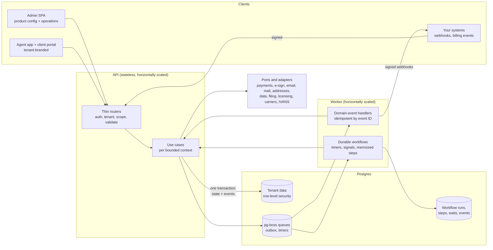
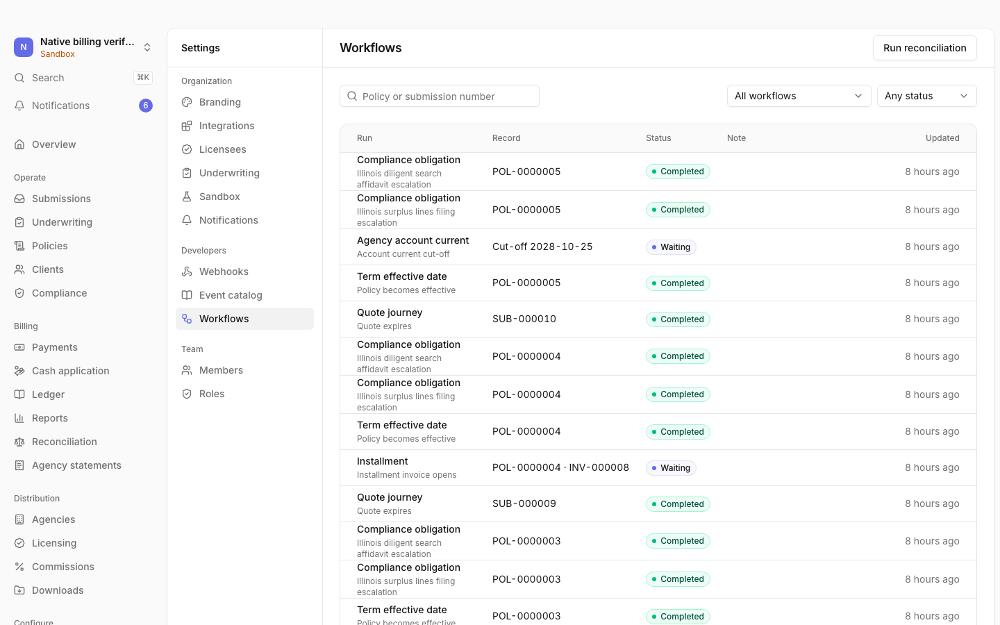
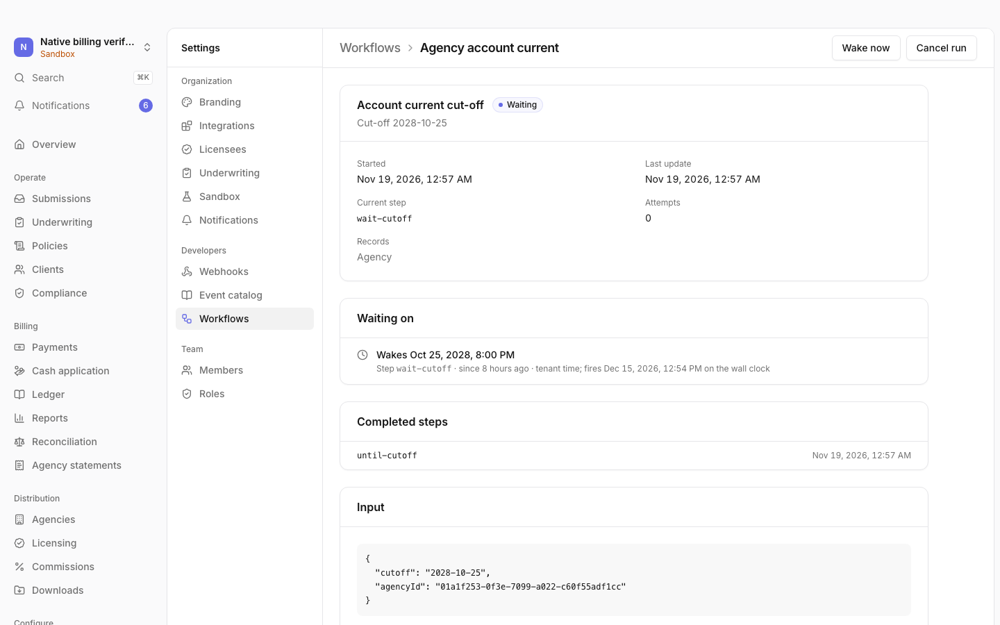
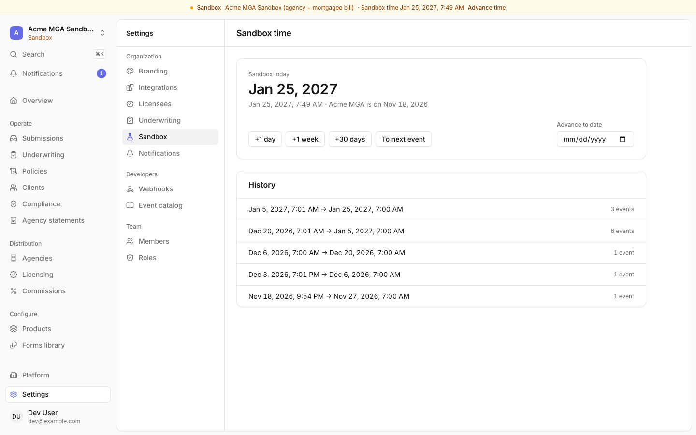
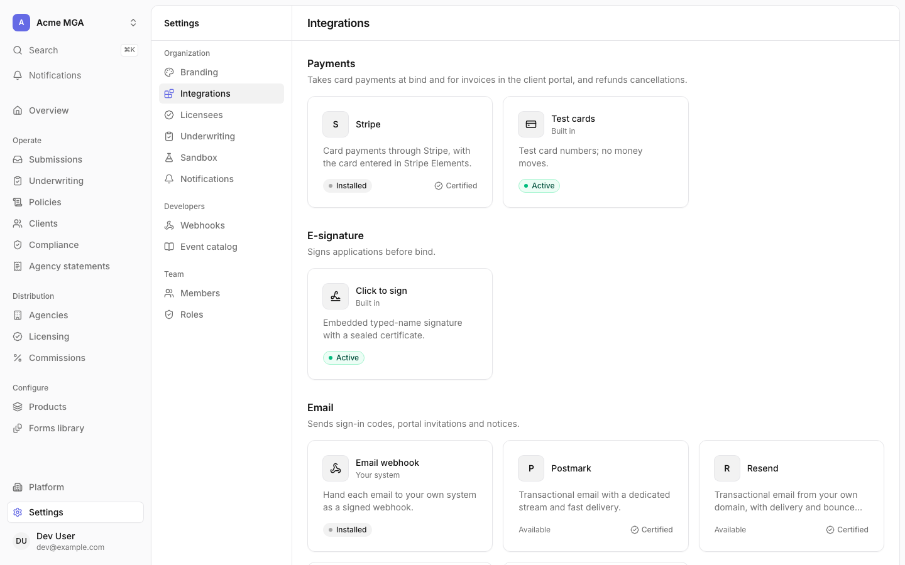
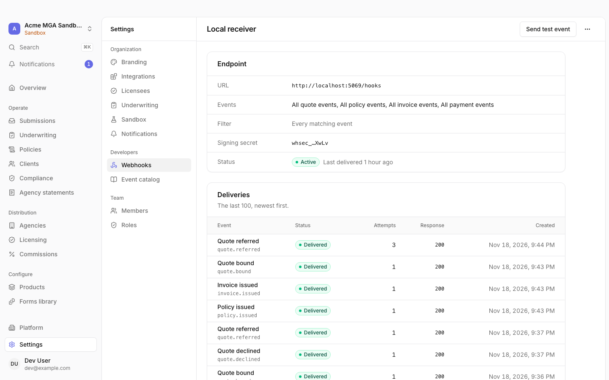

# Technology

**For CTOs and heads of engineering: how PAS is built, why it stays correct when insurance does what insurance does (wait), and how it grows with your team.**

PAS is a TypeScript monorepo on Node with Postgres as the only required infrastructure besides object storage. A stateless API serves the admin, the agent app and the client portal; a separate worker runs domain-event handlers and durable workflows. Every external system sits behind a port with a built-in test adapter.

## Durable workflows: built for an industry that runs on waiting

Insurance is mostly waiting for the right date or the right answer: effective dates, installment due dates, grace periods, notice periods and the earliest valid cancellation date, proof-of-mailing gates, filing deadlines, subjectivity due dates, inspection turnaround, an underwriter's reply, an agent's reply, a lender's check. Most platforms handle this with cron jobs that scan tables, which are hard to test, easy to double-fire and invisible when they silently stop.

PAS runs these processes on its own **durable workflow engine on Postgres**, built on pg-boss.

**How it works**

- **One run per business process.** A workflow run is started for a specific aggregate and purpose (this installment, this cancellation, this obligation) with an idempotency key, so starting it twice returns the existing run.
- **Memoized steps.** Each `step.run` result is stored. After a crash, restart or deploy the handler replays from the top and skips every step that already completed, so a charge, a notice or a filing is never repeated.
- **Timers are scheduled jobs, not sleeping processes.** `step.delay` records a wake time and suspends the run. Nothing is held in memory, so a run can wait a year across any number of deploys.
- **Signals for the outside world.** `step.waitFor` pauses until an event arrives (an underwriting decision, a carrier answer), with a timeout. Signals are persisted, so one that arrives before the run is waiting isn't lost.
- **One execution at a time per run**, enforced by the queue, so concurrent workers can't race on the same process.
- **Tenant time.** Wake times are stored in the tenant's time. Production tenants run on the real clock; a sandbox with an offset fires its timers earlier, which is how a sandbox fast-forwards months in seconds.
- **Re-check on wake.** Workflows coordinate; aggregates decide. Every step that acts re-reads current state through a use case first: a cancellation step checks the policy is still pending cancellation, an installment step checks the invoice is still unpaid. A stale timer can never take a wrong action.

**Real workflows in the product today**

| Workflow                    | What it does                                                                                                                           |
| --------------------------- | -------------------------------------------------------------------------------------------------------------------------------------- |
| `quote.journey`             | Waits on quote changes; on referral waits for the underwriting decision with the quote's validity as timeout; expires the quote        |
| `policy.term`               | Moves the term from pending effective to in force on its effective date                                                                |
| `policy.cancellation`       | Sleeps until the cancellation date, re-checks, cancels; holds without proof of mailing and re-checks daily                             |
| `billing.installment`       | Opens the invoice, charges autopay, marks past due, retries, sends the reminder, waits out grace, starts nonpayment                    |
| `billing.agency_account`    | Cuts the agency's account current after cut-off, then ages it: reminder, suspension, restoration when current                          |
| `billing.mortgagee_bill`    | Mails the lender packet with proof, follows up, offers direct bill, then starts nonpayment notices to insured and mortgagee            |
| `compliance.obligation`     | Reminder before the due date, overdue at the deadline, escalation after it; stops once the obligation is met                           |
| `compliance.filing`         | Polls an API filing channel until the filing is accepted or rejected                                                                   |
| `underwriting.subjectivity` | Waits for a post-bind subjectivity's due date and raises it if still open                                                              |
| `underwriting.inspection`   | Orders the inspection and checks back when the vendor expects a change                                                                 |
| `carrier.flow`              | Runs one carrier capability as steps: requests, polling, waiting for the carrier's signed callback, branching, compensation on failure |
| `carrier.feed`              | Sends a carrier's scheduled file feed (for example a monthly bordereau) for carriers without an API                                    |
| `ledger.reconciliation`     | Daily: compares ledger receivables with PAS open balances, verifies cached balances, catches up missed facts                           |
| `agency_downloads.nightly`  | Waits for the tenant's batch time, delivers each enrolled agency's file, books the next night                                          |

**Seeing and steering runs: Settings → Developers → Workflows**

Every run is visible to tenant admins. The Workflows page lists runs by workflow and status with the record each one concerns (policy, invoice, submission, agency), searchable by policy or submission number. A run's page shows its completed steps with timestamps, its input and, for a waiting run, **what it's waiting on**: the timer and when it wakes, in tenant time and wall-clock time, or the signal it expects. Admins can **retry** a failed run, **cancel** a run that no longer applies, or **wake now** to fire a timer early.

_Every durable run in the tenant, filterable by workflow and status and searchable by policy or submission number._

_A waiting run shows exactly what it's waiting for and when it will wake, with wake now and cancel._

**Keeping runs honest**

- **Lifecycle cleanup.** When a cancellation is issued, the runs it made pointless are cancelled with a reason: the term's activation timer if it never took effect, installments and lender invoices the cancellation credit settled, open inspections and subjectivities. When a pending cancellation is rescinded, its cancellation run is cancelled. Compliance runs are deliberately left alone, because filings stay owed after a cancellation. Thanks to the re-check rule, any run that slips through still does nothing when it wakes.
- **Reconciliation sweep.** A daily `reconciliation` job (also runnable from the Workflows page) re-runs compliance obligations and commissions for recently issued transactions that are missing them, and the ledger's own daily reconciliation catches up any billing fact it missed. A domain event type the running worker doesn't know is failed rather than silently acknowledged, so a newer worker retries it.

**What it unlocks**

- **Automation you can audit.** Every run has its steps, waits and events in Postgres, tied to the tenant and the records it concerns.
- **Compliance-safe timing.** Notice periods and proof-of-mailing gates are enforced by the same machinery that runs billing, with the re-check rule as a backstop.
- **Time-travel testing.** Because timers live in tenant time, QA can run a year of policy life in a sandbox in an afternoon. See [Sandboxes and time travel](sandboxes.md).
- **No cron spaghetti and no extra infrastructure.** No separate orchestration cluster to run; it's Postgres you already operate. Renewals will use the same pattern.

_Advancing a sandbox's clock fires every workflow timer that came due, in order._

## Integration choices

**Ports and adapters per external system.** Payments, e-signature, email, print and mail, addresses, data providers, licensing, inspections, filing channels and chat each have a port in the domain's language and a fake adapter. Development and sandboxes run with no vendor accounts at all; vendor vocabularies never leak into the domain.

**An integrations catalog, per tenant.** Tenants enable providers with their own credentials. Secrets are sealed with AES-256-GCM using a rotating keyring. Sandboxes are forced to test mode or the fake, so a sandbox can't move real money or mail a real letter. See [Integrations, events and webhooks](integrations.md).

**The transactional outbox.** Use cases record domain events on aggregates and add them to the outbox inside the same database transaction as the state change; pg-boss enqueues in that transaction. A side effect happens if and only if the change committed. Delivery is at least once, so every handler is idempotent on event ID.

**Signed webhooks and a versioned public event catalog.** Public events are mapped explicitly from internal ones and rebuilt from public read models, so internal refactors don't break your integrations. Deliveries are signed, retried for about a day, logged and replayable.

**Bring your own billing.** Money moves wherever you want it to; every money change to a PAS invoice is applied through one path as a canonical billing event, whether it came from PAS or from your billing platform's signed endpoint. Policy consequences (cure, nonpayment cancellation) behave identically either way. See [Billing](billing.md).

**Enrichment with provenance.** The enrichment engine calls data providers in parallel waves with dependencies (geocode first), fallbacks and circuit breakers, merges overlapping fields by strategy and records provenance per field. Provider adapters are in the catalog; attaching enrichment plans to product releases is in progress.

**Filing channels per obligation kind and jurisdiction.** A channel declares the kinds and jurisdictions it serves (SLAI for Illinois surplus lines filings, file export, a test filing office), so adding a state is content plus a channel, not a code path. See [Surplus lines and compliance](compliance.md).

**Bring-your-own carrier connectors.** Each carrier is connected by a configured connector: per capability, a versioned flow of request, poll, await-callback, branch, map, compensate and fail steps, run as a `carrier.flow` durable workflow, with mappings as ZEN expressions, signed callbacks, a redacted exchange log and recorded fixtures that must pass before a connector version can be published. Carriers without an API get scheduled file feeds; extension adapters for irregular carriers are designed in, with the sandboxed runtime planned. See [Carriers](carriers.md).

**Agency downloads.** Issued transactions become canonical ACORD-shaped records delivered nightly to enrolled agencies' IVANS mailboxes through format adapters (ACORD XML, AL3) and a transport port with a built-in test mailbox. See [Agency downloads](agency-downloads.md).

**Native billing as just another billing system.** The built-in double-entry ledger reaches PAS only through the billing gateway and canonical billing events, the same seams an external billing platform uses, so switching between them changes no policy behavior. See [Native billing](native-billing.md).

_Per-tenant providers with your own credentials, and a built-in adapter behind every category._

_Signed webhook deliveries with a per-attempt log, replay and test events._

## Built to scale with your team

**Configuration, not code.** Products, rules, raters, pay plans, documents and lifecycle behavior are versioned configuration. Published releases are immutable, content-hashed and pinned to every quote, term and transaction, so a rate change never disturbs in-force policies and any result is reproducible. Domain code contains no product, carrier or state names; variability lives in configuration and decision tables.

**Business teams own the logic.** Decision tables and expressions run on the ZEN engine; rating runs on plans or uploaded spreadsheets; both are tested with golden cases before publishing. See [Rules and underwriting workbench](underwriting.md) and [Rating](rating.md).

**Hexagonal modules.** Each bounded context (catalog, submissions, underwriting, policy, billing, distribution, compliance, parties, integrations, events and more) has `domain`, `application`, `ports` and `infrastructure` layers. Lint rules enforce the boundaries: domain code imports nothing but the shared kernel, application code never touches Prisma, queues or HTTP, and modules talk only through each other's public API. Replacing Prisma or a provider means rewriting an adapter, not the domain.

**Multi-tenant by construction.** Every tenant table has a tenant column and an RLS policy; repositories require a tenant context; queries take a book scope. RBAC with custom roles plus agency and producer scoping is resolved in one place. See [Security and multi-tenancy](security.md).

**Scales horizontally on Postgres.** The API is stateless; workers scale independently. Immutable configuration is cached in process by release ID with no invalidation. Tenant-leading indexes keep a path open to move a large tenant to its own database.

**Correct by default.** Money is a decimal value object with a currency and explicit, configured rounding; never a float. Effective dates are jurisdiction-local calendar dates; timestamps are instants; "now" always comes from a `Clock` port, which is what makes sandboxes possible. Issued transactions are append-only; corrections are new transactions.

**AI-ready, never AI-trusting.** Configuration is typed and statically checkable, so AI-drafted changes can be verified mechanically and still pass the same publish gates as a person's changes.

## A grow path, not a big bang

1. **Start native.** Use the built-in components: native billing with a double-entry ledger, pay plans and installments, documents, rules, rating, test payments, click-to-sign and the sample address provider.
2. **Bring your own systems as you mature.** Connect your billing platform through billing events, your carriers through configured connectors or file feeds, your payment processor, email and print and mail providers, Smarty for addresses and the data vendors you already license, and IVANS for agency downloads.
3. **Extend.** Subscribe your systems to signed webhooks and build on the event catalog. A public REST API, embeddable quote widget and config-as-code bundle are on the roadmap.

## Stack

TypeScript · Node 26 (native Temporal) · pnpm + Turborepo · Fastify · tRPC · React 19 + Vite + TanStack Router and Query · Tailwind and shadcn/ui · Postgres 17 + Prisma 7 · pg-boss · Better Auth · GoRules ZEN · react-pdf · OpenTelemetry · oxlint + oxfmt · vitest

Licensed under the Functional Source License (FSL-1.1, Apache 2.0 future license): self-host and modify it for your own business; each release becomes Apache 2.0 two years after it ships.
