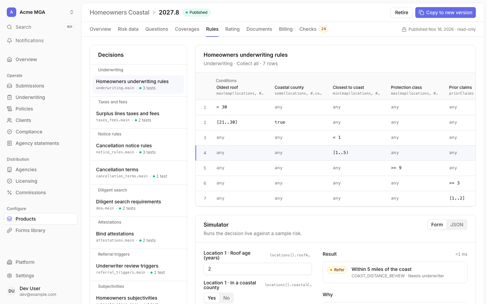
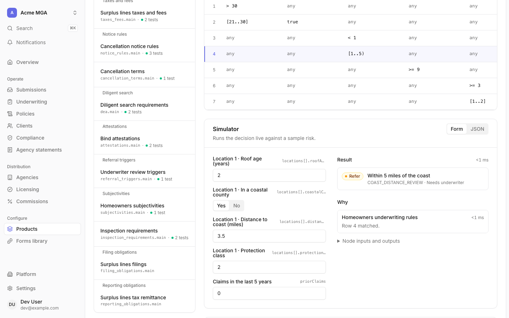
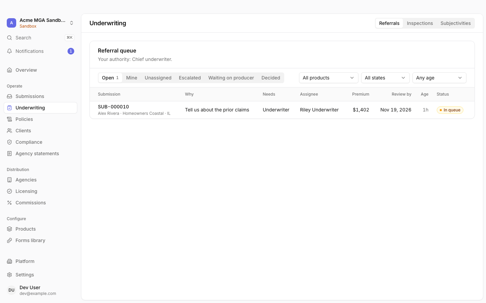
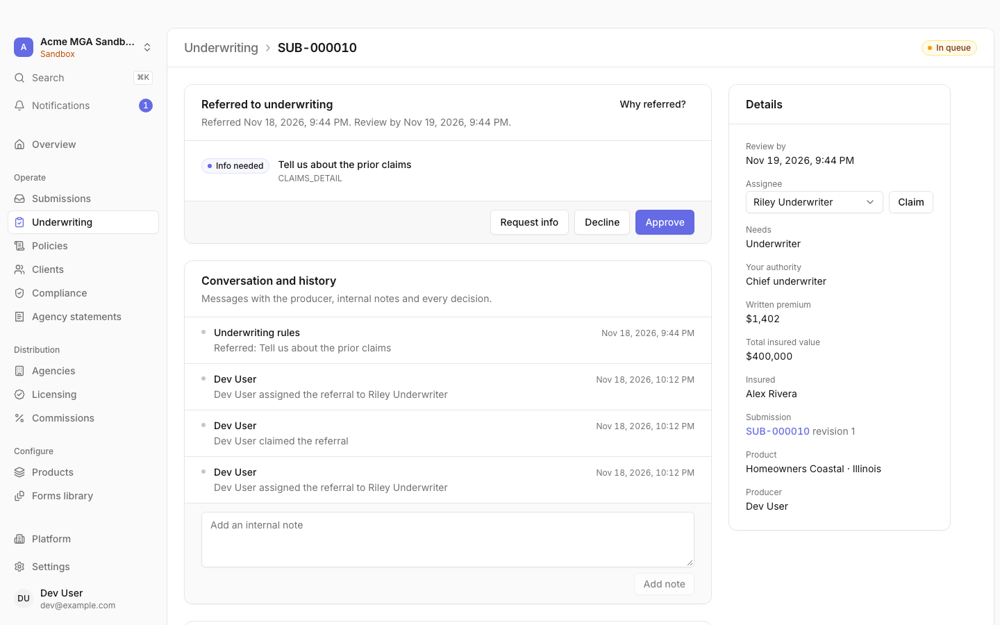
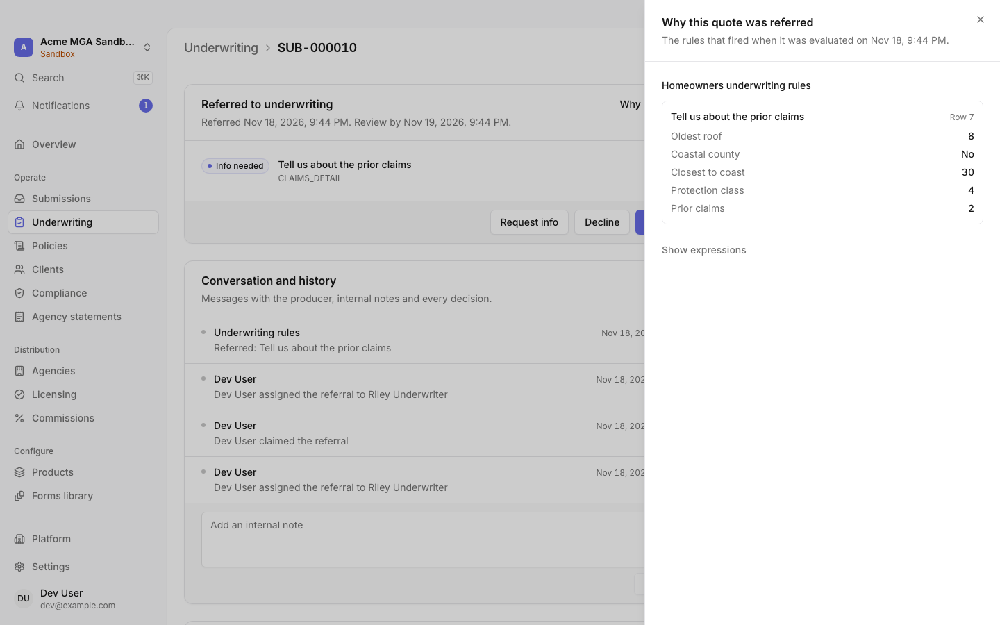
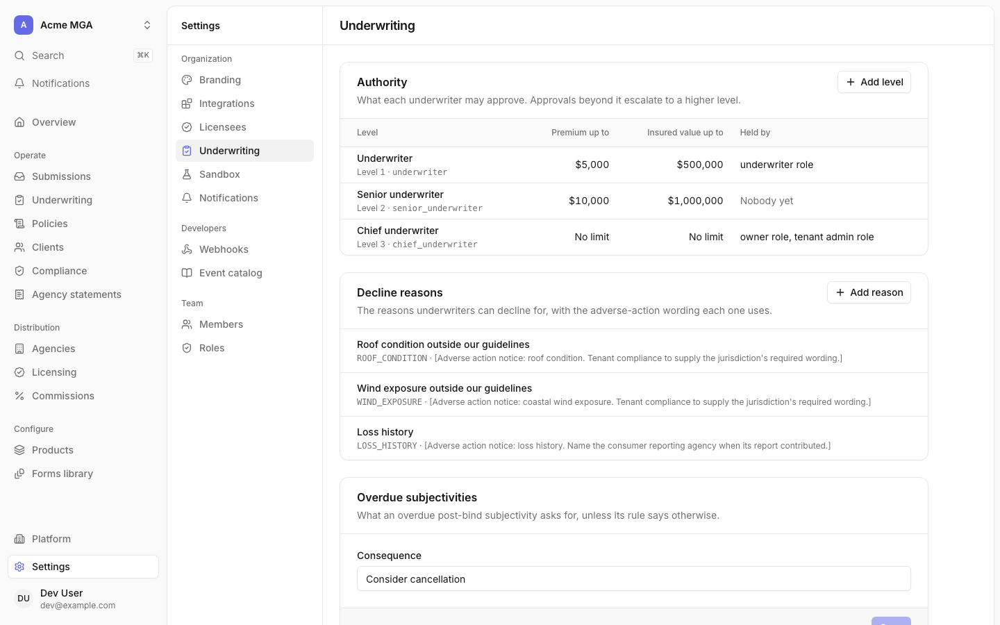
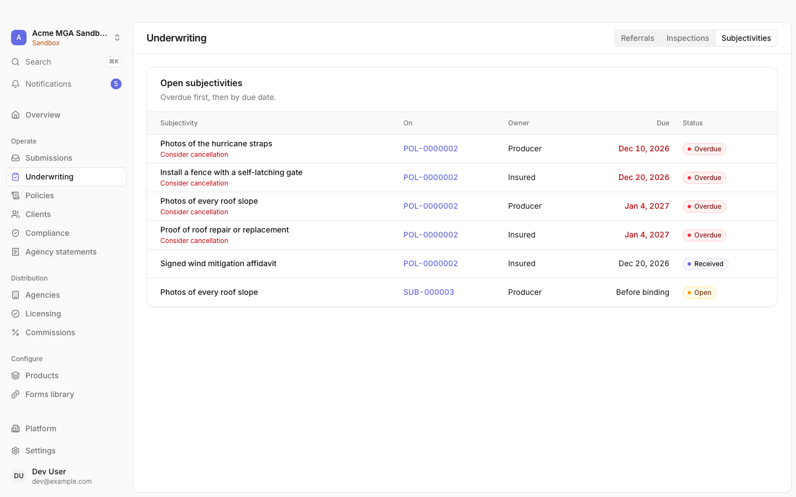
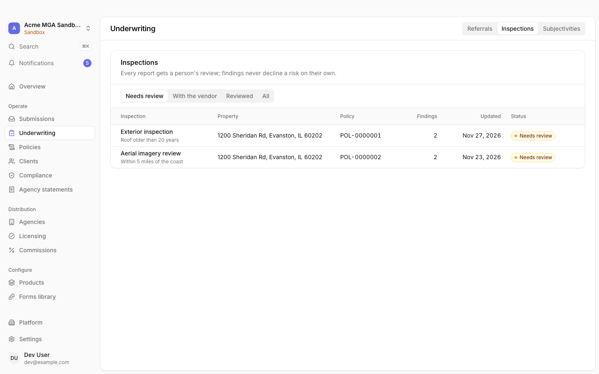

# Rules and underwriting workbench

**Put underwriting guidelines into decision tables your team can read, test and change, and give underwriters a workbench that shows exactly why a risk was referred.**

## The problem

Underwriting rules end up scattered across code, spreadsheets and people's heads. Agents don't know why a quote stopped, underwriters re-derive the reason from scratch, authority limits are enforced by habit, and subjectivities agreed at bind are forgotten until the claim.

## How it works

Rules are **decision tables** (and decision graphs) attached to the product version, each of a known kind with a fixed output: underwriting, referral triggers, taxes and fees, notice rules, cancellation terms, diligent search requirements, bind attestations, subjectivities, inspection requirements, filing obligations and reporting obligations. Each has its own test cases and a live simulator.

At quote time the rules run with the risk and the rated premium. A pass quotes straight through. A referral opens a case in the **underwriting workbench**, pauses the agent's journey and tells the agent when to expect an answer. A decline gives the reason, with adverse-action wording where configured.

_Underwriting rules as a decision table: oldest roof, coastal county, distance to coast, protection class and prior claims._

## What you can do

- **Author decision tables** with conditions over the risk and quote (including total insured value and written premium) and typed outputs.
- **Simulate live**: enter sample answers and see the result and which rows matched, with node inputs and outputs.
- **Refer at quote time** with a review SLA from product config. The workbench queue filters by open, mine, unassigned, escalated, waiting on producer and decided.
- **Answer "Why referred?"** with the exact rules that fired and the values they saw.
- **Act on a referral**: claim or assign, request information from the producer, approve (optionally with coverage changes, a loading or credit, or subjectivities) or decline with a configured reason.
- **Enforce authority** with levels per role or user: maximum premium and total insured value, with escalation above them.
- **Track subjectivities** before or after bind, with due dates and an owner (producer or insured), and a configured consequence such as "consider cancellation" when they're overdue.
- **Order inspections** when rules require them. Findings become subjectivities or a field visit only after a person reviews them.

_The simulator runs the rule live against sample answers and explains the result._

_The referral queue shows what needs a decision, who has it and when it's due._

_One referral: why it was referred, the decision buttons and the full history with the producer._

_"Why referred?" shows the rule that fired and the values it saw._

_Authority levels with premium and insured value limits, decline reasons with adverse-action wording, and the overdue subjectivity consequence._

_Subjectivities, overdue first, each linked to its policy or submission._

_Inspections ordered by rules, waiting for a person's review._

## How it fits

- The referral pauses the agent's journey and resumes it on approval: [Quote to bind](quote-to-bind.md)
- Endorsements re-run referral rules and wait for approval: [Policy lifecycle](policy-lifecycle.md)
- Notice rules and cancellation terms decide notice periods and minimum earned premium: [Policy lifecycle](policy-lifecycle.md)
- Filing and reporting obligation rules create compliance work: [Surplus lines and compliance](compliance.md)

## Under the hood

- Decisions use the JDM format evaluated by the ZEN engine in process (first-hit and collect tables, expressions, switches), with a parity test against the native engine. Compiled decisions are cached by immutable release.
- Every evaluation keeps a trace on the quote, which is what powers "Why referred?".
- Subjectivity due dates and inspection follow-ups run as durable workflows, so a due date set today fires correctly months from now, or in seconds in a sandbox.
- Inspections go through an inspection provider port. A mock vendor is built in; real vendor adapters are on the roadmap.
